# Fluxweir Architecture

Fluxweir is an LLM routing gateway written in Rust: it exposes OpenAI and Anthropic protocol endpoints externally, makes weighted multi-factor routing decisions across multiple model vendors internally, and guarantees call resilience through circuit breaking, retries, fallback chains and congestion admission; request logs and token usage are persisted asynchronously through bounded queues, never affecting the response path. This document is based on the actual `src/` code structure (the former `llm-gate` pure routing core library has been merged back into a single crate; public paths such as `fluxweir::config` are unchanged) and covers Fluxweir's layered design, module map, request lifecycle, routing decision algorithm, and the configuration, persistence and performance designs.

## 📋 Table of Contents

- [Design overview](#-design-overview)
- [Module map](#️-module-map)
- [Request lifecycle](#-request-lifecycle)
- [Routing decisions](#-routing-decisions)
- [Resilience and fault tolerance](#️-resilience-and-fault-tolerance)
- [Cost tracking](#-cost-tracking)
- [Data persistence](#️-data-persistence)
- [Configuration system and hot reload](#️-configuration-system-and-hot-reload)
- [Middleware pipeline](#-middleware-pipeline)
- [Response cache](#-response-cache)
- [Internationalization](#-internationalization)
- [Dependency injection and sibling libraries](#-dependency-injection-and-sibling-libraries)
- [Performance design points](#-performance-design-points)
- [Document navigation](#-document-navigation)

---

## 🎯 Design overview

Fluxweir is divided into five layers by responsibility: access layer (axum endpoints + middleware pipeline) → protocol layer (unified OpenAI/Anthropic intermediate representation and conversion) → routing layer (weighted multi-factor decisions + session affinity + LinUCB) → vendor execution layer (connection pool, queues, rate limiting, circuit-break/retry/fallback) → persistence layer (async logs + pre-aggregation + SQLite repositories). Config hot reload (`confers::dynamic::DynamicField`, lock-free arc-swap reads) and internationalization provide cross-cutting support for all layers.

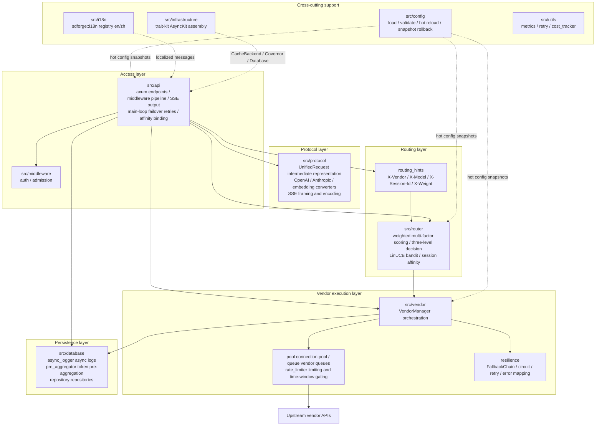

---

## 🗺️ Module map

### Top-level directories

| Directory / file                         | Responsibility                                                                                                                           |
| ---------------------------------------- | ---------------------------------------------------------------------------------------------------------------------------------------- |
| `src/api/`                               | HTTP access layer: protocol endpoints, middleware orchestration, request-handling main loop, ops endpoints                                |
| `src/config/`                            | config struct definitions, file load & validation, hot-reload transactional writes and snapshot rollback                                   |
| `src/database/`                          | SQLite persistence: async batched logs, hourly token pre-aggregation, repositories and incremental migrations                              |
| `src/i18n/`                              | internationalization: FTL catalogs embedded at compile time, registered into the sdforge::i18n host registry, language detection chain      |
| `src/infrastructure/`                    | dependency-injection assembly based on trait-kit `AsyncKit`                                                                                |
| `src/middleware/`                        | auth, congestion admission, quota (`quota.rs` / `quota_period.rs` / `quota_persist.rs`), key budgets (`key_budget.rs`), OIDC verification (`oidc.rs`, feature `oidc`), lexical compression (`lexcompress.rs`) |
| `src/protocol/`                          | OpenAI/Anthropic/Responses/Gemini unified intermediate representation, protocol converters, SSE framing and encoding                       |
| `src/router/`                            | routing decision core: weighted scoring, LinUCB, session affinity                                                                          |
| `src/utils/`                             | cross-cutting helpers: global metrics (incl. EWMA), retry delay policy, cost accumulator, tenant credential extraction (`tenant.rs`), netguard SSRF triage (`netguard.rs`), state files, token estimation, blocking containment (`blocking.rs`: `block_in_place` on multi-thread runtimes), OIDC JWKS (`oidc_keys.rs`), OTLP metrics bridge (`otlp.rs`, feature `otlp`) |
| `src/vendor/`                            | vendor execution layer: VendorManager, connection pool, queues, rate limiting, resilience, pricing, subscription-account pool (`subscription-vendor` feature) |
| `src/vault/`                             | key vault: AEAD-encrypted storage, three-state master-key sources (env / 0600 file / derived)                                              |
| `src/server/`                            | assembly and serving surface: `bootstrap.rs` (assembly chain), `http.rs` (site build & router merge), `grpc.rs` (gRPC facade, feature `grpc`), `console.rs` (built-in console, feature `console`), `hot_reload.rs` (file hot reload and structural gate) |
| `src/sdk/`                               | Rust client: admin / chat / embed / rerank / responses / stream modules (feature `sdk`)                                                     |
| `src/storage.rs`                         | storage-layer type facade: `LogFilter` / `RequestLog` and other cross-layer shared storage types                                            |
| `src/quota_contract.rs`                  | quota budget read-side contract (standalone root-level module, consumed by the router)                                                      |
| `src/error/mod.rs` / `app.rs` / `gate.rs` | unified `FluxweirError` / `GateError` errors: `mod.rs` keeps types only, `app.rs` carries the presentation track (`IntoResponse` / `user_message()` / source conversions), `gate.rs` carries routing variants; Display is always an English canonical string (logs/error chains), HTTP presentation goes through `user_message()` (FTL, per locale) |
| `src/lib.rs`                             | library entry: module declarations, feature gating and public re-exports (config/i18n/utils/protocol/storage/vendor + the routing half; api/server/database as the application surface) |
| `src/main.rs`                            | thin binary entry: parses only the CLI config path argument; the assembly chain lives in `src/server/bootstrap.rs`, site build & router merge and serve in `src/server/http.rs` |

### src/api/

| File                              | Responsibility                                                                                                                               |
| --------------------------------- | -------------------------------------------------------------------------------------------------------------------------------------------- |
| `api/mod.rs`                      | business route assembly and request-handling main loop: failover retry loop, affinity bind/clear orchestration                              |
| `api/router_builder.rs`           | axum Router building, middleware pipeline layering and endpoint registration (data-plane/admin-plane/feature-gated partitions); admission decision mounting |
| `api/completions.rs`              | `POST /v1/chat/completions`, `POST /v1/embeddings` endpoints                                                                                  |
| `api/gemini.rs`                   | Gemini native endpoint (`/v1beta/models/{model}:{action}`): IR routing / native passthrough / embeddings / countTokens / model list and Gemini error bodies |
| `api/rerank.rs`                   | `POST /v1/rerank` endpoint: capability-filtered routing, Cohere shape conversion and log summaries (without query/documents raw text)        |
| `api/responses.rs`                | `POST /v1/responses` plus retrieve/delete/cancel/input_tokens: IR and native dual paths, semantic SSE, `response_store` state replay and background tasks |
| `api/anthropic.rs`                | `POST /v1/messages` endpoint                                                                                                                  |
| `api/health.rs`                   | `/health` health-check endpoint                                                                                                               |
| `api/admin.rs`                    | `/admin/*` ops endpoint handlers (log queries, metrics, vendor status, config hot reload, model management)                                   |
| `api/state.rs`                    | `ApiState` application state aggregation; LinUCB reward feedback                                                                              |
| `api/global_state.rs`             | global state holder for sdforge macro handlers (`OnceCell` holding `ApiState`, compensating for macros not supporting axum State extractors) |
| `api/routing_hints.rs`            | extracts four routing hints from request headers (X-Vendor / X-Model / X-Session-Id / X-Weight); fallback hash when the session key is missing |
| `api/response_cache.rs`           | recId=12 exact response cache, stored via oxcache (see [Response cache](#-response-cache))                                                    |
| `api/sse.rs`                      | SSE encoder and incremental framer facade (actual source `src/protocol/sse_frame.rs`, re-exported here to keep the reference path)            |
| `api/models.rs`                   | `GET /v1/models` OpenAI-compatible model list (model catalog ∪ vendor models deduplicated live, never cached)                                 |
| `api/count_tokens.rs`             | `POST /v1/messages/count_tokens` Anthropic-compatible token counting (approximate estimation, no tokenizer)                                    |
| `api/readiness.rs`                | readiness probe: real component checks registered via sdforge `AsyncReadinessCheck`, aggregated at `/readyz` (200/503)                        |
| `api/openapi_docs.rs`             | OpenAPI documentation surface: main REST endpoints registered into the global spec via the sdforge inventory; doc routes mounted per the `[docs].enabled` switch (default false = 404) |
| `api/route_explain.rs`            | `POST /admin/route/explain` route explainability: per-candidate decision / reason_code (purely read-only)                                     |
| `api/route_difficulty_explain.rs` | `POST /admin/route/difficulty-explain` difficulty-tier explain endpoint (read-only, zero metering side effects)                               |
| `api/semantic_cache.rs`           | semantic response cache (O4, `semantic-cache` feature gated): embedding similarity retrieval layer isolated per api_key_hash tenant after exact misses |
| `api/vault.rs`                    | key vault admin surface (key-vault): `/admin/vault/keys*` upsert / masked list / delete; inline key pool re-injected immediately after put/remove |

### src/router/

| File                                               | Responsibility                                                                                                                |
| -------------------------------------------------- | ------------------------------------------------------------------------------------------------------------------- |
| `router/mod.rs`                                    | module organization and re-exports                                                                                                |
| `router/router.rs`                                 | routing decision core: three-level decision order, `compute_weight` weighted scoring, selection layer (temperature smoothing / roulette / PoTC), SLA/LPS enhanced factors, fallback chain building |
| `router/bandit.rs`                                 | recId=15 LinUCB contextual bandit (third tier of selection)                                                               |
| `router/affinity.rs` / `router/affinity_settle.rs` | recId=11 session/prefix affinity table (storage via oxcache) + cache-economy settle decisions and stickiness bookkeeping                                      |

### src/vendor/

| File                             | Responsibility                                                                                                                                                                                                                                                                                                                                                                                                                                                                                            |
| -------------------------------- | ----------------------------------------------------------------------------------------------------------------------------------------------------------------------------------------------------------------------------------------------------------------------------------------------------------------------------------------------------------------------------------------------------------------------------------------------------------------------------------------------- |
| `vendor/manager.rs`              | `VendorManager` request execution orchestration: circuit-breaker wrapping, retry loop, pricing hot reads, vendor status maintenance                                                                                                                                                                                                                                                                                                                                                        |
| `vendor/pool.rs`                 | `ConnectionPool`: single `reqwest::Client` + `tokio::sync::Semaphore` concurrency cap; permits auto-release on drop                                                                                                                                                                                                                                                                                                                                                                                                |
| `vendor/queue.rs`                | `VendorQueue` vendor request queue (`PendingRequest`), the data source of the queue_factor load signal                                                                                                                                                                                                                                                                                                                                                                                                                   |
| `vendor/rate_limiter.rs`         | `TokenBucket`/`ConcurrencyLimiter` (limiteron wrappers) + unified time-window gating (recId=13, incl. cross-midnight windows)                                                                                                                                                                                                                                                                                                                                                                                              |
| `vendor/status.rs`               | `VendorStatus`/`VendorState`: atomic state machine and error counters (Available/Unavailable etc.)                                                                                                                                                                                                                                                                                                                                                                                                                  |
| `vendor/cost.rs`                 | `CostCalculator`: pricing-table lookup and USD computation by (vendor_id, model_id)                                                                                                                                                                                                                                                                                                                                                                                                                               |
| `vendor/key_pool.rs`             | multi-key pool: per-env-name resolution, rotation cursor and fingerprint observability; the `RequestCredential::Subscription` arm (feature `subscription-vendor`) carries subscription-account credentials (sole Bearer assembly entry `build_authed_for_credential`, fingerprint always None → vendor-level circuit breaking)                                                                                                                                                                                                           |
| `vendor/subscription/`           | subscription-account upstreams (feature `subscription-vendor`, not in `full`): `mod.rs` holds the `SubscriptionProvider` trait and types; `anthropic.rs` endpoint constants and token parsing; `oauth.rs` PKCE sessions (state single-use for 10 minutes); `pool.rs` account pool (rotation + skipping failing candidates / single-flight refresh near expiry / degraded-removal sequencing / revoke gauge decrement); `store.rs` vault wrapper for refresh tokens (key `sub:{account_id}`, reads the latest entry tolerating rotation interruption windows). Assembly in `server/bootstrap.rs` (declared accounts registered at startup, pool always in place); the 401 single-refresh resend hook covers non-streaming / streaming / passthrough paths (`manager.rs`) |
| `vendor/probe.rs`                | vendor probe executor (consumed by `[health]` active probing)                                                                                                  |
| `vendor/resilience/fallback.rs`  | `FallbackChain`: chain fallback in ascending priority order                                                                                                                                                                                                                                                                                                                                                                                                                                                       |
| `vendor/resilience/error_map.rs` | `GateErrorClassifier`: implements limiteron `FailureClassifier<GateError>` (business errors pass through the circuit breaker losslessly)                                                                                                                                                                                                                                                                                                                                                                                            |

### src/database/

| File                         | Responsibility                                                                                                                                                                                                            |
| ---------------------------- | --------------------------------------------------------------------------------------------------------------------------------------------------------------------------------------------------------------- |
| `database/database.rs`       | `Database`: connection establishment (path + pool_size) and repository handles                                                                                                                                                      |
| `database/migration.rs` + `database/migrations/core/` | versioned migrations: V1 FROZEN + V2..V9 migrations (sqlite/postgres/mysql three dialects, currently `CORE_SCHEMA_VERSION = 9`) — the SQL source of truth lives in `migrations/core/*.sql` (embedded at compile time via `include_str!`), executed by the dbnexus `MigrationExecutor` (UP creates tables + DOWN rolls back); `schema.*.sql` demoted to readable documentation, consistency locked by guard tests |
| `database/repository.rs`     | repositories: parameterized batch INSERT on dbnexus's session defense chain (`execute_with_params` + single-transaction batches)                                                                                                                             |
| `database/async_logger.rs`   | recId=9 backpressure-semantics async log writer: `try_send` drops-and-counts when full, never blocking the response path; de-sensitized by the inklog secret gate before persisting                                                                                                     |
| `database/dialect.rs`        | SQL dialect differences across the three dialects (sqlite/postgres/mysql) collapsed into one place                                                                                                |
| `database/response_store.rs` | `response_store` table read/write repository (Responses API storage surface)                                                                                            |
| `database/pre_aggregator.rs` | token usage pre-aggregator: aggregates by hour, reducing database query pressure                                                                                                                                                              |

### Other small modules

| Directory                  | Files and responsibilities                                                                                                                                                                                                                                                                                                                                                                                                                                                                                          |
| --------------------- | --------------------------------------------------------------------------------------------------------------------------------------------------------------------------------------------------------------------------------------------------------------------------------------------------------------------------------------------------------------------------------------------------------------------------------------------------------------------------------------------------- |
| `src/config/`         | `mod.rs`: the `Config` struct (30 top-level fields/sections); `loader.rs`: `ConfigLoader` (confers loading + stripping `AnnotatedValue` down to bare serde_json) and `validate_config` (split per section: vendor entries / env warnings / model_catalog / resilience breaker windows + admin-plane key validation); `manager.rs`: `ConfigManager` hot-reload transactional writes + `SnapshotManager` snapshots; `model_catalog.rs`: the `[[model_catalog]]` model capability catalog                                                                                                                               |
| `src/middleware/`     | `auth.rs`: SHA256 digest + constant-time comparison auth; `admission.rs`: recId=16 congestion-aware priority admission; `lexcompress.rs`: lexical compression (N2, deterministic pruning triggered by `X-Compress: 1`); `mod.rs`: middleware organization                                                                                                                                                                                                                                                                                                                    |
| `src/protocol/`       | `unified.rs`: unified request structure and streaming chunks; `openai_converter.rs`/`anthropic_converter.rs`: bidirectional protocol conversion (incl. the Anthropic streaming encoder); `responses/`: Responses wire types, inbound/outbound conversion and semantic SSE codecs; `gemini/`: Gemini wire types, bidirectional conversion, JSON Schema sanitization and SSE codecs; `embedding_converter.rs`: embedding request conversion; `rerank_converter.rs`: Cohere rerank conversion; `usage.rs`: usage conversion; `sse_frame.rs`: the actual source of SSE encoding and upstream incremental framing (recId=3)                                                                                                                    |
| `src/utils/`          | `metrics.rs`: `GlobalMetrics` atomic metrics + EWMA smoothing (α=0.2); `retry.rs`: error-class-classified retry delay policy; `cost_tracker.rs`: the `CostTracker` micro-USD accumulator; `blocking.rs`: async-context containment for synchronous fs/CPU snippets; `otlp.rs` (feature `otlp`): exposition text parsing + `OtlpBridge` periodic push to OTLP/HTTP-Proto, with `sdforge::metrics::global_registry().render()` as the single source of truth (same source as `/metrics`), export failures counted fail-open; `otlp_export.rs` (feature `otlp`): attempt-level tracing trace surface (see "Observability")                                                                                                                                          |
| `src/i18n/`           | `catalog.rs`: FTL catalogs embedded at compile time + line-parsed and registered into the `sdforge::i18n` host registry at startup (same pattern as janvi, `{ $name }` template substitution); `locale.rs`: language detection chain and the global locale context; `mod.rs`: the `t()`/`t_args()` lookup facade (explicit locale passed, not relying on the sdforge active locale)                                                                                                                                                                                                                                                                                                                                                        |
| `src/infrastructure/` | `di.rs`: `AsyncKit` four-module topologically ordered assembly and `verify_kit`                                                                                                                                                                                                                                                                                                                                                                                                                                                 |
| `src/masking/`        | (feature `masking`, not in `full`) outbound request masking: `rule_detector.rs` assembles the inklog extended-form table + entropy scan + custom words/regexes; `placeholder.rs` deterministic placeholder registry (first 8 hex of a peppered SHA256 — three-state source env/0600 file/in-process random with a warn degradation; consistent across processes/replicas sharing the same pepper, unlinkable when peppers differ; the reverse map is a minimal in-memory LRU heap of 10k + 24h TTL, never persisted; return-path restoration gated by the `MaskTicket` request domain — forged or cross-request echoes are not restored; `ledger.rs` daily JSONL audit ledger, values never persisted); `masker.rs` recursive outbound JSON masking + three action tiers; `stream_restore.rs`/`restorer.rs` streaming tail-hold buffering and whole-value restoration; `gates.rs` fail-closed gate (503 refusal on failure) and the 24h statistics window |

---

## 🔄 Request lifecycle

Take one `POST /v1/chat/completions` as the example; the full chain is below (the failover retry loop happens inside the API handler, `execute_request_with_fallback` / `execute_dispatch_with_fallback` in `src/api/mod.rs`):

```mermaid
sequenceDiagram
    autonumber
    participant C as Client
    participant MW as Middleware pipeline
    participant H as API handler
    participant RC as Response cache
    participant R as Router
    participant VM as VendorManager
    participant U as Upstream vendor
    participant BG as Async background tasks

    C->>MW: POST /v1/chat/completions
    MW->>MW: TraceLayer opens the request span
    MW->>MW: auth (Bearer → x-api-key fallback)
    MW->>MW: rate_limit (endpoint table + tower global layer; shared token bucket fallback when no global rules) + admission decision
    MW->>H: allow
    H->>H: extract routing hints (X-Vendor / X-Model / X-Session-Id / X-Weight)
    H->>RC: exact response cache lookup (when cache.enabled)
    alt cache hit
        RC-->>C: return the cached response directly
    else cache miss
        H->>R: route_with_hints() (route_excluding re-route on failover failure)
        R-->>H: decision result (vendor_id, model)
        H->>VM: execute the request
        VM->>VM: circuit check → connection pool acquire → vendor queue / rate limit
        VM->>U: forward (same-protocol zero-copy passthrough / protocol conversion)
        U-->>VM: response (JSON or upstream SSE stream)
        VM->>VM: retry after the retry delay on failure (retryable classes)
        VM-->>H: execution result
        H-->>C: JSON response or SSE streaming response
        H->>BG: async request log (try_send, dropped when full)
        H->>BG: token pre-aggregation (hourly-granularity buffer)
        H->>BG: cost bookkeeping (CostTracker micro-USD accumulation)
        H->>BG: affinity binding (bind the successful vendor) + LinUCB reward feedback
    end
```

Key semantics:

- **Zero blocking on the response path**: logs are enqueued via `try_send`; when the channel is full they are dropped and counted (`dropped_logs`, exposed on `/admin/metrics`) — never waiting for persistence.
- **Streaming boundary**: once an SSE streaming response starts writing to the client, mid-stream errors no longer trigger failover (see [Resilience and fault tolerance](#️-resilience-and-fault-tolerance)).
- **Bookkeeping only on success**: cost bookkeeping, affinity binding and LinUCB rewards all hang off the success path.

---

## 🧭 Routing decisions

Routing decisions are Fluxweir's core and live entirely in `src/router/`.

### Three-level decision order

`route_inner` tries in the following order (the `route_inner` decision sequence in `src/router/router.rs`). Note the order is **abstract model first, then direct mapping**, and the global pool last:

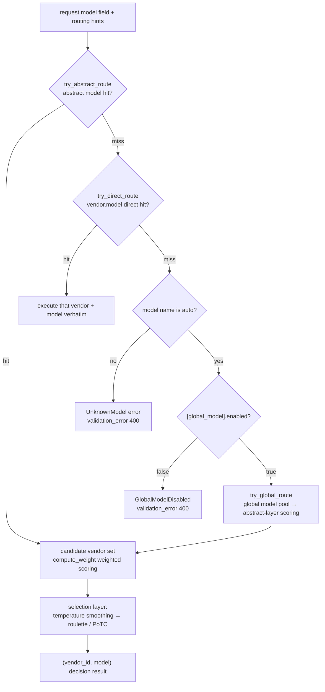

> `[global_model].enabled=false` turns off the auto tier: the global pool is excluded from routing and the request is rejected with `validation_error` (400) (the message carries the "not found" original phrase plus the switch source, avoiding misreporting "disabled by the administrator" as "model not found"). A missing section (`Config.global_model = None`) keeps the historical fallback semantics = enabled; explicit model names (abstract/direct routing) are unaffected by the switch. `ConfigManager::is_global_model_enabled` is the single read point for this decision.

### Weighted scoring formula

`compute_weight` (`src/router/router.rs`):

```text
weight = w_model·model.weight + w_queue·queue_factor
       + w_window·window_factor + w_latency·latency_factor
       + w_error·error_factor
```

| Factor           | Meaning                     | Value                                                                                         |
| ---------------- | ---------------- | -------------------------------------------------------------------------------------------- |
| `model.weight`   | static configured model weight | configured value; non-finite/≤0 guarded to zero                                                                   |
| `queue_factor`   | vendor queue idleness   | queue length 0 → 1.0; ≥100 → 0.0 (`queue_factor` in `src/router/router.rs`)                     |
| `window_factor`  | time-window budget health   | 0.5 without a window (neutral); 0 when the budget is exhausted; halved when <300s remain (`window_factor` in `src/router/router.rs`) |
| `latency_factor` | EWMA latency score    | `ref/(ref+ewma_ms)`; 0.5 with no data (`latency_factor` in `src/router/router.rs`)                |
| `error_factor`   | error rate score       | `1−ewma_err`; 1.0 with no data (`error_factor` in `src/router/router.rs`)                         |

Default coefficients (`RoutingSection` defaults in `src/config/mod.rs`):

| Coefficient | Default | Notes         |
| ----------- | ------ | ------------ |
| `w_model`   | 0.4    | static weight dominates |
| `w_queue`   | 0.3    | queue load     |
| `w_window`  | 0.3    | time-window budget     |
| `w_latency` | 0      | off by default     |
| `w_error`   | 0      | off by default     |

All coefficients carry non-finite/≤0 zeroing guards, so broken configuration cannot pollute scoring.

### Weight fallback chain

The four-level fallback for candidate weights (the weight fallback chain in `src/router/router.rs`); a higher level short-circuits the lower ones:

1. **request-level `X-Weight` header** (gated by `[routing].allow_request_weight`);
2. **`model.weight` configured static weight**;
3. **vendor capacity auto weight** (derived from capacity only when `model.weight ≤ 0`);
4. **uniform 1.0** (when all of the above are absent).

### Selection layer

Selection after scoring (the selection layer in `src/router/router.rs`):

| Mechanism            | Behavior                                   | Switch                                                                                     |
| -------------------- | -------------------------------------- | ---------------------------------------------------------------------------------------- |
| Temperature smoothing | `w^(1/T)` flattens/amplifies the weight distribution            | `[routing].temperature`                                                                  |
| Roulette             | random by smoothed weights; uniform when total ≤ 0 | default path                                                                                 |
| Power-of-Two-Choices | take two random candidates, pick by EWMA latency         | `[routing].selection == "power_of_two"` (`power_of_two_pick` in `src/router/router.rs`) |
| min+buffer candidate set    | keep only candidates within the minimum latency plus a buffer margin   | `[routing].latency_buffer > 0` (`min_buffer_pick` in `src/router/router.rs`)            |

Load-signal single choice (`[routing].load_signal`, `src/router/router.rs`): one of `"queue"` (default) / `"in_flight"` / `"in_flight_relative"`, deciding which signal feeds the queue-dimension load.

### Optional enhanced factors

| Mechanism             | recId | Switch                             | Behavior                                                                                                                                     |
| ---------------- | ----- | -------------------------------- | ---------------------------------------------------------------------------------------------------------------------------------------- |
| SLA virtual-queue scoring | 14    | `sla_v > 0`                      | penalty factor multiplied into the weight; dual variables update on violations, keyed by tenant hash (or `"global"`) (SLA dual-variable update in `src/router/router.rs`)                       |
| LPS queueing lookahead   | 17    | off by default                           | soft-constraint factor + `x-deadline-ms` header hard-constraint gating (over-deadline candidates excluded directly) (`lps_penalty_context` / `lps_deadline_filter` in `src/router/router.rs`) |
| Failure-rate soft down-weight     | —     | `[resilience].failure_rate_gate` | candidates over the error-rate threshold get weight ×0.1 (failure-rate soft down-weight in `src/router/router.rs`)                                                                     |

### Session affinity (recId=11)

`src/router/affinity.rs`; storage rides oxcache's `CacheBackend`, no hand-written maps:

- key `affinity:{session_key}`; with `tenant_scoped` on, an `api_key_hash` prefix is added, isolated from the response cache's `resp:` namespace;
- TTL semantics branch by mode: `legacy` is table-level 1 hour with **renewal on hit**; `auto`/`turn` TTLs are set by the writer (settle) per upstream cache lifetime / consecutive window, with **no renewal on the read path** (`peek`), and existing records expire naturally per their write-time TTL; `off` short-circuits lookups (existing bindings become invalid immediately, writes stop as well);
- **hard (default) is exclusive within the eligible set**: a hit selects the bound vendor; only when the bound vendor is not in this round's eligible set does it fall back to weighted selection (the `soft` mode is a boost throughout);
- only "the vendor that last served successfully" is recorded — bind/clear are called by the API layer after successful execution (`bind_session_affinity` in `src/api/mod.rs`; the rerank endpoint reuses the same single point; the mode gate lives here uniformly, `off` writes nothing);
- hit rates feed `GlobalMetrics`;
- **cache-economy affinity** (`[routing.affinity]`, default `legacy` freezing current behavior): settle decisions and stickiness bookkeeping live in `src/router/affinity_settle.rs` — `legacy` sticks for 1h on success (write semantics share the source with `bind_session_affinity`: with tenant isolation on, it goes through `bind_if_absent` first-binding convergence without bypassing the concurrent convergence result); `auto` decides by response-cache worth (`worth = cache_read + cache_creation + (prompt_tokens when vendor.silent_cache) ≥ cache_worth_tokens` to stick, TTL from the vendor's `cache_ttl_secs`; below threshold, neither write nor delete, and existing records expire naturally per their write TTL); `turn` sticks for `turn_gap_secs`; `off` writes nothing + short-circuits lookups (both the router's `affinity_hit` and the explain endpoint short-circuit per `AffinityMode::Off`). The settle point is the API layer's response usage settlement (`settle_api_affinity` in `src/api/request_cost.rs`, taking usage from the same source as `record_keyed_usage`); the legacy path's bind/clear/rebind stays as-is.

#### Stickiness persistence and startup restore

The `affinity_sticks` table (migration V6, composite key `(tenant, session_key)`, three-dialect table creation from a single source in `src/database/migrations/core/` (the V6 migration file, embedded via `migration.rs`)):

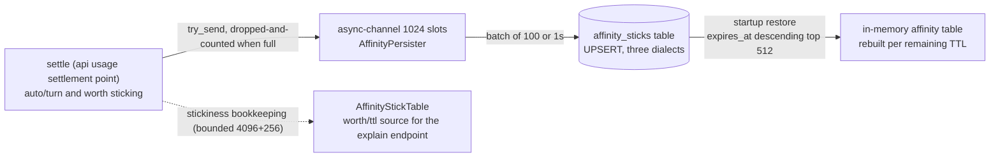

- dropped-and-counted writes into `affinity_persist_drop_total` when the write-behind channel is full (affinity is an optimization, not a promise — drops never block requests); persistence failure drops the whole batch, counts and warns without retrying — two counters with separate exits: `affinity_persist_dropped` (channel side, exact) and `affinity_flush_failures` (UPSERT-failed batches);
- startup restore runs only for auto/turn (legacy does not persist, off short-circuits); failure warns only and does not block startup (`src/server/affinity_restore.rs`);
- four observability counters: `affinity_stick_total` (stickiness writes: legacy/auto/turn successful settlements all count) / `affinity_drift_total` (threshold-skip) / `affinity_persist_drop_total` / `affinity_restored_count`, exposed via `/admin/metrics`; the route explain endpoint outputs `affinity {decision, worth_tokens, ttl_secs}` (`affinity_decision_block` in `src/api/routing_hints.rs`; purely read-only peek without renewal; `ttl_secs` is the bound key's remaining TTL, and `decision` distinguishes `disabled` from `no_session` in four states).

### Quota ledger persistence (quota_ledger, quota-aware-routing)

The `quota_ledger` table (migration V7, composite key `(api_key_hash, window_id, window_start)`, three-dialect table creation from a single source in `src/database/migrations/core/` (the V7 migration file, embedded via `migration.rs`) — the persistence surface for multi-window budgets (`[[quota.windows]]`) and vendor budgets (`[[vendor_budgets]]`):

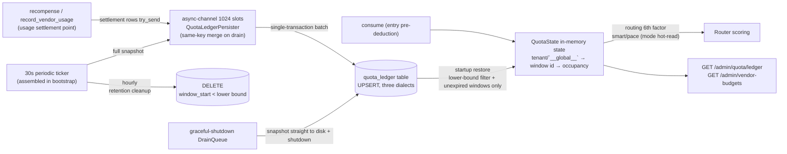

- **In-memory authority**: decisions take the in-memory fast path (zero DB round-trips per request); persistence is best-effort enforcement — UPSERT on settlement (consumer-side same-key merge + single-transaction batch commit) + a 30s full flush; the crash-rollback window for non-graceful exits is ≤30s (graceful shutdown does a final flush, so normal restarts lose nothing; budgets are constraints, not billing);
- **Three scope classes share one table and one path**: tenant windows keyed by digest, `scope=global` windows at the fixed key `__global__`, vendor budgets at `__vendor__:{id}` (window_id=`vendor:{id}`); startup restore takes unexpired windows only (active periods are interpreted by the current configuration cycle; the ledger does not store period facts), with the read side lower-bounded by "now − the configured longest window" (single-sourced with the retention cleanup via [`crate::middleware::quota::ledger_retention_secs`]); restore refill is bounded by a 10k-key cap (skips + warns beyond it);
- **Bounded retention**: expired period rows are cleaned hourly by the flush loop (lower bound = now − the configured longest window; monthly takes a 31-day ceiling; empty config falls back), so the table does not accumulate over historical periods indefinitely;
- **Failures do not block**: persistence failure counts + warns (`quota_ledger_flush_fail_total`; in-memory state unaffected); restore read failures log an ERROR and start with an empty ledger;
- **Routing factor**: mode=smart removes exhausted vendors from candidates (all vendors exhausted keeps everyone and counts `quota_factor_depleted_total{vendor}`) + the fastest-reset boost enters the 6th additive term; mode=pace applies multiplicative up/down weights by consumption rate (×0.5/×1.2); 429 multi-window rejections count per window in `quota_window_refused_total{window_id}`.

### Routing hints

`src/api/routing_hints.rs` extracts four request headers: `X-Vendor` / `X-Model` / `X-Session-Id` / `X-Weight`. `route_with_hints` priority (`src/router/router.rs`):

```text
preferred_vendor direct pin  >  preferred_model abstract model  >  default weighted decision
```

When the session key is missing, the fallback is `sha256(first 2KB of messages[0])` truncated to 16 hex characters, keeping affinity stable for same-prefix conversations.

### LinUCB contextual bandit (recId=15)

`src/router/bandit.rs`, the third tier of selection (`[routing].selection`, default `"weighted"` meaning off):

- **Arms**: `(abstract_model, vendor_id)` combinations, each arm an independent linear model;
- **Scoring**: closed-form least squares `θ̂ = A⁻¹b` + the UCB confidence bound `⟨x,θ̂⟩ + α√(xᵀA⁻¹x)`, argmax selection — the confidence bound automatically encodes cold-start exploration;
- **Features**: 5 dimensions `[1, ln(1+message count), ln(1+body char count), has tools, streaming]` (feature construction in `src/router/bandit.rs`);
- **Reward**: success 1 / failure 0 (proxy reward), fed back by the API layer after execution (`src/api/state.rs` reward feedback); updates touch only the chosen arm;
- **Known boundary**: state is in memory, resets to zero on restart, never persisted.

---

## 🛡️ Resilience and fault tolerance

Resilience mechanisms span `src/vendor/resilience/`, `src/utils/retry.rs` and the API-layer main loop.

### Fallback chain and failover loop

- `FallbackChain` (`src/vendor/resilience/fallback.rs`): `FallbackTarget = vendor + model + priority` (lower value = higher priority). `Router::build_fallback_chain` builds the chain from the configured vendors' priorities, trigger = All (`build_fallback_chain` in `src/router/router.rs`).
- The failover loop is consumed at the API layer (`execute_request_with_fallback` / `execute_dispatch_with_fallback` in `src/api/mod.rs`):

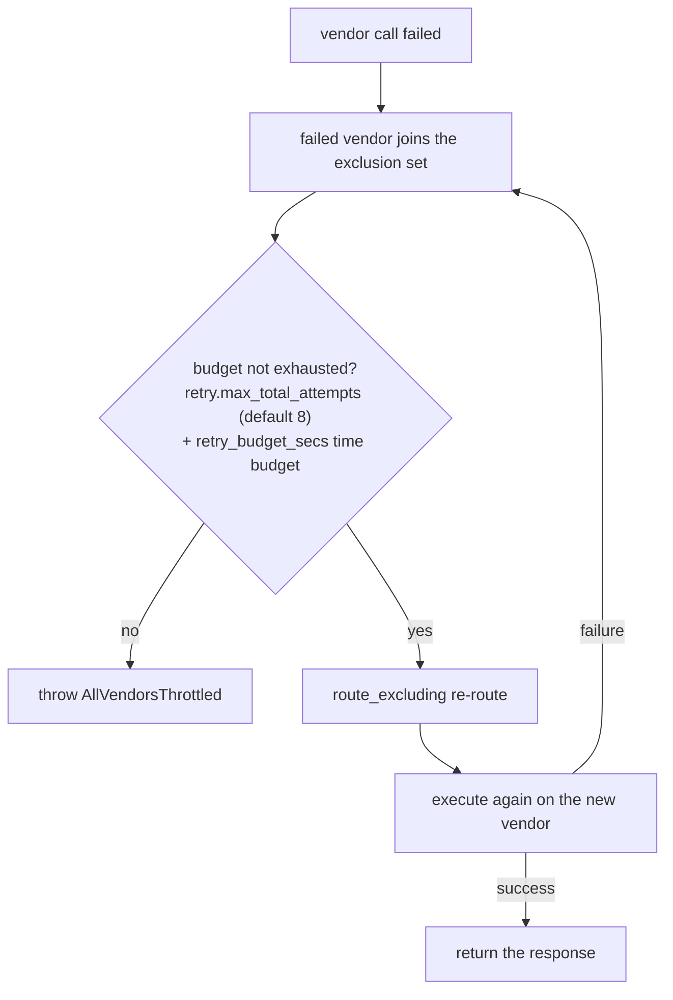

- Dual budget constraint: either the total attempt count (`retry.max_total_attempts`, default 8) or the time budget (`retry_budget_secs`) exhausting ends the loop; when all candidates are Throttled, `AllVendorsThrottled` is thrown.
- **Streaming boundary**: after an SSE response starts output, mid-stream errors do not fail over.

### Circuit breaker

`limiteron::circuit` three-state machine (the hand-written version was deleted; everything delegates to limiteron). Production config `gate_circuit_config()` (`src/vendor/manager.rs`):

| Parameter           | Value      | Design rationale                    |
| ------------------- | ---------- | --------------------------- |
| `failure_threshold` | 5          | opens after 5 consecutive failures           |
| half-open recovery  | 3 successes  | closes after probe confirmation              |
| open duration       | 30s        | regular cooldown window                |
| slow_call criterion | 60s / 100% | prevents long LLM calls from being misjudged as failures |

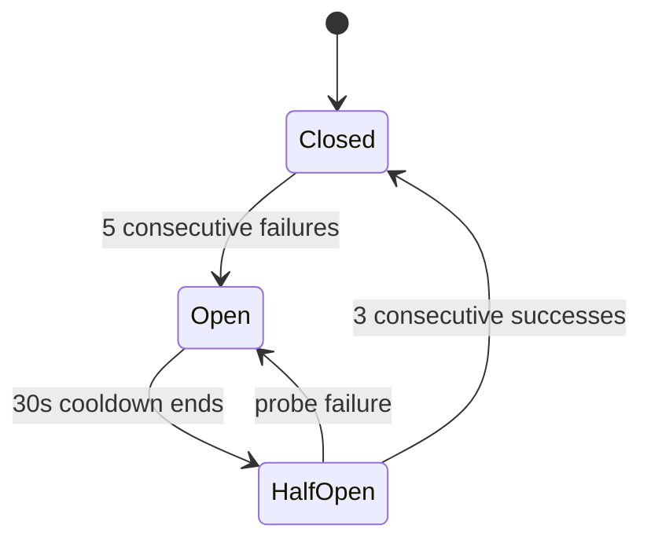

### Retry policy

Delay computation delegates to `limiteron::retry::delay_for_attempt`, classified by error category (the delay selection functions in `src/utils/retry.rs`, error-classification consumption in `src/vendor/manager.rs`):

| Error class           | Delay policy                                        |
| --------------------- | ----------------------------------------------- |
| 429 + Retry-After header  | wait per the header, full-range jitter spread (highest priority)         |
| 429 without header              | exponential backoff: 1s × factor 2.0, capped at 16s, jitter 0.2 |
| 5xx                   | uniform random in [1s, 1s + spread)                      |
| network errors              | 500ms × attempt                                 |
| 400 / 401 / 403 / 404 | no retry; mark the vendor Unavailable                    |

The retryable status-code set defaults to `[429, 500, 502, 503]`.

### Error mapping layer

`src/vendor/resilience/error_map.rs`: the limiteron circuit breaker is generic (`CircuitBreaker<E>` / `FailureClassifier<E>`), and Fluxweir uses `GateError` directly as `E` — business errors pass through `CircuitCallError::Inner` verbatim, **no string encode/decode** (the lossy scheme is retired); circuit rejections are restored from `CircuitCallError::Open` into the structured `VendorCircuitOpen` variant. The error classifier (`FailureClassifier::is_counted_as_failure`) decides which errors count as breaker failures.

### Connection pool

`src/vendor/pool.rs`: a single `reqwest::Client` is reused (it carries its own internal pool), with an outer `tokio::sync::Semaphore` capping max concurrent requests; the permit returned by `acquire()` auto-releases on drop; in streaming scenarios the permit lives with the stream, counting long connections truly (also the source of the admission congestion signal).

---

## 💰 Cost tracking

| Component        | File                        | Responsibility  
| ---------------- | --------------------------- | -------------------------------------------------------------------------------------------------------------------------------------------------------------------------------------------------------------------------------------------------------------------------------- |
| `CostCalculator` | `src/vendor/cost.rs`        | the pricing table comes from the hot config `[[pricing]]`, computing USD as `(prompt/1000)×in_price + (completion/1000)×out_price`; a `(vendor_id, model_id)` miss counts 0.0; the hot config is read fresh per request, so pricing changes take effect immediately (the pricing hot-read point in `src/vendor/manager.rs`)                                                             |
| `CostTracker`    | `src/utils/cost_tracker.rs` | `total` is an `AtomicU64` of micro-USD (USD ×1e6 into u64, avoiding floating-point accumulation error); `by_vendor` / `by_model` are two DashMap buckets; bookkeeping happens on the worker success path; `restore_from_db(pool, window_hours)` restores at startup (aggregating `token_usage` over the recent window by `(vendor, model)` to refill the in-memory view — restore happens before serving) |
| `replay`         | `src/utils/replay/`         | offline cost replay (`cost-replay` feature, main CLI subcommand `fluxweir cost-replay`): reads `request_logs` per time window and replays counterfactual costs for affinity / cache_ttl scenarios (integer micro-unit accumulation, with `catalog-sync`'s `unit.rs` as the conversion single point); pure explicit code, read-only never writing the DB (sqlite `mode=ro` + target DB must exist), fail-fast on row-load caps, byte-equal for identical inputs |

**Cost persistence and in-memory boundary (declared honestly)**: the cost breakdown is persisted — the `token_usage` table UPSERTs by `(vendor, model, api_key_hash, date, hour)`, writing the four cost columns `input_cost` / `output_cost` / `cache_read_cost` / `cache_creation_cost` (`src/database/pre_aggregator.rs`; unit prices from the `[[model_catalog]]` four tiers, 0 for unregistered entries), aggregatable via `GET /admin/cost` grouped by vendor/model. Per-request costs persist too — `request_logs.cost_usd` is computed in the log-write path by `request_cost_usd` in `src/api/request_cost.rs`: the response usage four-tier sum × catalog prices (shared by the chat/embeddings/anthropic/gemini/responses five entries, cache semantics single-sourced via `prompt_cache_semantics`, same caliber as the breakdown; rerank priced per 1k docs); the five entries record `None` without usage (failures / empty responses / streaming success — streaming usage goes through pre-aggregation bookkeeping, logs carry no usage body), and 0 for unregistered prices. rerank keeps its existing caliber: the request log's `cost_usd` failure path (capability mismatch / upstream failure) also writes the computed value per the formula, while `token_usage` bookkeeping does not record failures — the two calibers run in parallel, and `/admin/cost` aggregation excludes failed-request costs. The in-process `CostTracker` (`by_vendor`/`by_model`) restores from `token_usage` per window at startup (`[metrics].cost_restore_window_hours`, default 24, range 1–8760; skipped with a warn when the DB is unwired or in-memory) — usage outside the restore window does not enter the live in-memory view.

---

## 🔭 Observability

**Prometheus bridge vs OTLP tracing responsibility split** (two modules coexist under feature `otlp`, different semantic surfaces):

- **`src/utils/otlp.rs` (metrics bridge)**: parses `/metrics`' Prometheus text exposition (single source of truth `sdforge::metrics::global_registry().render()`) into samples and periodically pushes them to an OTLP/HTTP endpoint via `SdkMeterProvider` — oriented to **aggregated metrics** (counts/histograms/cost snapshots); config section `[otlp].{enabled, endpoint, interval_secs}`.
- **`src/utils/otlp_export.rs` (trace surface)**: attempt-level distributed tracing — inbound parses the W3C `traceparent` (a root is created when absent), one child span per vendor attempt (`vendor`/`model`/`attempt`/`status_code`/`error_class`/`cost_details.estimate_usd`, with the fallback's actually-served vendor marked `fluxweir.served=true`), outbound injects `traceparent`; request/response bodies are not exported by default. Config section `[otlp].tracing.{enabled, sample_ratio, endpoint, protocol}`, **double-zero default off** (enabled=false installs no provider, sample_ratio=0.0 samples nothing → zero spans, zero network export); shutdown flushes via the teardown coordinator (best-effort). The two switch independently; `[otlp].enabled` only governs the metrics bridge, tracing is gated separately by `tracing.enabled`.

---

## 🗄️ Data persistence

### Storage model

SQLite, 8 tables (migrations V1↔V9 defined in `src/database/migrations/core/` (`include_str!` embedded via `migration.rs`, currently `CORE_SCHEMA_VERSION = 9`), with `schema.*.sql` as same-source readable documentation):

| Table           | Purpose                                                 | Status                    |
| --------------- | ---------------------------------------------------- | ----------------------- |
| `request_logs`  | request logs (columns incl. `cost_usd`, `upstream_key_fingerprint`, `session_key` etc.) | read/write                    |
| `token_usage`   | hourly token usage aggregation (incl. the four cost columns)                   | read/write                    |
| `vendor_status` | vendor status persistence                                       | schema only, no read/write path |
| `model_stats`   | model statistics                                             | schema only, no read/write path |
| `vault_keys`    | key vault (cocoon ciphertext + mask/fingerprint columns, table created in the V3 migration) | read/write                    |
| `response_store`| Responses API storage surface (table created in the V4 migration)                  | read/write                    |
| `affinity_sticks` | affinity stickiness persistence (V6 migration, refilled at startup)          | read/write                    |
| `quota_ledger`  | quota ledger (V7 migration, 30s flush)                   | read/write                    |

Table structures are version-managed by dbnexus's `MigrationExecutor`: the startup assembly chain runs the V1..V9 migrations (UP creates tables + indexes, DOWN rolls back correspondingly), with migration history recorded in dbnexus's default history table; existing databases (tables present, history empty) are handled by the baseline check without re-creating tables. Each of the three dialects (sqlite/postgres/mysql) has a FROZEN V1; the consistency between `schema.sql`'s (sqlite) table set and the full migration set is locked by a guard test (`schema.postgres.sql` / `schema.mysql.sql` are readable dialect documentation, unguarded).

### Async write pipeline

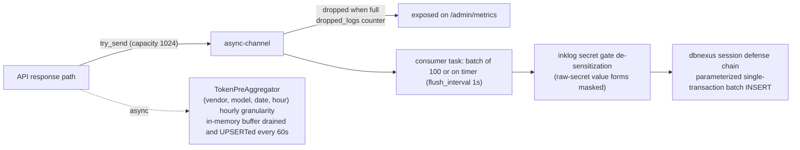

- Queue capacity 1024 and flush_interval 1s are constructed at startup assembly, with the pre-aggregator started in the same window (the log-pipeline assembly section in `src/server/bootstrap.rs`; the assembly chain was moved verbatim from the former main.rs, order bit-identical).
- Backpressure semantics (recId=9): `log()` never blocks the response path; drop volume is counted explicitly and exposed rather than silently swallowed.
- Pre-aggregation buffers hourly token statistics in memory first and UPSERTs periodically, flattening write amplification.

---

## ⚙️ Configuration system and hot reload

### Config structure

`Config`'s 30 top-level fields/sections (the `Config` struct in `src/config/mod.rs`):

| Section                  | Notes                                  | Section              | Notes                                                                            |
| ------------------------ | ------------------------------------- | --------------- | ------------------------------------------------------------------------------- |
| `server`                 | listen address and port                          | `routing`       | routing policy parameters                                                                    |
| `database`               | SQLite path and pool size                   | `cache`         | response cache switches                                                                    |
| `vendors`                | vendor and model inventory                        | `rate_limit`    | rate-limit rules                                                                        |
| `global_model` (Option)  | global model pool                            | `resilience`    | circuit / fallback / soft down-weight                                                                |
| `pricing`                | `[[pricing]]` pricing table                  | `admission`     | congestion admission                                                                        |
| `auth` (Option)          | API keys and tiers                        | `retry`         | retry and failover budgets                                                                  |
| `cors` (Option)          | cross-origin                                  | `model_catalog` | `[[model_catalog]]` model capability/pricing catalog (serialized as omitted when empty)                     |
| `health`                 | active health probes (default off)              | `quota`         | cost/token quotas + `[[quota.windows]]` multi-window budgets + `[[vendor_budgets]]` (default off) |
| `grpc` (Option)          | gRPC server (missing/disabled = no listener)     | `docs`          | OpenAPI documentation surface switch (default off = routes absent)                                       |
| `lexcompress`            | lexical compression (X-Compress triggered, default off) | `vendor_budgets`| `[[vendor_budgets]]` vendor declarative budgets (default off)                                    |
| `key_budgets`            | inbound key cost budgets (missing section = feature off)  | `responses`     | Responses API surface (storage TTL/limits etc.)                                              |
| `metrics`                | metrics export (incl. the 24h cost restore window)          | `otlp`          | OTLP export (`otlp` feature, default off)                                              |
| `usage_insights`         | session usage insights switch (default on)            | `catalog_sync`  | catalog auto sync (`catalog-sync` feature, default off)                                   |
| `subscription`           | subscription-account upstreams (`subscription-vendor` feature, default off) | `subscription_accounts` | subscription-account declaration list          |
| `web_search`             | search injection and guarded fetch (`web-search` feature, default off)    | `masking`       | outbound masking (`masking` feature, default off)                                            |

**Hard constraint**: every config section must be in the `Config` struct — persist writes the whole file back to disk, so sections missing from the struct vanish from the file on write-back (the `Config` field docs in `src/config/mod.rs`).

### Loading

`confers::loader::load_file` loads (with built-in symlink-traversal and file-size protections) → serde deserialization → `validate_config` (vendor/model id dedup validation). `src/config/loader.rs` strips confers' `AnnotatedValue` tree down to bare serde_json values (a structural gap in confers' current version which has not implemented Deserializer — not reinventing the wheel).

### Hot-reload write path (transactional semantics)

`ConfigManager.config` is a `confers::dynamic::DynamicField<Config>` (arc-swap, lock-free read path). The write path (`update_config` / `update_config_with` in `src/config/manager.rs`):

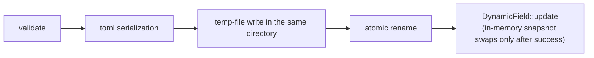

- temp file + rename guarantees a power loss cannot corrupt the config; the in-memory snapshot updates only after the disk succeeds;
- RMW (read-modify-write) scenarios use `update_config_with` to prevent lost updates;
- `SnapshotManager` (`src/config/manager.rs`): snapshots the old config into `config-backups/` before every update, keeping 10, with `auth.api_keys` masked in the snapshots.

### `/admin/config` hot-reload boundary

| Category   | Sections                                                                                                                                                                                                                                                                                                                                                                                     |
| ------ | -------------------------------------------------------------------------------------------------------------------------------------------------------------------------------------------------------------------------------------------------------------------------------------------------------------------------------------------------------------------------------------- |
| Hot-effective | `routing`, `retry`, `resilience`, `admission`, `auth`, `cache` (exact cache), `quota`, `health`, `pricing`, `lexcompress`, `vendors` (enabled and weights) and the other per-request hot-read sections in the response (`masking` / `usage_insights` / `responses` / `model_catalog` / `key_budgets` / `vendor_budgets` etc.) |
| Restart required | `server`, `cors`, `rate_limit` (built at tower-layer construction), `database`, `grpc`, `otlp` (endpoint/interval/timeout), `docs.enabled` (mounted at router-build time), `cache.semantic` (semantic layer assembled in bootstrap), `routing.difficulty.enabled` and the `routing.difficulty.classifier` keys `model_path`/`engine`/`cache_ttl_secs` (all explicitly reported in the POST response's `restart_required` array), vendor concurrency, the `vendors` topology (not in the array); the `global_model` special case — file-side hot reload is rejected by the structural gate (restart needed), while admin writes switch in memory and take effect on the next request (`enabled` hot-read per request) but still carry the conservative `restart_required` hint |

---

## 🚦 Middleware pipeline

Pipeline order (the middleware layering section in `src/api/router_builder.rs`; the code comments state the order explicitly):

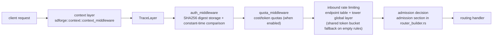

### Auth

- API keys are stored as SHA256 digests and compared in constant time, preventing timing side channels;
- credential extraction: `Authorization: Bearer` first, `x-api-key` fallback;
- ten whitelist entries pass through: `/health`, `/api/v1/health`, `/`, `/readyz`, `/metrics`, `/admin/subscription/callback` (the OAuth 302 callback), `/api-docs` and `/api-docs/*`, `/swagger-ui` and `/swagger-ui/*` (the auth whitelist decision in `src/middleware/auth.rs`); beyond the business surface there are the sdforge-plane `/healthz` and `/readyz` (mounted after all middleware, auth-free and rate-limit-free; internal-network exposure recommended);
- the `[auth]` section is hot-read per request; key additions/removals take effect immediately;
- key tiers (recId=16, the `tier` of `[[auth.keys]]`): `dedicated` / `guaranteed` / `elastic` / `spot`.

### Congestion admission (recId=16, off by default)

`src/middleware/admission.rs` — moves the 429 decision from "first come, first served" to "priority":

- **Congestion signal**: gateway-side concurrency occupancy = Σ in_flight / Σ concurrency caps (reusing `ConcurrencyLimiter::in_flight`; streaming permits live with the stream, so long streams count truly); congestion at `[admission].congestion_threshold` (default 0.9);
- **Ruling**: when a new request's tier base weight is below "the smallest tier currently in flight", reject directly with 429 + Retry-After 1s, no queueing; equal/higher tiers pass (first come, first served within a tier);
- **Observability priority formula**: `w_tier · (1+α_slo·ℓ*)⁻¹ · (1+α_burst·b)⁻¹ · (1+α_debt·d)⁻¹`, where burst/debt are per-key EWMAs (table cap 1024) — diagnostic caliber only, **not consumed** by the shed decision (equal-tier requests must not be suppressed).

### Rate limiting (rate_limit)

- limiteron inbound limiting has two layers: endpoint rules with a `path` prefix go through the middleware-side endpoint table (`ShardedSlidingWindowLimiter`, bucketed by the tenant API key's SHA256 digest); global rules without a `path` go through the tower global layer (`GlobalRateLimitLayer` + `QuotaLimiter`, bucketed by tenant digest; truly per-tenant since G5);
- exceeding any limit returns `429` + `Retry-After`; the legacy `Decision::Banned → 403` ban branch was removed in the tower migration (rule bans are always `None`), and empty `rules` falls back to a shared `TokenBucket(100, 10/s)`;
- rate-limit exempt paths (the ten entries of `is_quota_exempt_path`): `/health`, `/healthz`, `/ready`, `/api/v1/health`, `/readyz`, `/metrics`, `/api-docs` and `/api-docs/*`, `/swagger-ui` and `/swagger-ui/*`.

---

## ⚡ Response cache

`src/api/response_cache.rs` (recId=12), storage rides the oxcache in-memory backend, no hand-written HashMap caches:

- **Key design**: `resp:{api_key_sha256}:{vendor_id}:{model_id}:{sha256(canonical_body)}`;
- `vendor + model + the full canonical body` go into the key, preventing wrong hits across vendors/models;
- the caller API key's SHA256 digest goes into the key for **tenant isolation** (preventing LaCache key-collision poisoning; the plaintext key never enters the key);
- the switch is `[cache].enabled`, hot-read per request (`enabled()` in `src/api/response_cache.rs`);
- on a hit, the handler returns early, skipping routing and vendor execution (see the [Request lifecycle](#-request-lifecycle) sequence).

---

## 🌐 Internationalization

`src/i18n/` + `locales/`:

| Design point     | Implementation                                                                                                                                  |
| ---------- | ------------------------------------------------------------------------------------------------------------------------------------- |
| Message format   | Fluent (`.ftl`) single-line `key = value` form; en/zh have 10 files in total (line-parse vs Fluent-parse equivalence is pinned by the parity guard)                              |
| Deployment form   | embedded at compile time via `include_str!`, so the artifact carries no on-disk `locales/` directory; new ftl files must be registered in `EMBEDDED_LOCALES`, backed by a guard test                      |
| Runtime structure | the `sdforge::i18n` host registry (a process-global REGISTRY; `register_translation` registers at startup, `translate_for` looks up + `{ $name }` template substitution)      |
| Language detection chain | `FLUXWEIR_LANG` → `LC_ALL` → `LC_MESSAGES` → `LANG` → `sys-locale` → `"en"` (forced order; explicit reads guarantee determinism on Windows/edge environments)          |
| Lookup fallback   | current language → en → key name                                                                                                                  |
| Language scope | process level: the detection chain fixes the language once at startup; the `set_locale` override exists solely for SDK-embedded callers (no HTTP entry on the server, not in hot reload, no per-request Accept-Language negotiation) |
| Coverage   | all business messages (error `user_message()`, admin responses and log copy); framework strings such as OpenAPI/health descriptions excluded (see below)                                   |
| Localization formatting | deliberately avoids Fluent `NUMBER()/DATETIME()` and ICU: API output keeps numbers/dates machine-readable (ISO 8601, micro-USD integers), and localized rendering belongs to the client               |

Error presentation runs on two tracks (implemented in `src/error/app.rs`; `mod.rs` keeps only types and re-exports): `#[error]` Display is always an English canonical string (for logs and error chains), while the HTTP response body uses `user_message()` to return FTL copy per locale; error payloads (`message`/`field`/`source`/`vendor`) store only language-neutral anchors, with localization single-pointed in `user_message()`.

One registry shared with the framework layer: business messages and the OpenAPI/health framework descriptions use the same `sdforge::i18n` host registry (the OpenAPI key family has been merged into `locales/{en,zh}/api.ftl` as the single source; the manual registration block in `openapi_docs.rs` was deleted); locale decisions stay in this repo's detection chain (starting from `FLUXWEIR_LANG`), and `i18n::init()` plus `assemble_router` one-way sync the business stack's locale into the sdforge active locale at site build, making `FLUXWEIR_LANG` the single language entry for both stacks. Business key lookups (`t()`/`t_args()`) pass `current_locale` explicitly and do not rely on that sync.

Guards: `tests/i18n/i18n_parity_test.rs` makes four assertions (en/zh key alignment, referenced-key existence, zero Junk + en/zh placeholder alignment, call-site arguments covering FTL placeholders) plus scanner self-test cases; a unit test in `src/i18n/catalog.rs` pins the embedded catalog to bidirectional consistency with the on-disk directory.

---

## 🧩 Dependency injection and sibling libraries

### DI container

`src/infrastructure/di.rs`: trait-kit's `AsyncKit` assembles 4 infrastructure modules (`build_kit_with_config` / `build_kit`) in topological order + `verify_kit` validation:

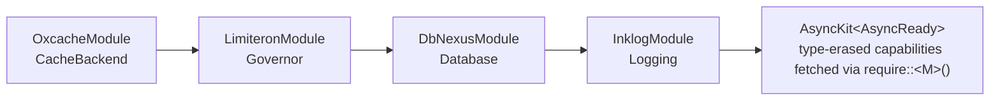

### Sibling libraries (crates.io registry)

The root `Cargo.toml` integrates 7 sibling libraries as registry versions (versions in `[dependencies]`, checksums locked in `Cargo.lock`). During migration they once used path dependencies + `[patch.crates-io]` to unify identity (guaranteeing transitive dependencies converged to one source); that form was removed with the full move to the registry:

| Sibling library      | Role in Fluxweir                                      |
| ----------- | --------------------------------------------------------- |
| `confers`   | config loading (loader) and hot reload (`DynamicField`)              |
| `dbnexus`   | database foundation layer                                              |
| `inklog`    | logging (`LoggerManager`)                                   |
| `limiteron` | circuit breaking, retries, rate limiting (Governor/limiters) |
| `oxcache`   | cache backend (response cache, session affinity table)                          |
| `sdforge`   | HTTP service macro framework (`#[forge]` handlers)                     |
| `trait-kit` | the `AsyncKit` DI container                                   |

### Feature gating

`default = ["full", "db-sqlite"]`; the `full` preset contains 12 features: `web-server` / `database` / `vendor-management` / `router` / `protocol` / `infrastructure` / `sdforge-integration` / `logging` / `resilience` / `cost-tracking` / `sdk` / `vault`; independently gated outside `full`: `grpc` (separate from the hidden macro-gated `http`), `db-postgres` / `db-mysql` (the other two database backends, mutually exclusive with `db-sqlite`), `otlp` (metrics export and attempt-level tracing), `masking` (outbound masking), `catalog-sync` (catalog sync), `subscription-vendor` (subscription-account upstreams), `oidc` (short-lived credential verification middleware), `netguard` (zero-dependency SSRF triage), `web-search` (search injection and guarded fetch), `console` (built-in console static surface), `difficulty-classifier` / `semantic-cache` (both depend on vecboost via path, requiring a sibling checkout), `cost-replay` (offline cost replay, main CLI subcommand `fluxweir cost-replay`, requires one db backend). Main dependency directions:

```text
web-server → router → vendor-management
web-server → database (→ protocol + url + logging) ＋ infrastructure (→ oxcache + trait-kit) ＋ sdforge-integration
web-server surface uses directly: limiteron (inbound rate limiting) + hex / sha2 / subtle / once_cell
router → oxcache (CacheBackend: session affinity table / response cache)
sdk → reqwest + eventsource-stream + url (HTTP client, independent of web-server)
database → logging: async_logger (DB sink) consumes inklog unconditionally; the inklog kit requires any db-* backend group
```

Trimming features on demand shrinks the build artifact (e.g. dropping `web-server` for library-only usage).

---

## 🚀 Performance design points

The following are design facts (no benchmark data; data-bearing conclusions defer to measurements):

1. **Zero-copy passthrough**: when the client protocol matches the upstream vendor protocol, the request body is forwarded directly without intermediate-representation conversion; only cross-protocol traffic (e.g. OpenAI in → Anthropic out) goes through converters.
2. **confers DynamicField lock-free hot reads**: all hot config reads go through `DynamicField` snapshots — lock-free and uncontended on the read path; hot updates only swap pointers.
3. **Async batched persistence**: request logs are enqueued through a bounded channel `try_send` and batched into single-transaction INSERTTs; pre-aggregation buffers in memory and drains every 60s — zero disk I/O on the response path.
4. **Semaphore connection pool**: a single `reqwest::Client` reuses underlying connections; the Semaphore only caps concurrency, and permits release on drop.
5. **oxcache carries caching and affinity**: the response cache and session affinity table share the in-memory backend's TTL/renewal semantics, avoiding self-built cache eviction and expiry bugs.
6. **Feature-gated trimming**: 30 feature declarations in `Cargo.toml` gate precisely; unenabled code does not compile, controlling binary size per deployment form.

---

## 📚 Document navigation

| Document                           | Description                     |
| :----------------------------- | :----------------------- |
| [User Guide](./USER_GUIDE.md)    | installation, configuration and daily usage     |
| [API Reference](./API_REFERENCE.md) | HTTP endpoints and request/response formats |
| [Security](./SECURITY.md)      | auth, isolation and security design     |
| [FAQ](./FAQ.md)                | common questions             |
| [Changelog](./CHANGELOG.md)     | version history             |

## Catalog sync pipeline (catalog-sync)

`catalog-sync` feature (not in `full`) + `[catalog_sync].enabled` dual gating. **Add-only, never modify** is a hard policy:
merging only adds `model_id`s missing from the catalog; existing entries (including user-set pricing) are untouched — the costing-source-of-truth semantics must never be overridden by an external source.

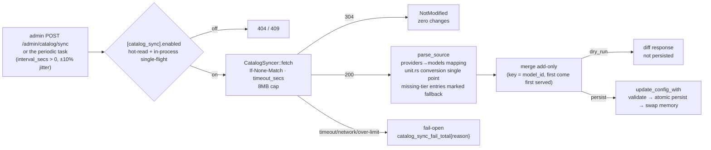

- Modules: `src/config/catalog_sync.rs` (feature gated) + `src/config/unit.rs` (pricing unit conversion single point, reused by cost-replay);
- Observability: `catalog_sync_fail_total{reason}` / `catalog_sync_added_total` on `/admin/metrics`;
- Admin surface: `POST /admin/catalog/sync` (dry_run diff, 409 on re-entry, 502 on failure / 413 over-limit, i18n error details); the SDK exposes `FluxweirClient::sync_catalog`.

## netguard trust boundary (web-search-inject)

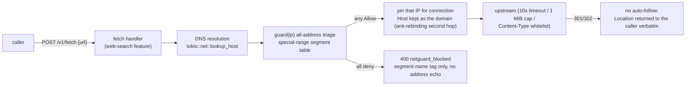

- **The triage only guards the "user-controlled URL" path** (/v1/fetch and future fetch surfaces); vendor `api_base` is a trusted, administrator-configured surface and does not go through netguard triage — global mounting would turn misconfiguration into runtime rejections, breaking existing deployment semantics (design Alternatives).
- **The triage point is after resolution, before connection**; triaged IPs are pinned via reqwest `ClientBuilder::resolve` (0.13 has no per-request resolve; a host-level one-shot Client cache carries connection reuse; the key includes the IP — a resolution change means a new entry, and pinned snapshots are never reused).
- **Search provider outbound (/v1/search) does not go through netguard**: provider base_urls are likewise trusted, administrator-configured surfaces; same trust level as vendor outbound.
