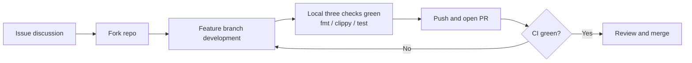

# Fluxweir Contributing Guide

[🔒 Security](./SECURITY.md) · [📜 Changelog](./CHANGELOG.md) · [📖 User Guide](./USER_GUIDE.md) · [🏗️ Architecture](./ARCHITECTURE.md) · [📖 README](../../README.md)

Thank you for your interest in **Fluxweir**! Whether you are fixing defects, adding features, improving documentation or helping others, your contribution is invaluable.

## 📋 Table of Contents

- [Environment setup](#-environment-setup)
- [Project structure](#️-project-structure)
- [Development commands](#-development-commands)
- [Testing conventions](#-testing-conventions)
- [Feature discipline](#-feature-discipline)
- [Commit conventions](#-commit-conventions)
- [Documentation discipline](#-documentation-discipline)
- [PR process](#-pr-process)
- [License](#-license)

---

## 🧰 Environment setup

### Prerequisites

| Dependency | Version | Notes |
|:-----|:---------|:-----|
| Rust | **1.97.1+** (MSRV) | The floor is declared by `rust-version` in the root `Cargo.toml` (aligned with the 7 sibling libraries). ci.yml installs the toolchain at MSRV (`dtolnay/rust-toolchain@683b588c487a69d01f6c6ddf40f036ff682cc2c8 # v1`, see ci.yml, plus `toolchain: 1.97`), both guarding the floor and making the clippy lint set reproducible; `docker/Dockerfile` uses the currently supported stable (1.99). **clippy's MSRV comes only from each package's own `rust-version`**: `clippy.toml` deliberately does not repeat the `msrv` key (it once said 1.75, conflicting with the floor — clippy warnings made `-D warnings` permanently red, and MSRV-gated lints were silently suppressed against the old baseline); the `examples` member crate also declares the same `rust-version` explicitly, otherwise its lint baseline would fall back to the runtime stable and drift. After changing the MSRV, verify clippy with `cargo clean -p fluxweir -p fluxweir-examples` first: cargo does not fingerprint `clippy.toml`, so stale cached diagnostics are reused without cleaning |
| Git | any recent version | version control |

Install the Rust toolchain:

```bash
curl --proto '=https' --tlsv1.2 -sSf https://sh.rustup.rs | sh
rustup component add rustfmt clippy
```

### 🧩 Self-developed library dependencies (crates.io registry)

Fluxweir deeply depends on 7 self-developed libraries, integrated via the **crates.io registry** — versions declared in the root `Cargo.toml` `[dependencies]`, checksums locked in `Cargo.lock`, fetched automatically by cargo. **Cloning this repository is enough to `cargo build`** (the default caliber needs no sibling directories for the 7 libraries); CI jobs work the same way, with no sibling-clone step. Two exceptions: the optional `difficulty-classifier` / `semantic-cache` features depend via path on `../vecboost` (a sibling checkout is needed when enabling them); Docker builds always need the vecboost additional context — `docker build --build-context vecboost=../vecboost -f docker/Dockerfile .` (compose equivalent: `build.additional_contexts`); without it, resolution fails with `failed to read /vecboost/Cargo.toml`.

(Historical form: during migration, `path = "../<lib>"` plus `[patch.crates-io]` unified identity to guarantee trait identity; that form, along with the accompanying CI clone steps and the Dockerfile `SIBLING_PINS` mechanism, was removed when everything moved to the registry.)

| Library | Role in Fluxweir |
|:---|:----------------------|
| [confers](https://github.com/Kirky-X/confers) | Config parsing (TOML), `DynamicField` hot reads, config snapshots (SnapshotManager) |
| [dbnexus](https://github.com/Kirky-X/dbnexus) | SQLite database layer (rustls + connection pool + permissions) |
| [inklog](https://github.com/Kirky-X/inklog) | Structured logging |
| [limiteron](https://github.com/Kirky-X/limiteron) | Rate-limit / circuit-break / retry primitives |
| [oxcache](https://github.com/Kirky-X/oxcache) | Unified cache API (session affinity table / response cache storage) |
| [sdforge](https://github.com/Kirky-X/sdforge) | HTTP service framework (`#[forge]` macro + CORS) |
| [trait-kit](https://github.com/Kirky-X/trait-kit) | DI container (AsyncKit; assembles the modules above uniformly at startup) |

### Fork and clone

| Step | Action |
|:----:|:-----|
| **1. Fork the repo** | click "Fork" on [github.com/Kirky-X/fluxweir](https://github.com/Kirky-X/fluxweir) |
| **2. Clone the repo** | only Fluxweir itself needs cloning; the 7 self-developed libraries are fetched by cargo from crates.io |
| **3. Install git hooks** | `pip install pre-commit && pre-commit install --install-hooks` (see next section) |
| **4. Build check** | `cargo build` (default = full + db-sqlite; the first build also compiles the 7 self-developed dependencies and takes longer) |

### 🪝 Git hooks (pre-commit)

A unified baseline across the 7 repositories (functionally equivalent to confers' lefthook.yml). Hooks install into the local `.git/hooks/`; fresh clones must install again.

| Hook | Purpose |
|------|------|
| Generic fixers | trailing whitespace, end-of-file newline (auto-fixes and blocks the commit on hit; `git add` and commit again) |
| `detect-private-key` | byte-level private key detection (upstream credentials in this repo are stored only as `api_key_env` env var names; no fixture exclusions) |
| `gitleaks` | secret history scanning (v8.30.1, blocks before commit by default, complementing detect-secrets) |
| `detect-secrets` | secret scanning; entries inside baseline `.secrets.baseline` are human-verified false positives (`api_key_env` variable names, test fixtures, SHA256 digests); new findings outside the baseline block |
| `typos` | spell check (with auto-fix); the whitelist lives in `typos.toml` (fixture words `abd`/`ot`/`ded`/`Hel`, mermaid node `THR`, the `out/` artifacts directory) |
| `cargo-fmt` / `cargo-check` / `cargo-clippy` | exactly the CI caliber (`--workspace` / `-D warnings`) |
| `no-commit-to-branch` | protects `master` (this repo's workflow commits on `main`) |

False-positive handling: typos hits → verify semantics, then add to the `typos.toml` word list; new detect-secrets findings → after human verification as false positives, update the baseline with `detect-secrets scan --update .secrets.baseline` and explain in the PR. The optional post-commit build-artifact cleanup stage is disabled by default (enable with `pre-commit install -t post-commit`).

---

## 🏗️ Project structure

`src/` holds 179 `.rs` files in total (the former `crates/llm-gate/` pure routing core library has been merged back into a single crate; public paths such as `fluxweir::config` are unchanged), organized by directory responsibility:

| Directory | Responsibility | Key files |
|:-----|:-----|:---------|
| `src/api/` | REST endpoints and router building | `router_builder.rs` (middleware mounting), `admin.rs`, `completions.rs`, `anthropic.rs`, `sse.rs`, `response_cache.rs` |
| `src/config/` | TOML config load / validate / hot reload | `mod.rs` (Config struct and defaults), `manager.rs`, `loader.rs`, `model_catalog.rs` |
| `src/database/` | SQLite persistence | `repository.rs`, `async_logger.rs` (async batched writes), `pre_aggregator.rs` (token pre-aggregation) |
| `src/i18n/` | Fluent bilingual catalogs (en/zh) and locale detection | `catalog.rs`, `locale.rs` |
| `src/infrastructure/` | trait-kit AsyncKit DI assembly | `di.rs` |
| `src/middleware/` | auth / congestion admission middleware | `auth.rs`, `admission.rs` |
| `src/protocol/` | OpenAI ↔ Anthropic protocol conversion | `unified.rs`, `openai_converter.rs`, `anthropic_converter.rs`, `sse_frame.rs` |
| `src/router/` | routing dispatch | `router.rs` (6-factor weighting, optional 6th quota factor), `affinity.rs`, `bandit.rs` |
| `src/vendor/` | vendor management | `manager.rs`, `rate_limiter.rs`, `pool.rs`, `queue.rs`, `key_pool.rs`, `resilience/` (FallbackChain + error mapping) |
| `src/utils/` | cost tracking / global metrics / retry helpers | `cost_tracker.rs`, `metrics.rs`, `retry.rs` |
| `src/error/mod.rs` / `src/error/gate.rs` | unified `FluxweirError` / `GateError` (incl. HTTP mapping) | — |
| `src/lib.rs` / `src/main.rs` | lib public API and thin bootstrap entry (assembly chain in `src/server`) | — |

Two auxiliary locations:

| Location | Notes |
|:-----|:-----|
| `src/server` | **server assembly chain** library module (`all(web-server, logging)` gated): bootstrap / http / handle / shutdown; `run()` serves, `build_app()` returns `(Router, ServerHandle)` (graceful-shutdown flush on teardown, idempotent; a second in-process assembly panics — see the `# Panics` docs) |
| `src/sdk` | **Rust client SDK** module (`sdk` feature gated): chat / embed / models / vendors / health, incl. SSE streaming (the former top-level `sdk/` crate has been merged in) |
| `tests/` | **integration tests** (organized into functional-domain directories; 69 `.rs` files = 68 registered `[[test]]` binaries + `common/mod.rs`; the default caliber runs 61 integration targets: HTTP full-chain / routing / protocol conversion / vendors / circuit breaking / retries / cost / config example assertions / feature matrix / dead-code guard etc.; grpc_smoke / grpc_coverage carry `required-features` and compile only with the `grpc` feature — no empty binaries on the default caliber) |

> Architecture convention: `mod.rs` keeps only interfaces and re-exports; concrete implementations live in separate files (e.g. `router/router.rs`, `config/manager.rs`). New code should follow the same convention.

---

## 🔨 Development commands

Local checks identical to CI (`.github/workflows/ci.yml`):

```bash
# Format check (same as CI)
cargo fmt --all -- --check

# Clippy static analysis (must be warning-free)
cargo clippy --workspace --all-targets -- -D warnings

# Full test run (default caliber: full + db-sqlite; --all-features always fails due to db-* exclusivity)
cargo test --workspace
```

Production builds enable LTO and a single codegen unit (`[profile.release]`: `lto = true`, `codegen-units = 1`, `opt-level = 3`):

```bash
cargo build --release
```

**All three checks must be green before committing** — CI re-runs the same commands.

---

## 🧪 Testing conventions

This project's test baseline (measured with `cargo test --workspace`):

| Type | Count | Location | Style |
|:-----|:-----|:-----|:-----|
| Unit tests | **1156** (measured 2026-11-16) | inline in `src/` modules | inline `#[cfg(test)] mod tests { ... }` |
| Integration tests | **1197 (61 default-caliber integration targets)** | `tests/` (69 `.rs` files = 68 registered `[[test]]` + `common/mod.rs`; grpc_smoke / grpc_coverage compile with the `grpc` feature) | HTTP full-chain / cross-module behavior |

> Caliber: measured with `cargo test --workspace --no-fail-fast` on 2026-11-16 — default and `FLUXWEIR_LANG=en` calibers each run 62 test targets (1 lib + 61 integration), 2353 passed, 4 ignored, 0 failed; the hot-reload watcher test is hardened with event replay (rewrites replayed when FSEvents drops events).

Conventions and tools:

| Item | Convention |
|:---|:-----|
| Mock framework | `mockito` (HTTP wire-level upstream stubs, same as SDK tests) + hand-written fakes (in-process doubles, e.g. `MockDifficultyClassifier`) |
| Fake clock | limiteron `MockClock` **requires the `test-clock` feature** (noted in `[dev-dependencies]`) — drives circuit-break timeouts / rate-limit window resets and other time-dependent tests |
| Async tests | `#[tokio::test]`; use `flavor = "multi_thread"` when connection pools or multi-task coordination are involved |
| Determinism | time-sensitive assertions inject clocks/timestamps first (e.g. `admit(&self, tier, key_hash, now_ms)`); avoid real `sleep` |
| Config example | `tests/config/config_toml_example_test.rs` makes structural assertions against `config.example.toml` — **config structure changes must update this test in sync** |

Running tests:

```bash
cargo test --workspace                         # full run (default caliber)
cargo test --test gate_router_test             # single integration binary (name = file stem)
```

Integration tests live in functional-domain directories (`tests/<domain>/<name>.rs`); the root `Cargo.toml` disables auto-discovery (`autotests = false`) and registers each `[[test]]` explicitly: **new test files must be registered in sync** (name = file stem, path = actual location), otherwise cargo silently neither compiles nor runs them.

---

## 🚩 Feature discipline

`Cargo.toml` declares **30 feature declarations** (the `full` preset includes the 12 features in the table below), with `default = ["full", "db-sqlite"]` (all enabled + sqlite backend):

| Feature | Gates |
|:--------|:---------|
| `web-server` | axum / tower / tower-http HTTP service |
| `database` | dbnexus + sea-orm + async-queue persistence |
| `vendor-management` | reqwest + limiteron + rand + async-channel vendor management |
| `router` | routing dispatch (depends on vendor-management + oxcache) |
| `protocol` | protocol conversion |
| `infrastructure` | oxcache + trait-kit |
| `sdforge-integration` | sdforge HTTP framework integration |
| `logging` | inklog |
| `resilience` | FallbackChain + error mapping layer (circuit/retry moved to limiteron) |
| `cost-tracking` | dashmap + CostTracker cost tracking |
| `sdk` | Rust client SDK (reqwest + eventsource-stream + url) |
| `vault` | key vault (cocoon AEAD encryption + secrecy in-memory wrapping; db builds store the `vault_keys` table, library-less builds fall back to a file vault) |

Discipline requirements:

1. **New capabilities must be feature-gated** and wired into `full`'s dependency chain; `tests/matrix/feature_matrix.rs` verifies feature combinations
2. `--no-default-features` must compile; `--all-features` always fails to compile because the three db-* backend groups are mutually exclusive (expected behavior, not a defect)
3. Special case `http`: a **macro-gated empty feature** (no implementation). Reason in the `Cargo.toml` comments: sdforge's `#[forge]` macro evaluates `cfg(feature = "http")` against the **target crate**'s features — without a same-named feature, `RouteRegistration` is cfg'd away entirely and the `#[forge]` site route (/health) is silently lost. It exists only as the macro-gating switch enabled alongside `web-server`

---

## 💬 Commit conventions

Follow [Conventional Commits](https://www.conventionalcommits.org/): `<type>(<scope>): <subject>`.

Real examples from this repository:

```text
feat(cost): add CostTracker with dashmap sharding and atomic accumulation
fix(security): fix critical security issues from diting review (T042)
refactor(database): [T021-T023] 用 dbnexus 替换 sqlx 数据库层
```

(examples taken from real commits `4ca8afe` / `893156a` — task numbers go into the message per the red line, not into source comments.)

| Type | Purpose |
|:-----|:-----|
| `feat` | new feature |
| `fix` | defect fix |
| `refactor` | refactoring (no behavior change) |
| `test` | test additions |
| `docs` | documentation changes |
| `chore` | build / repository maintenance |
| `style` | formatting (e.g. a full `cargo fmt` pass) |
| `perf` | performance optimization |

Red lines:

- **`git commit --no-verify` is forbidden** — never skip any local check hook
- one commit, one logical change; tracking info such as task numbers goes into the commit message, not source comments
- before community interactions, read the [Code of Conduct](./CODE_OF_CONDUCT.md) (reporting channels listed there)

---

## 📚 Documentation discipline

Code changes must update documentation in sync; **when docs and code disagree, the code wins, but the docs must be fixed promptly**:

| Change type | Documents to update |
|:---------|:-----------------|
| API / endpoint changes | `docs/cn|en/API_REFERENCE.md` |
| Config field changes | `docs/cn|en/USER_GUIDE.md` (and sync `config.example.toml` plus `tests/config/config_toml_example_test.rs`) |
| Architecture / module changes | `docs/cn|en/ARCHITECTURE.md` |
| User-visible new capability / fix | `docs/cn|en/CHANGELOG.md` |

**Fabricated data in documentation is forbidden**: test counts, performance figures, review conclusions etc. must come from real runs.

---

## 🔄 PR process



| Step | Notes |
|:-----|:-----|
| **1. Issue** | describe the problem or proposal on [Issues](https://github.com/Kirky-X/fluxweir/issues) first; discuss major changes to consensus first ([Discussions](https://github.com/Kirky-X/fluxweir/discussions) suits open-ended topics) |
| **2. Fork** | forking this repository is enough; the 7 self-developed libraries are fetched by cargo from crates.io — no extra preparation |
| **3. Develop** | develop on a new branch, keep commits atomic; remember feature gating and tests for new capabilities |
| **4. Local verification** | `cargo fmt --all -- --check` + `cargo clippy --workspace --all-targets -- -D warnings` + `cargo test --workspace` all green (non-default backends additionally run `cargo check -p fluxweir --no-default-features --features "full,db-postgres"`) |
| **5. PR** | describe the motivation and impact, link the Issue; wait for green CI and review |
| **6. Release** | Kirky.X pushes a `v*.*.*` tag to trigger `.github/workflows/release.yml`: `verify` checks tag ↔ Cargo.toml version consistency → builds the x86_64-linux-musl static binary and checksums.txt (same source as the alpine container and the `docker/Dockerfile` build stage) → creates the GitHub Release (with auto-generated source archives, binaries, checksums; versions containing `-` are marked pre-release) → conditional crates.io publish (runs when the `CARGO_REGISTRY_TOKEN` secret exists; skipped silently when missing); if the tag was pushed but the pipeline failed, re-run the same workflow manually from Actions with the version number (x.y.z, no `v`; requires the tag to exist); binary deployment can also use the docker image (`docker build -f docker/Dockerfile .`) or a local `cargo build --locked --release`; deleting a tag makes `tag-deleted.yml` clean up the corresponding Release (crates.io versions cannot be deleted — use yank if necessary) |

Do not disclose security fix details through public PRs — use [Security Advisories](https://github.com/Kirky-X/fluxweir/security/policy) instead (see the [Security guide](./SECURITY.md#-vulnerability-reporting-process)).

---

## 📄 License

Fluxweir is released under the **MIT License** (see the root [LICENSE](../../LICENSE)), `Copyright (c) 2026 Kirky.X🌠`. Submitting a contribution means you agree to license your contribution under the same license.

---

### 💝 Thank you for contributing to Fluxweir!

[🔒 Security](./SECURITY.md) • [📜 Changelog](./CHANGELOG.md) • [📖 User Guide](./USER_GUIDE.md) • [🏗️ Architecture](./ARCHITECTURE.md) • [🐛 Report issues](https://github.com/Kirky-X/fluxweir/issues)
