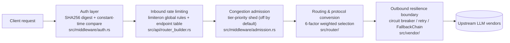

# Fluxweir Security Guide

[🤝 Contributing](./CONTRIBUTING.md) · [📜 Changelog](./CHANGELOG.md) · [📖 User Guide](./USER_GUIDE.md) · [🏗️ Architecture](./ARCHITECTURE.md) · [📖 README](../../README.md)

Fluxweir treats security as a core design goal. This document covers Fluxweir's security policy, vulnerability reporting process, built-in security mechanisms and known security boundaries.

## 📋 Table of Contents

- [Security model overview](#️-security-model-overview)
- [API key authentication design](#-api-key-authentication-design)
- [Upstream key isolation](#️-upstream-key-isolation)
- [Inbound rate limiting](#-inbound-rate-limiting)
- [Congestion admission](#-congestion-admission)
- [Outbound resilience boundary](#-outbound-resilience-boundary)
- [Information disclosure control](#️-information-disclosure-control)
- [CORS](#-cors)
- [Transport & deployment](#-transport--deployment)
- [Supply chain & CI gates](#-supply-chain--ci-gates)
- [Security review status](#-security-review-status)
- [Known security boundaries](#️-known-security-boundaries)
- [Vulnerability reporting process](#-vulnerability-reporting-process)
- [Subscription upstream compliance notice](#️-subscription-upstream-compliance-notice-subscription-vendor)

---

## 🛡️ Security model overview

A request entering Fluxweir passes through five defensive lines in order; any one of them can independently reject the request:

Responsibilities and failure semantics of each line:

| Line | Rejection | Failure semantics |
|:-----|:---------|:---------|
| Auth | 401 `authentication_error` | with auth off, everything is allowed (the `[auth]` section must be configured explicitly) |
| Inbound rate limiting | 429 + `Retry-After` | fail-open (allow) on internal limiter faults |
| Congestion admission | 429 + `Retry-After: 1` | off by default; when off, the decision is bypassed |
| Routing | 400 / 503 etc. (fixed error codes) | errors bubble up explicitly when no candidate is available |
| Outbound resilience | an Open breaker rejects directly and fails over | the original error bubbles up after candidates are exhausted |

Health-check paths carry independent whitelists on both the auth and rate-limit sides and are never unloaded.

There are also three optional security capabilities (feature-gated, not part of the default build surface): **netguard** (zero-dependency outbound SSRF triage, `netguard` feature / consumed by `web-search`), **outbound masking** (sensitive values in prompts replaced with deterministic placeholders and restored on the way back — vendors never store real values), and **OIDC short-lived credentials** (`oidc` feature; an external IdP issues in-process short-lived gateway keys, never persisted); plus the **key vault** (`vault` feature, included in `full` — upstream LLM keys persisted with AEAD encryption, with plaintext only at the input/use/assembly instants; see [Upstream key isolation](#️-upstream-key-isolation)).

---

## 🔑 API key authentication design

Auth lives in `src/middleware/auth.rs`; the core principles: **plaintext keys are never persisted, never retained in memory, and compared without timing side channels**.

### Digest storage

- `[auth].api_keys` in the configuration stores only **SHA256 hex digests** (64 lowercase hex characters), never plaintext; generate with `echo -n "your-api-key" | sha256sum`
- `ApiAuthState` keeps digests in a `HashSet<String>`; the programmatic `add_api_key` digests on arrival and discards the plaintext immediately
- Unit tests lock the algorithm and encoding with known plaintext/digest pairs

### Digest form and key entropy requirements (unsalted SHA-256)

Persisted digests are **unsalted SHA-256** (`sha256(key)`, shared by `[[auth.keys]].hash`, the accounting table's `token_usage.api_key_hash`, and the response-cache/affinity keys). Unsalted means a key's digest stays stable across restarts (correctness of accounting attribution and cache keys depends on it), at the price that digests are open to offline dictionary attacks: **the exposure grows with key entropy**. Therefore:

- API keys must be **high-entropy random strings** (≥128 bit, e.g. `openssl rand -base64 24`); low-entropy / enumerable keys are forbidden — a low-entropy key's SHA-256 can be cracked offline with precomputed tables after a database leak;
- unsalted digests of high-entropy keys are irreversible (precomputation is infeasible), giving security equivalent to salted forms;
- emergency handling for a database leak is the same as for a key leak: rotate all keys immediately (`POST /admin/config` hot update takes effect instantly).

### Constant-time comparison

On verification, the request key's SHA256 digest is computed on the spot and compared in constant time against the stored digest via `subtle::ConstantTimeEq` (`constant_time_eq`: candidate digests are zero-padded to max length and compared wholesale; the length check is folded into the comparison, with no early return), eliminating timing side channels. The caller digest is always 64 hex. Key tier lookup (`tier_for_key`) reuses the same constant-time comparison.

### Header extraction

| Order | Source | Notes |
|:-----|:-----|:-----|
| 1 | `Authorization: Bearer <key>` | primary channel (OpenAI / Anthropic compatible) |
| 2 | `x-api-key` | fallback channel |

### Hot reads and immediate effect

The auth middleware's State is `Arc<ConfigManager>`: **the `[auth]` section is read fresh from the hot config per request** to build the auth state. Key revocation, rotation and the `enabled` switch take effect immediately after `POST /admin/config` — there is no "update succeeded but the old key set lives until restart" silent staleness.

### Key tiers

The optional `[[auth.keys]]` sub-table declares key tiers (SHA256 digest → tier) as the priority basis for congestion admission:

| Tier | Meaning | Base weight |
|:-----|:-----|:--------:|
| `dedicated` | dedicated capacity | 1000 |
| `guaranteed` | guaranteed tier | 100 |
| `elastic` (default) | elastic tier | 1 |
| `spot` | cheap, preemptible tier | 0.1 |

Keys not declared in the `keys` table (including everything in `api_keys`) default to `elastic`.

### Deployment requirements

**An absent `[auth]` section means auth disabled** (with no such section in the config, `enabled=false` and all requests pass). Production deployments must configure `[auth]` explicitly. The auth-side whitelist has ten entries (`/health`, `/api/v1/health`, `/`, `/readyz`, `/metrics`, `/admin/subscription/callback` (the OAuth 302 callback, a bare GET), `/api-docs` and `/api-docs/*`, `/swagger-ui` and `/swagger-ui/*` — see the auth whitelist decision in `src/middleware/auth.rs`); all other **business routes** (including every `/admin/*`) require auth. `/healthz` and `/readyz` are listed in the whitelist but are actually mounted by sdforge **after** all middleware, bypassing Fluxweir's auth/rate-limit/timeout layers (auth-free and rate-limit-free; the whitelist entries are defense-in-depth redundancy — neither passes through this middleware); `/readyz` actually runs DB and cache probes per request, so internal-network exposure is recommended.

### Admin endpoint exposure and production isolation requirements (review M2)

`/admin/*` (config read/write, vendor governance, log/cost queries, route explain) shares a **single-layer key auth** with the data plane (the same `[auth]` digest table; no separate admin role system — an RBAC-style role system is out of scope for this change and would need its own project). This means: **any caller holding a data-plane key can read and write the admin plane**. New endpoints (`/admin/cost`, `/admin/route/explain`, `/admin/models` CRUD, `/admin/quota/ledger`, `/admin/vendor-budgets` etc.) widen the exposure; production deployments must compensate at the network/reverse-proxy layer:

- isolate `/admin/*` by path at the reverse proxy (nginx/traefik etc.): reachable only from the admin subnet/admin port, or add a separate admin-plane auth (mTLS / SSO / IP allowlist);
- or hand the admin-plane key only to operators/administrators while data-plane callers hold different keys — accepting the model boundary that "a data-plane key equals an admin-plane key" (this paragraph is the explicit statement of that boundary, not a hidden defect);
- the key filter parameter of `/admin/cost` passes plaintext via the request header `x-fluxweir-cost-key` (hashed server-side before comparison); **never** put the key in the URL query string (it would land in proxy/access logs, CWE-598).

---

## 🗝️ Upstream key isolation

Upstream vendors' API keys are fully isolated from the gateway's own auth keys:

- vendor keys are stored in configuration only as **environment variable names** (`[[vendors]].api_key_env`, e.g. `"OPENAI_API_KEY"`); the real key is injected at runtime via the environment and **never lands in the config file** (`VendorConfig` in `src/config/mod.rs`; multiple keys via `api_key_envs`)
- config snapshots and `GET /admin/config` responses contain only the variable names, never the keys themselves

---

## 🚦 Inbound rate limiting

Inbound rate limiting is built on limiteron's tower implementation (`src/api/router_builder.rs`) with two decision layers:

| Layer | Config consumed | Implementation | Bucketing |
|:---|:---------|:-----|:---------|
| Global rules | rules in `[[rate_limit.rules]]` without a `path` | tower global layer (`GlobalRateLimitLayer` + `QuotaLimiter` fixed window, one layer per rule) | bucketed by tenant (SHA256 digest of the verified API key); rules with `per_tenant = false` degrade to a rule-level shared bucket |
| Endpoint rules | rules in `[[rate_limit.rules]]` with a `path` prefix | middleware-side endpoint table (`ShardedSlidingWindowLimiter`, lazily created) | bucketed by tenant (SHA256 digest of the caller's API key), disableable via `per_tenant` |

Response semantics:

| Decision | Response |
|:-----|:-----|
| Endpoint rule / global rule exceeded | 429 + `Retry-After` (remaining seconds to window reset) |

> The legacy `Governor` path's header-less 429 and the `Decision::Banned → 403` ban branch were removed in the tower migration (rule bans are always `None`, so the branch is unreachable); with empty `rules`, the fallback is a shared `TokenBucket(100, 10/s)` (bit-identical to the old `Governor::new()` default).

Memory protection: endpoint-table entries have a hard cap (1024) — with `[auth]` off, an attacker forging arbitrary Bearer keys cannot create buckets endlessly; beyond the cap, new tenants degrade to the rule-level `__overflow__` shared single bucket.

Rate-limit exempt paths (rate-limit side, the ten entries of `is_quota_exempt_path`, independent of the auth side): `/health`, `/healthz`, `/ready`, `/api/v1/health`, `/readyz`, `/metrics`, `/api-docs` and `/api-docs/*`, `/swagger-ui` and `/swagger-ui/*`.

> Note: the `[rate_limit]` section is consumed at Router-construction time and is **restart-required** — updating it via `POST /admin/config` does not hot-apply.

---

## 🚪 Congestion admission

Congestion-aware priority admission lives in `src/middleware/admission.rs` and is **off by default** (`[admission].enabled` defaults to `false`; hot-read, enableable instantly via `POST /admin/config`).

How it works:

- congestion signal = gateway-side concurrency occupancy = Σ in_flight / Σ concurrency caps; congestion at `[admission].congestion_threshold` (default 0.9)
- under congestion, a new request's tier base weight is compared directly against the smallest tier currently in flight: **lower tiers get 429 + `Retry-After: 1` immediately** (no queueing); equal/higher tiers pass as usual (first-come-first-served within a tier)
- observability priority formula: `w_tier·(1+α_burst·b)⁻¹·(1+α_debt·d)⁻¹` (the SLO-gap dimension α_slo is reserved in configuration and currently never applies) — burst/debt feed only that diagnostic caliber, not the shed decision
- b / d are per-key EWMA of burst (arrival rate) / debt (shed frequency), recorded as `AtomicU64` fixed-point (×2¹⁶); the per-key table caps at 1024 entries, overflowing into a shared spill bucket
- per-tier in-flight counts release via the guard's `Drop` — even panic unwinding does not leak
- health checks are allowed at the head of the rate-limit whitelist and are **never unloaded**

Semantic positioning: a gateway-side approximate, coarse-grained shed-order control — no precise TTFT service-level promise.

---

## 🔄 Outbound resilience boundary

Upstream vendor calls are wrapped by three resilience layers (`src/vendor/`) to keep a single vendor's failure from becoming gateway-level unavailability or a retry storm.

### Circuit breaker

`limiteron::circuit` three-state machine (single production construction point `gate_circuit_config()`, see `src/vendor/manager.rs`):

| Parameter | Value | Meaning |
|:-----|:---|:-----|
| failure_threshold | 5 | 5 consecutive failures → Open |
| open duration | 30s | transitions to Half-Open on expiry |
| half-open probes | 3 | probe success restores Closed |
| slow-call criterion | 60s / 100% | the slow-call path can only trigger when 100% of calls in the window exceed 60s, so breaks are driven by real failures |

### Retry

The `[retry]` section (hot-read per request by workers):

- retryable status codes default to `[429, 500, 502, 503]`; 429 uses exponential backoff (honoring `Retry-After`), 5xx uses fixed intervals
- backoff carries jitter (`jitter` default 0.2) and synchronized-thundering spread (`spread_jitter` default 1.0, de-synchronizing multi-instance retries at the same instant)
- max retries within a single vendor default to 3

### Failover FallbackChain

- the chain is built from `[[vendors]].priority` (lower value = higher priority); failed vendors enter an exclusion set and routing retries
- the cross-vendor total attempt budget `max_total_attempts` **defaults to 8**, preventing "vendor count × retry count" explosion
- optional per-request retry time budget `retry_budget_secs` (default 0 = unlimited)
- three outbound timeout backstops: per-attempt `timeout_ms` (default 60s), streaming TTFT `stream_ttft_ms` (default 60s), streaming inter-chunk idle `stream_idle_ms` (default 30s) — a hung upstream cannot hold a concurrency permit indefinitely

---

## 🕵️ Information disclosure control

### Error responses

Error responses expose only **fixed `error.type` codes**, never internal enum structures or stacks (`src/error/mod.rs`):

| error.type | HTTP |
|:-----------|:-----|
| `config_error` | 500 |
| `protocol_error` | 502 |
| `vendor_unavailable` | 503 |
| `timeout` | 504 |
| `rate_limited` | 429 |
| `database_error` | 500 |
| `validation_error` | 400 |
| `routing_error` | 500 |
| `all_vendors_throttled` | 429 (with a `Retry-After` header) |

`error.message` follows the i18n localization track (Fluent, per locale); internal `Display` canonical strings go only to logs/error chains, never out of the gateway.

### Config snapshot masking

Before `POST /admin/config` applies an update, the old config snapshot is automatically persisted to `config-backups/` (timestamped, 10 kept, older ones auto-cleaned); `auth.api_keys` within is **masked automatically** via confers Redacted serialization (the key is already a digest; masking is belt-and-suspenders) — see `src/config/manager.rs` (`SnapshotManager`).

### Outbound log de-sensitization (secret gate)

Both log output paths are scanned by inklog's `SecretScanGate` before writing (built-in rule set covering six raw-secret value forms such as `sk-`-prefixed API keys, AWS AKIA, PEM private key blocks):

- **console path**: the inklog console sink mounts a masker containing the outbound gate (assembled in `bootstrap.rs`);
- **persistence path**: `async_logger` passes through the same gate before writing `request_logs` (the persistence pipeline with the largest sensitive surface).

Log content containing raw secrets (no key-name prefix — value forms the PII/key-name rules cannot cover) is masked as `***REDACTED***`-style markers before write-out/persistence; combined with the regular key-name PII masking (email/phone/card numbers/sensitive field names) this forms a two-layer defense. The rule set is provided by inklog's built-in `SecretPatternRegistry` under the `secret-scan` feature; Fluxweir does not maintain a second word list.

### Admin endpoints

`/admin/config` (GET/POST) and every other `/admin/*` route sit under the auth middleware and **require authentication**; the auth whitelist has ten explicit entries, plus the sdforge-plane `/healthz` and `/readyz` (mounted after all middleware, auth-free and rate-limit-free; internal-network exposure recommended).

---

## 🌐 CORS

The `[cors]` section is consumed once and baked in at service **construction time** (mounted while `src/server/http.rs` assembles the sdforge CORS layer); changing `[cors]` via `POST /admin/config` only reports restart-required, **changes need a restart**.

Security-relevant behavior:

- sdforge's construction validation requires origins to carry the `http(s)://` prefix and rejects empty lists
- the wildcard `"*"` is filtered; if filtering leaves nothing, **no CORS layer is mounted** (in gateway scenarios, cross-origin is the caller's concern)
- defaults `allow_credentials = false`, `max_age = 86400`

---

## 📦 Transport & deployment

| Item | Fact |
|:---|:-----|
| Database TLS | dbnexus compiles with the `runtime-tokio-rustls` feature (rustls stack) |
| Gateway TLS | TLS is not terminated by sdforge — the self-built axum listens in plaintext; **TLS is the external reverse proxy's responsibility** (a deployment responsibility) |
| Container runtime | minimal `alpine:3.24` image (main-repo support to 2028-06), multi-stage build; the artifact is musl-statically-linked and the app does not depend on OpenSSL (TLS stack is pure rustls; libssl3/libcrypto3 ship with the alpine base image and were removed from the explicit apk add list); the runtime stage re-verifies with `ldd` that all dependencies resolve |
| Non-root | dedicated user `appuser` (UID/GID 10001), no login shell; HOME=/home/appuser/.fluxweir (created and owned in the Dockerfile; the vault master-key file fallback path) |
| Data volume | `/app/data` (SQLite database), owned by appuser |
| Health check | Dockerfile `HEALTHCHECK` probes `/api/v1/health` (the registered path carries the sdforge version prefix) |

---

## 🔗 Supply chain & CI gates

`.github/workflows/ci.yml` automated gates:

| Gate | Command/action | When |
|:-----|:----------|:---------|
| Format check | `cargo fmt --all -- --check` | every push / PR |
| Static analysis | `cargo clippy --workspace --all-targets -- -D warnings` | every push / PR |
| Compile check | `cargo check --workspace` + non-default backend feature matrix (`cargo check -p fluxweir --no-default-features --features "full,db-postgres"` / `"full,db-mysql"`) | every push / PR |
| Dependency vulnerability scan | `cargo audit` (installed via `taiki-e/install-action`, run directly) | every push / PR + **daily schedule** (cron `37 5 * * *`) |
| Full tests | `cargo test --workspace` | every push / PR |

Feature caliber: default carries `full + db-sqlite`; the mutual exclusivity of the three db-* backend groups is enforced by dbnexus's compile-time guard (see [CONTRIBUTING](./CONTRIBUTING.md)), so `--all-features` opens all three and necessarily fails to compile — expected behavior; gates always run the default caliber, while non-default backends are checked per package by the feature matrix above (literally matching `ci.yml`).

Image building and Trivy scanning are not part of CI; see [USER_GUIDE · Docker Deployment](./USER_GUIDE.md#-docker-deployment) for local build commands. The image is now a pure-registry build (self-developed libraries come from crates.io, not sibling sources) and builds standalone; `docker/Dockerfile` has also dropped the sibling-clone and `SIBLING_PINS` mechanisms.

Toolchain baseline: the MSRV floor `rust-version = "1.97.1"` is declared in the root `Cargo.toml` (aligned with the 7 sibling libraries; cargo hard-rejects lower toolchains at dependency resolution), ci.yml installs the toolchain at that floor (`dtolnay/rust-toolchain@683b588c487a69d01f6c6ddf40f036ff682cc2c8 # v1`, see ci.yml) to fix the clippy lint set, and `docker/Dockerfile` uses the currently supported stable (1.99). Base images and Rust dependencies are tracked weekly by `.github/dependabot.yml` across the `cargo` / `github-actions` / `docker` ecosystems, so build artifacts trace to specific baseline versions.

### Supported version matrix

| Item | Range | Notes |
|:---|:-----|:-----|
| Source version | `main` HEAD (currently `0.1.2`; `v0.1.1` released) | include the commit SHA of your actual build in vulnerability reports |
| MSRV | `1.97.1` (`Cargo.toml` rust-version) | lower toolchains are rejected at dependency resolution |
| Docker build image | `rust:1.99-alpine3.24` | stable line, tracked by dependabot |
| Docker runtime image | `alpine:3.24` (support roughly to 2028-06, per alpine official) | artifact musl-statically-linked |

(Verification date 2026-11-14; external support periods per official pages.)

---

## ✅ Security review status

The project's self-review record (see [README · Security](../../README.md#-security)):

| Review item | Result |
|:-------|:-----|
| diting code review | ✅ 0 Critical / 0 High |
| tiangang SAST scan | ✅ 0 CRITICAL vulnerabilities |
| cargo-audit dependency audit | ✅ 0 vulnerabilities |

A self-review is not a third-party audit; report security issues via the vulnerability reporting process below.

---

## ⚠️ Known security boundaries

The current version's capability boundaries are declared honestly; deployers should assess risk accordingly:

| Boundary | Notes | Deployment advice |
|:-----|:-----|:---------|
| Cost aggregation is two-layered | persistence layer: the `token_usage` table persists four cost columns by `(vendor, model, api_key_hash, date, hour)` (`input_cost`/`output_cost`/`cache_read_cost`/`cache_creation_cost`, `src/database/pre_aggregator.rs`), queryable aggregated via `GET /admin/cost`, surviving restarts. in-memory layer: the in-process `CostTracker` (`by_vendor`/`by_model`, `src/utils/cost_tracker.rs`) accumulates in memory and restores from `token_usage` at startup per `[metrics].cost_restore_window_hours` (default 24h) (`restore_from_db`; skipped with a warning for in-memory DBs); per-request logs `request_logs.cost_usd` are persisted (five data-plane entries compute the four-tier sum × catalog prices; `None` without usage) | treat persisted `token_usage` + `GET /admin/cost` as the long-term source of cost truth; the in-process `CostTracker` is coarse observability within the restore window and should not be the only cost source |
| Request messages persisted in plaintext | the `request_logs.messages` column **stores request messages in plaintext** (including user conversation content; see `src/database/schema.sql`) | encrypt the disk yourself (e.g. LUKS / cloud volume encryption) and strictly control database file access permissions |
| Log search is a LIKE query | `GET /admin/logs/search` does keyword LIKE matching on `messages` / `error_message`; the query is parameter-bound (`Statement::from_sql_and_values`), so **no SQL injection**, but keyword matching widens the sensitive-content read surface | limit network exposure of `/admin/*` and hand auth keys only to trusted operators |

---

## 🐛 Vulnerability reporting process

We take security vulnerabilities very seriously. If you discover a security issue, please report it responsibly.

### How to report

**Do not open a public GitHub Issue for security vulnerabilities.**

| Method | Channel | Response time |
|:-----|:-----|:---------|
| **GitHub security advisory (recommended)** | [report privately via GH Advisory](https://github.com/Kirky-X/fluxweir/security/policy) | acknowledged within 48 hours |

### What to include

1. **Description**: a clear description of the vulnerability itself
2. **Reproduction steps**: detailed steps to reproduce the problem
3. **Impact assessment**: how the vulnerability might be exploited
4. **Affected versions**: which versions are affected
5. **Suggested fix** (optional): if you already have a potential fix in mind

### Our commitment

| Stage | Timeline | Action |
|:-----|:-------|:-----|
| **Acknowledgment** | within 48 hours | confirm receipt of the report |
| **Initial assessment** | within 7 days | complete severity rating |
| **Fix development** | depends on severity | implement the fix by priority |
| **Coordinated disclosure** | after the fix is available | publish the public announcement |

---

## ⚠️ Subscription upstream compliance notice (subscription-vendor)

The `subscription-vendor` feature allows OAuth subscription accounts (e.g. Claude Pro/Max) to serve as server-side outbound upstreams. **The capability is absent from every default build artifact**: the feature is excluded from `full` and `[subscription].enabled` defaults to `false` — both gates must be on for any behavior. Required reading before enabling:

- using subscription accounts as server-side outbound upstreams **may violate the vendor's terms of service** (public vendor policies restrict the subscription OAuth surface to their official clients); assess compliance for commercial deployments yourself — the risk is the operator's;
- this gateway implements only the standard OAuth authorization-code + PKCE flow and contains no circumvention techniques;
- the authorization callback is bound to a **single instance**: PKCE state lives in process memory and is not shared across replicas — the callback must reach the same instance;
- `subscription_refresh_fail_total` / `subscription_accounts_degraded` (`/admin/metrics`) expose account health.

---

## 📚 Related documents

| Document | Description |
|:-----|:-----|
| [🤝 Contributing](./CONTRIBUTING.md) | development environment and commit process |
| [📜 Changelog](./CHANGELOG.md) | security fixes recorded per release |
| [📖 User Guide](./USER_GUIDE.md) | secure configuration practices |
| [🏗️ Architecture](./ARCHITECTURE.md) | where the defense lines sit in the overall architecture |
