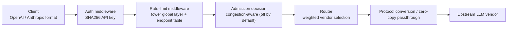
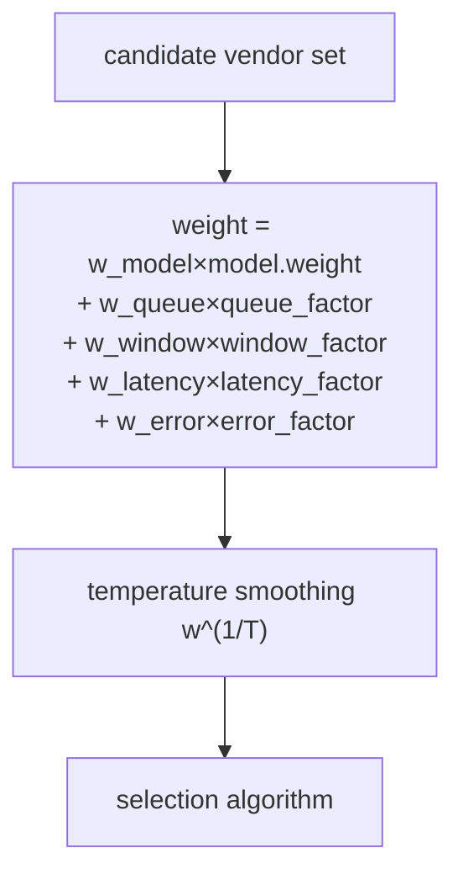
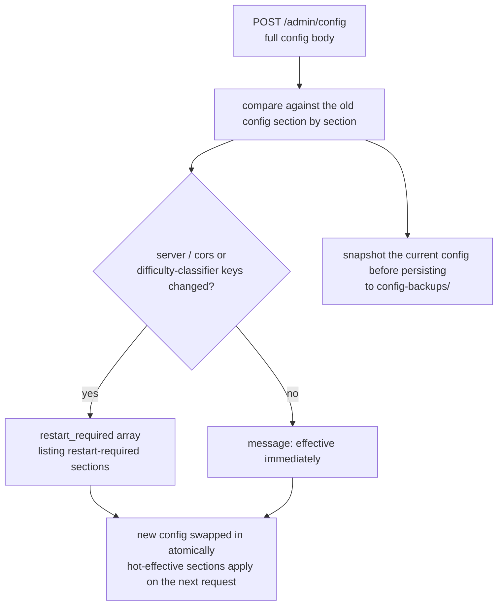
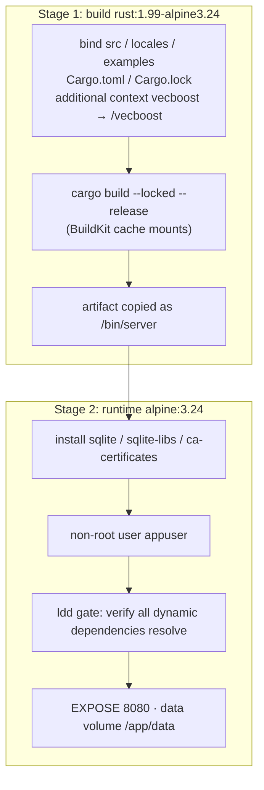

# Fluxweir User Guide

**Fluxweir** is an intelligent LLM routing proxy system: unified multi-vendor management, format conversion, smart scheduling. Built on Rust + Axum 0.8 + sdforge, it abstracts multiple upstream LLM vendors behind a single access point with weighted routing, rate limiting and circuit breaking, request logs, token statistics and other production-grade capabilities. This guide covers the complete operational path from build to deployment and operations.

> Related documents: [FAQ](./FAQ.md) · [API Reference](./API_REFERENCE.md) · [README](../../README.md)

## 📋 Table of Contents

- [Quick start](#-quick-start)
- [Auth configuration](#-auth-configuration)
- [Vendor and model configuration](#-vendor-and-model-configuration)
- [Routing tuning (routing)](#-routing-tuning-routing)
- [Responses API (responses)](#-responses-api-responses)
- [Gemini native endpoints (gemini)](#-gemini-native-endpoints-gemini)
- [Retry and resilience (retry · resilience)](#️-retry-and-resilience-retry--resilience)
- [Response cache (cache)](#-response-cache-cache)
- [Inbound rate limiting and admission (ratelimit · admission)](#-inbound-rate-limiting-and-admission-ratelimit--admission)
- [Pricing and cost (pricing)](#-pricing-and-cost-pricing)
- [Offline cost replay (cost-replay)](#-offline-cost-replay-cost-replay)
- [Subscription-account upstreams (subscription)](#-subscription-account-upstreams-subscription)
- [Config hot-reload operations guide](#-config-hot-reload-operations-guide)
- [Docker deployment](#-docker-deployment)
- [Operations manual](#-operations-manual)
- [gRPC server (grpc)](#-grpc-server-grpc)
- [Rust SDK overview](#-rust-sdk-overview)
- [Further reading](#-further-reading)

---

## 🚀 Quick start

### Requirements

| Item     | Requirement                     | Notes                                                                                                                                                                                           |
| :------- | :---------------------- | :---------------------------------------------------------------------------------------------------------------------------------------------------------------------------------------------- |
| Rust     | 1.97.1+ (MSRV)         | the floor is declared by `rust-version` in the root `Cargo.toml` (aligned with the 7 sibling libraries); `.github/workflows/ci.yml` runs build/clippy at MSRV (`RUST_VERSION: '1.97'`), and `docker/Dockerfile` uses the currently supported stable (1.99) |
| Self-developed libraries   | 7, fetched automatically by cargo | `confers` / `dbnexus` / `inklog` / `limiteron` / `oxcache` / `sdforge` / `trait-kit` (crates.io registry versions declared in the root `Cargo.toml`, checksums locked in `Cargo.lock`; no sibling directories needed)                   |
| Upstream keys | injected per vendor as environment variables      | the environment variables named by each `[[vendors]]` entry's `api_key_env` (e.g. `OPENAI_API_KEY`)                                                                                                                     |

### Build and start

```bash
# Runtime config is config.toml — not committed (deployment-private material stays local); start with cp config.example.toml config.toml
cp config.example.toml config.toml

# Reads config.toml from the current directory by default
cargo run --release

# Or specify a config file path (first CLI argument)
cargo run --release -- /path/to/config.toml
```

The config path argument is parsed in `src/main.rs` (`std::env::args().nth(1)`, default `config.toml`). The server listens on `0.0.0.0:8080` by default (the `[server]` section default, see `src/config/mod.rs`). **`config.example.toml` is the annotated full in-repo reference**: every section and field of the `Config` struct is there with its default and hot-reload availability noted (optional sections such as `[[model_catalog]]` are given as comment templates to uncomment as needed); except for entries marked "demo value (non-default)", explicit values match the serde defaults (copying yields default behavior); `config.toml` itself is not committed (listed in `.gitignore`) and a clean checkout must copy it itself. New config fields must update that file and `tests/config/config_toml_example_test.rs` in sync.

### Verify the service

```bash
curl http://127.0.0.1:8080/api/v1/health
```

> ⚠️ **Note**: the registered health-check path is **`/api/v1/health`** — the `#[forge(version = "v1")]` macro in `src/api/health.rs` automatically prepends the `/api/v1` version prefix to `path = "/health"`. The bare `/health` has no registered route (a direct hit returns 404); it only appears in the auth and rate-limit allow whitelists.

Normal response:

```json
{ "status": "ok", "version": "0.1.0", "timestamp": "..." }
```

Data-plane endpoint availability (auth required; the model list is always computed live, never cached):

```bash
curl http://127.0.0.1:8080/v1/models -H "Authorization: Bearer $API_KEY"
```

### The full path of one request



---

## 🔐 Auth configuration

### Key storage form

API keys are stored as **SHA256 hex digests**; plaintext keys never touch disk or memory. Generate a digest:

```bash
echo -n "your-key" | sha256sum
```

At auth time the request's key is digested on the spot and compared in constant time (`src/middleware/auth.rs`).

### The [auth] section

| Field           | Default                                         | Notes                                                                                          |
| :-------------- | :--------------------------------------------- | :-------------------------------------------------------------------------------------------- |
| `enabled`       | `true` (when the section exists)                             | auth switch; **a missing `[auth]` section entirely = auth disabled** (`auth: Option<AuthSection>`, `None` allows everything) |
| `api_keys`      | empty                                             | list of SHA256 hex digests of valid keys                                                               |
| `[[auth.keys]]` | empty                                             | key tier table (works with `[admission]` congestion admission)                                                     |
| `[auth.header]` | `name = "Authorization"` / `prefix = "Bearer"` | reserved section structure, preventing the section from being wiped on hot-reload write-back                                                                  |

### [[auth.keys]] tiers

| Field   | Notes                                                                |
| :----- | :------------------------------------------------------------------ |
| `hash` | the key's SHA256 hex digest (same form as `api_keys`)                      |
| `tier` | `dedicated` / `guaranteed` / `elastic` / `spot`, **default `elastic`** |

Keys not declared in `keys` (including everything in the `api_keys` list) always land in the `elastic` tier. Tiers participate in priority decisions only when `[admission]` congestion admission is on (see [Inbound rate limiting and admission](#-inbound-rate-limiting-and-admission-ratelimit--admission)).

```toml
[auth]
enabled = true
api_keys = ["<sha256-hex-of-your-key>"]

[[auth.keys]]
hash = "<sha256-hex>"
tier = "dedicated"
```

### OIDC exchange for short-lived gateway keys `[auth.oidc_rules]` (`oidc` feature)

Exchange an OIDC ID Token for a gateway short-lived key: a Bearer JWT matching a rule → JWKS signature verification by kid (RS256/ES256, cache TTL 10 minutes, on failure keep the old cache up to 24h) → an in-process TTL short-lived key derived from `sub`+`issuer` (default 1h, cap 86400s; **in-memory table, never persisted, lost on restart**), inheriting the bound parent key's tier and all restrictions. **No rules by default = entirely off**, with the auth middleware byte-for-byte unchanged; deleting/disabling the parent key invalidates the rule.

```toml
[auth.oidc_rules.rules]         # each rule = issuer+audience+claims exact match + bound parent key
issuer = "https://token.actions.githubusercontent.com"
audience = "my-gateway-client"
claims = { repository = "org/repo", ref = "refs/heads/main" }   # exact match; wildcards/prefixes forbidden (hard-rejected at validation)
bind_key_hash = "<64-char hex, must exist in api_keys>"
# ttl_secs = 3600               # short-lived key TTL (default 3600, cap 86400)
```

**Security red line**: claims support **exact matching only** — any key/value containing `*` or `?` is rejected at load (wildcards would let any issuer's token exchange for the parent key). `issuer` is https-only (loopback may use http). The feature is not in `full` (adds outbound JWKS fetching; opt-in: `--features oidc`).

### Request headers and hot reads

- Clients send **`Authorization: Bearer <key>`** (preferred) or **`x-api-key: <key>`** (fallback); extraction logic in `src/utils/tenant.rs` (`auth.rs` only re-exports).
- Auth state is **read fresh from the hot config per request**: revoking / rotating keys or toggling `enabled` takes effect immediately after `POST /admin/config`, no restart needed.
- Auth-exempt paths (`/health`, `/api/v1/health`, `/`, `/readyz`, `/metrics`, `/admin/subscription/callback`, `/api-docs` and `/api-docs/*`, `/swagger-ui` and `/swagger-ui/*` — see the auth whitelist decision in `src/middleware/auth.rs`) need no key; `/healthz` and `/readyz` are additionally mounted by sdforge after the auth layer, **auth-free and rate-limit-free** (a keyless request returns 200 in practice); `/ready` is unregistered (404).

---

## 🏭 Vendor and model configuration

### All [[vendors]] fields

| Field             | Type   | Default                   | Notes                                                                                                                                                                                                                                    |
| :--------------- | :----- | :------- | :-------------------------------------------------------------------------------------------------------------------------------------------------------------------------------------------------------------------------------------- |
| `id`             | String | required                     | unique vendor identifier; **must not be blank**; **deduplicated across entries** (ASCII case-insensitive) — duplicates fail config load (`src/config/loader.rs`)                                                                                                               |
| `name`           | String | required                     | display name                                                                                                                                                                                                                                  |
| `type_`          | String | required (TOML key `type`) | protocol direction: `"anthropic"` uses the Anthropic surface, `"gemini"` the Gemini native surface (`/v1beta/models/{model}:{action}` + `x-goog-api-key`), `"rerank"` the rerank surface; other values are treated as OpenAI-compatible (the code does not validate values; unknown types fall back to ollama's conservative capability tier) |
| `api_key_env`    | String | required                     | environment variable name holding the upstream key                                                                                                                                                                                                                |
| `api_key_envs`   | array   | empty                       | extra environment variable names for the multi-key pool (merged and deduplicated with `api_key_env`, this list first; missing env names are skipped with a warning; pool cap in `key_pool::MAX_KEY_POOL`)                                                                                                              |
| `extra_headers`  | table     | empty                       | custom outbound headers (static values, hot-effective; conflicting with headers the gateway already sets are skipped with a warn)                                                                                                                                                                         |
| `api_base`       | String | `""`                     | upstream API base URL                                                                                                                                                                                                                         |
| `api_style`      | String | default (`chat`)           | endpoint style: `chat` (`chat/completions`) or `responses` (OpenAI Responses `/responses`, legal only with `type_ = "openai"`); mutually exclusive with `chat_path`                                                                                                  |
| `enabled`        | bool   | `true`                   | vendor switch                                                                                                                                                                                                                                |
| `priority`       | u8     | `1`                      | fallback priority, **lower value = higher priority** (1 = primary)                                                                                                                                                                                  |
| `models`         | array   | empty                       | model list, see below                                                                                                                                                                                                                          |
| `rate_limit`     | table     | required                     | vendor-level quota, three forms, see below                                                                                                                                                                                                                |
| `concurrency`    | table     | see below                     | concurrency control                                                                                                                                                                                                                                |
| `timeout_ms`     | u64    | `60000`                  | outbound per-attempt total timeout (ms), `0` = unlimited                                                                                                                                                                                                |
| `stream_ttft_ms` | u64    | `60000`                  | streaming first-packet (response header) timeout (ms), `0` = unlimited                                                                                                                                                                                            |
| `stream_idle_ms` | u64    | `30000`                  | streaming inter-chunk idle timeout (ms), `0` = unlimited                                                                                                                                                                                       |
| `cache_ttl_secs` | u64    | `300`                    | upstream prefix-cache lifetime (seconds, legal range 1–86400): when `[routing.affinity] mode = "auto"` decides sticking is worth it, this is the stickiness TTL; for 1h cache deployments set `3600`                                                                                                     |
| `silent_cache`   | bool   | `false`                  | silent-cache vendor flag: for upstreams whose usage reports no cache columns (OpenAI prefix cache, Gemini implicit cache) set `true`, so auto mode counts `prompt_tokens` as written tokens into cache worth — otherwise such vendors' worth is always 0 and they never stick                                                             |
| `supports_batch` | bool   | `false`                  | batch endpoint support flag (a filter flag for `X-Batch: 1` routing)                                                                                                                                                                                        |
| `chat_path`      | none     | default follows legacy rules           | skips the `/v1` auto-prefix rules and uses this path directly (None/default follows legacy composition; ambiguous with `api_style` path semantics → load rejected)                                                                                                                                         |
| `anthropic_version` | none  | default → `"2023-06-01"`    | Anthropic surface version-header override; defaults to the built-in value                                                                                                                                                                                            |
| `forward_beta_headers` | bool | `false`              | forward client beta headers upstream (off by default)                                                                                                                                                                                                   |
| `send_nonstandard_params` | bool | `false`            | send non-standard params upstream verbatim (passthrough paths never touch the request body; only conversion paths consume this switch)                                                                                                                                                                      |

Config definitions in `src/config/mod.rs` (`VendorConfig`).

### models sub-entries

| Field           | Default | Notes                                                                                                                                                                                                          |
| :------------- | :----- | :------------------------------------------------------------------------------------------------------------------------------------------------------------------------------------------------------------ |
| `model_id`     | required   | the upstream's real model name (dedup-validated within a vendor, ASCII case-insensitive; must not be blank)                                                                                                                                     |
| `abstract_id`  | none     | abstract model name (the routing logical identifier; multiple vendors may map to one abstract name; clients request by it and `GET /v1/models` also lists it — once declared, the bare `model_id` is no longer a request name, though the qualified `vendor.model_id` form still routes; ID matching is case-insensitive; must not be blank once declared) |
| `weight`       | `1.0`  | routing weight (usually 0.0–2.0)                                                                                                                                                                                      |
| `enabled`      | `true` | model switch                                                                                                                                                                                                      |
| `dimensions`   | none     | embedding vector dimensions (declaring this field = an embedding entry). Used only for consistency validation within the same `compat_group` and as the response-dimension gate baseline; does not affect routing selection                                                                                                 |
| `compat_group` | none     | embedding compatibility group name (declaring any embedding field = an embedding entry). Same-group entries = the same vector space, allowed to migrate within the group on failure; undeclared = singleton group (not interchangeable with other vendors)                                                                                 |
| `model_type`   | none     | closed task-type set: `chat` / `embedding` / `rerank` (same shape as `api_style`, historical strict-lowercase `matches!` caliber; routing for `type_ = "rerank"` vendors depends on this declaration)                                                                    |

#### Embedding compatibility-group routing (`POST /v1/embeddings`)

Embedding requests do not participate in chat's multi-vendor weighted rotation: the first request's weighted selection "pins" a vendor (in-process pin, remembered per abstract model, first writer wins) and later requests always go to the same group's vendor. Without `compat_group`, the group = single vendor (**safe default**: failures error explicitly instead of silently switching to a vendor whose vector space may differ). Declaring the same `compat_group` promises the gateway "same group, same model, same dimensions, interchangeable vectors" and enables automatic in-group migration on failure.

Three config validations (shared by load and hot reload; violations rejected): `model_id` must be identical within a group (case-insensitive), declared `dimensions` must be equal within a group, and group names must not span `abstract_id`s. Two runtime gates: when all pinned-group vendors are unavailable → explicit error (with recovery guidance); a response dimension from the same (vendor, model) inconsistent with the first-seen baseline → intercepted with 502 (guarding against upstreams silently swapping models).

The pin can be reset via `POST /admin/embedding-pins/{abstract_id}/reset`; a successful config hot reload resets all pins automatically. **Behavior change**: existing "same-name embedding model across multiple vendors" configs change from "per-request random sharing" to "pinned to one vendor"; declare a same-name `compat_group` to share across vendors.

### The three rate_limit forms (tagged enum, key `type`)

| Form          | Fields                                                                 | Notes                                                                             |
| :------------ | :------------------------------------------------------------------- | :------------------------------------------------------------------------------- |
| `time_window` | `start` / `end`                                                      | allow during a fixed time span                                                                   |
| `interval`    | `hours`, `sliding` (default `false`)                                   | one window per N hours; `sliding = true` switches to a sliding window (removing the fixed window's boundary double-spend) |
| `token`       | `max_tokens`, `window_hours` (default `24`), `sliding` (default `false`) | token quota window                                                                   |

### concurrency sub-fields

| Field                      | Default       | Notes                                                      |
| :------------------------ | :----------- | :-------------------------------------------------------- |
| `requests_per_second`     | `1`          | outbound token-bucket rate                                            |
| `max_concurrent_requests` | none (`None`) | max concurrent in-flight (incl. streaming); default uses the queue capacity (100)           |
| `token_weighted`          | `false`      | token-weighted concurrency ticket switch (agentic long sessions hold tickets by estimated tokens) |
| `token_ticket_min`        | `1`          | per-request ticket floor                                            |
| `token_ticket_max`        | `16384`      | per-request ticket cap (escape valve)                                  |
| `token_ticket_default`    | `4096`       | billing fallback when the request declares no `max_tokens`                      |

> ⚠️ `concurrency` is consumed when vendor instances are constructed — a **restart-required** section (see [Config hot-reload operations guide](#-config-hot-reload-operations-guide)).

### The [global_model] global model

The global pool is the routing target for `model = "auto"` (tried only when both abstract and direct routing miss). Pool members = all enabled models of enabled vendors, selected by candidate weighted scoring.

| Field       | Default       | Notes                                                                                                                                                                                                                    |
| :--------- | :----------- | :---------------------------------------------------------------------------------------------------------------------------------------------------------------------------------------------------------------------- |
| `enabled`  | `true`       | auto-tier switch (hot-read per request). When `false`, `model = "auto"` is rejected with `validation_error` (400) and the global pool is excluded from routing; explicit model names and `X-Vendor`/`X-Model` hints (both explicit) are unaffected. Missing `[global_model]` section = enabled (historical fallback) |
| `strategy` | `"weighted"` | global-pool strategy tier declaration; routing is currently decided uniformly by `[routing]` (weighting / `selection` tiers) — the field has no independent consumer for now, kept for tier semantics                                                                                                         |

> ⚠️ The `global_model` section's **file-side hot reload is rejected by the structural gate** (editing `config.toml` directly does not take effect; the old snapshot keeps serving — restart required); `POST /admin/config` writes take effect on the next request after the in-memory swap (`enabled` is hot-read per request via `ConfigManager::is_global_model_enabled`, consumed at routing decision), but the response carries the conservative `restart_required` hint. Note also that `POST /admin/models/global` is model-catalog routing (updating the `[[model_catalog]]` global-policy entry, hot-effective) — a different thing from this section.

---

## 🎯 Routing tuning (routing)

### Weight formula



The default three-dimension coefficients `0.4 / 0.3 / 0.3` are bit-identical with historical behavior; `w_latency` / `w_error` default to `0` (off) and apply only when enabled explicitly. Definitions in `src/config/mod.rs` (`RoutingSection`), consumption in `src/router/router.rs`.

### [routing] fields and defaults

| Field                         | Default                                                                                                                                                                   | Notes                                                                                                                                                                                                                                                                                                                                                                                                                                                |
| :--------------------------- | :----------------------------------------------------------------------------------------------------------------------------------------------------------------------- | :-------------------------------------------------------------------------------------------------------------------------------------------------------------------------------------------------------------------------------------------------------------------------------------------------------------------------------------------------------------------------------------------------------------------------------------------------- |
| `rerank_score_normalization` | `"none"`                                                                                                                                                                 | rerank score normalization: `none` (passthrough) / `sigmoid` / `minmax`; affects only `/v1/rerank` response scores, not ordering or index                                                                                                                                                                                                                                                                                                                                          |
| `w_model`                    | `0.4`                                                                                                                                                                    | configured-weight dimension coefficient                                                                                                                                                                                                                                                                                                                                                                                                                                      |
| `w_queue`                    | `0.3`                                                                                                                                                                    | load dimension coefficient (input decided by `load_signal`)                                                                                                                                                                                                                                                                                                                                                                                                             |
| `w_window`                   | `0.3`                                                                                                                                                                    | token budget / window dimension coefficient                                                                                                                                                                                                                                                                                                                                                                                                                             |
| `w_latency`                  | `0.0`                                                                                                                                                                    | EWMA latency factor coefficient (`0` = off)                                                                                                                                                                                                                                                                                                                                                                                                                     |
| `w_error`                    | `0.0`                                                                                                                                                                    | EWMA error-rate factor coefficient (`0` = off)                                                                                                                                                                                                                                                                                                                                                                                                                   |
| `price_factor_enabled`       | `true`                                                                                                                                                                   | price factor switch: when on, each candidate in the eligible set is multiplied by "lowest unit price / this candidate's unit price" (weight ×= min_p/p, demoting expensive candidates); on by default                                                                                                                                                                                                                                                                                                                          |
| `price_factor_mode`          | `"nominal"`                                                                                                                                                              | price-factor unit-price caliber: `nominal` ((input+output)/2, matching history) / `cache_expected` (entries with `cache_read_price > 0` use (cache_read+output)/2, expressing cache-friendly preference together with prefix affinity); unknown values fall back to `nominal`                                                                                                                                                                                                                                                          |
| `latency_ref_ms`             | `1000.0`                                                                                                                                                                 | latency factor reference: a vendor EWMA equal to this yields factor 0.5                                                                                                                                                                                                                                                                                                                                                                                                        |
| `temperature`                | `1.0`                                                                                                                                                                    | temperature smoothing exponent; `>1` flattens gaps, `<1` amplifies them, must be `>0`                                                                                                                                                                                                                                                                                                                                                                                               |
| `selection`                  | `"weighted"`                                                                                                                                                             | selection algorithm: `weighted` (roulette) / `power_of_two` (Po2C experiment) / `linucb` (bandit tier; falls back to weighted when unwired); unknown values fall back to `weighted`                                                                                                                                                                                                                                                                                                                      |
| `load_signal`                | `"queue"`                                                                                                                                                                | load-dimension input tier: `queue` (queue depth) / `in_flight` (in-flight requests) / `in_flight_relative` (relative in-flight); single choice, no stacking; unknown values fall back to `queue`                                                                                                                                                                                                                                                                                                                      |
| `ewma_tau_ms`                | `10000`                                                                                                                                                                  | Peak-EWMA time constant τ (ms)                                                                                                                                                                                                                                                                                                                                                                                                                        |
| `latency_buffer`             | `0.0`                                                                                                                                                                    | min+buffer candidate-set buffer (`>0` first takes the set with EWMA ≤ min×(1+buffer), then picks uniformly); `0` = off                                                                                                                                                                                                                                                                                                                                                            |
| `allow_request_weight`       | `false`                                                                                                                                                                  | `X-Weight` request-level weight switch (header ignored by default)                                                                                                                                                                                                                                                                                                                                                                                                           |
| `fail_open_when_all_cooling` | `false`                                                                                                                                                                  | when all candidates are cooling, fall back to the candidate set of "ignoring state but enabled" (deliberately risky; recommended only for deployments with fallback capacity)                                                                                                                                                                                                                                                                                                                                                              |
| `retry_after_hint`           | `false`                                                                                                                                                                  | when failover is exhausted and all reasons are Throttled, return `429 + Retry-After` header                                                                                                                                                                                                                                                                                                                                                                                        |
| `affinity_mode`              | `"hard"`                                                                                                                                                                 | session affinity: `hard` (a hit is binding) / `soft` (a hit softens into a weight multiplier); unknown values fall back to `hard`                                                                                                                                                                                                                                                                                                                                                                       |
| `affinity_boost_factor`      | `1.0`                                                                                                                                                                    | soft-mode hit weight-multiplier base (weight ×(1+value))                                                                                                                                                                                                                                                                                                                                                                                                         |
| `affinity_tenant_scoped`     | `false`                                                                                                                                                                  | tenant isolation of the affinity key (`affinity:{api_key_hash}:{session_key}`, preventing cross-tenant hijacking)                                                                                                                                                                                                                                                                                                                                                                             |
| `sla_v`                      | `0.0`                                                                                                                                                                    | SLA/satisfaction virtual-queue scoring strength (`0` = off)                                                                                                                                                                                                                                                                                                                                                                                                            |
| `sla_alpha`                  | `0.95`                                                                                                                                                                   | target service level α ([0,1])                                                                                                                                                                                                                                                                                                                                                                                                                             |
| `lps_delta`                  | `0.0`                                                                                                                                                                    | LPS queueing-latency lookahead soft-constraint strength (`0` = off)                                                                                                                                                                                                                                                                                                                                                                                                          |
| `lps_deadline_gate`          | `false`                                                                                                                                                                  | LPS hard-constraint gating (filters the feasible set by the `x-deadline-ms` header)                                                                                                                                                                                                                                                                                                                                                                                                     |
| `default_deadline_ms`        | `10000.0`                                                                                                                                                                | default deadline when no deadline header is present (ms)                                                                                                                                                                                                                                                                                                                                                                                                              |
| `ucb_alpha`                  | `1.0`                                                                                                                                                                    | LinUCB exploration parameter (consulted only with `selection = "linucb"`)                                                                                                                                                                                                                                                                                                                                                                                               |
| `prefix_affinity`            | sub-section `[routing.prefix_affinity]`: `enabled = false`, `prefix_chars = 512`                                                                                                | prefix-affinity PoTC (off by default): once on, a stable prefix hash yields 2 in-band candidates, best picked by smoothed weight; `prefix_chars` is the number of leading characters of the first user content used for the prefix key                                                                                                                                                                                                                                                                                                               |
| `affinity`                   | sub-section `[routing.affinity]`: `mode = "legacy"`, `cache_worth_tokens = 1024`, `turn_gap_secs = 120`                                                                         | cache-economy affinity (default legacy = bit-identical current behavior): `legacy` sticks for 1h on success; `auto` decides by response-cache worth (`worth = cache_read + cache_creation + (prompt_tokens when vendor silent_cache) ≥ cache_worth_tokens` to stick, TTL from that vendor's `cache_ttl_secs`; below threshold, neither write nor delete existing records); `turn` sticks consecutive in-session requests for `turn_gap_secs`; `off` writes nothing + short-circuits lookups (existing bindings stop applying immediately, and are not deleted). Only auto/turn persist to the `affinity_sticks` table and restore at startup (unexpired top 512) |
| `difficulty`                 | sub-section `[routing.difficulty]`: `enabled = false` fully bypassed (other defaults `w_clf = 0.6`, `w_rule = 0.4`, `score_low = 0.35`, `score_high = 0.65`, `mid_band_policy = "strong"`) | difficulty tiering (off by default): requests matching `groups` are scored by rules, fused with classifier probabilities into low/mid/high tiers, rewriting the target abstract model name; `w_clf > 0` requires the `difficulty-classifier` feature; the `lexicon` sub-section can override the hard/easy word lists, math symbols, question marks and code-fence markers wholesale (default = built-ins), the `scoring` sub-section holds rule-scoring weights/caps (default = historical constants); the `classifier` sub-section holds vecboost laya runtime parameters                                                                                                |

### Session affinity

- Clients declare the session key via the **`X-Session-Id`** header; when missing, the fallback is truncated hex of `sha256(first 2KB of serialized messages[0])` (`src/api/routing_hints.rs`).
- **Session header aliases** (`[routing.affinity].session_headers`, default `["x-session-id"]`): the **first present, non-empty** header in order becomes the affinity key source, byte cap carried over — accommodating agents' native session headers (e.g. `x-conversation-id`):

  ```toml
  [routing.affinity]
  session_headers = ["x-session-id", "x-conversation-id"]
  ```

  Elements are lowercased at load; when all are missing, the messages-prefix hash fallback applies (zero-config behavior identical to today).
- With `affinity_mode = "hard"` (default), a hit makes the bound vendor mandatory; with `"soft"`, the hit vendor's weight is multiplied by `(1 + affinity_boost_factor)` and competes with other candidates as usual.
- Cache-economy affinity (`[routing.affinity]`, default `legacy` = zero regression): `auto` decides at response-usage settlement whether sticking is worth it — handing the problem of "sticking sessions that only wrote 200 cache tokens to a suboptimal vendor for 1h" to the cache-worth threshold (default 1024 tokens, aligned with magpie measurements); `turn` approximates the tool-result feedback window with `turn_gap_secs` (default 120s). Silent-cache vendors (OpenAI prefix cache / Gemini implicit cache; usage reports no cache columns) set `silent_cache = true` so `prompt_tokens` counts as written tokens into cache worth; align TTL with the upstream cache deployment via `cache_ttl_secs` (default 300s; 1h cache deployments set 3600).
- **TTL is set only by the writer; the read path does not renew** (`auto`/`turn`): after settle writes that vendor's `cache_ttl_secs` (or `turn_gap_secs`), later routing hits do not extend it — once the upstream cache expires, the session can naturally return to the routing pool, which is exactly the point of `auto`. `legacy` keeps the historical semantics (table-level 1h, renewed on hit). Settlements below the threshold (`worth < cache_worth_tokens`) neither write nor delete: existing records expire per their own write-time TTL.
- First-binding convergence applies only to `legacy` + `affinity_tenant_scoped = true` (concurrent first requests converge to a unique winner via SETNX; later settles do not overwrite); `auto`/`turn` treat each settlement as a fresh stickiness judgment — the later overwrites the earlier.
- The write-side mode gate also covers `/v1/rerank`: that endpoint has no usage semantics; write-back shares the source with chat's legacy path (`bind_session_affinity`) — `off` writes nothing, and `auto`/`turn` write nothing either (no unconditional 1h set is introduced).
- `off` is the stop-loss valve: no writes and lookups short-circuit — existing bindings stop applying immediately (and are not deleted; switch back to the original mode to restore).
- In auto/turn modes, sticky write-behind persists to the `affinity_sticks` table; on restart the unexpired top 512 restore by remaining TTL.

### Named presets

Three out-of-the-box coefficient sets (`RoutingSection::preset`):

| Preset      | w_model | w_queue | w_window | Notes                                             |
| :-------- | :-----: | :-----: | :------: | :----------------------------------------------- |
| `quality` |   0.7   |   0.2   |   0.1    | leans on configured model weights                                   |
| `latency` |   0.2   |   0.2   |   0.2    | additionally enables `w_latency = 0.4`, `latency_ref_ms = 500` |
| `cost`    |   0.2   |   0.2   |   0.6    | leans on window budgets (token balance ≈ cost-budget proxy)          |

---

## ♊ Gemini native endpoints (gemini)

A `type_ = "gemini"` vendor can both take traffic from the gateway's other entries (`/v1/chat/completions`, `/v1/messages`, `/v1/responses`) and serve Gemini native inbound endpoints (Google's official SDK can point its base URL straight at the gateway root).

### Vendor configuration

```toml
[[vendors]]
id = "google"
name = "Google Gemini"
type_ = "gemini"
api_base = "https://generativelanguage.googleapis.com"   # optional (default is the official host)
api_key_env = "GEMINI_API_KEY"                           # pragma: allowlist secret (example env var name); sent upstream as x-goog-api-key
rate_limit = { type = "time_window", start = "00:00", end = "24:00" }
concurrency = { requests_per_second = 20 }

[[vendors.models]]
model_id = "gemini-2.5-pro"
abstract_id = "gemini-pro"
enabled = true
weight = 1.0
```

`type_ = "gemini"` does not allow `chat_path` (endpoints composed dynamically from model + action), and `api_style` allows only default or `chat`. Health probes: the `free` strategy GETs `models`; `minimal_call` sends a 1-token `generateContent`.

### Inbound endpoints

| Endpoint                                                | Notes                       |
| --------------------------------------------------- | -------------------------- |
| `POST /v1beta/models/{model}:generateContent`       | non-streaming conversation                 |
| `POST /v1beta/models/{model}:streamGenerateContent` | streaming SSE (no `[DONE]`)    |
| `POST /v1beta/models/{model}:countTokens`           | local estimation                   |
| `POST /v1beta/models/{model}:embedContent`          | single embedding (converted to OpenAI shape) |
| `POST /v1beta/models/{model}:batchEmbedContents`    | batch embeddings                   |
| `GET /v1beta/models` / `GET /v1beta/models/{model}` | model list / details              |

Auth: the Google SDK sends `x-goog-api-key` by default; the gateway also accepts `?key=` on `/v1beta/` paths (recommended only when the SDK cannot customize headers, and ensure the reverse proxy does not log the query string).

### Routing and passthrough

- By default converts to the unified chat IR and can hit any vendor (OpenAI/Anthropic/Responses/Gemini included), enjoying weighting / affinity / difficulty / circuit breaking / quotas.
- `safetySettings`, `cachedContent` and built-in tools (`googleSearch` etc.) cannot be equivalently downgraded → route only to `type_ = "gemini"` vendors with the body passed through verbatim; no candidate → 400 with a config-remediation hint.
- Thought summaries: `thinkingConfig.includeThoughts` enters the IR as a request-level switch, effective only on Gemini outbound; other vendors ignore it.
- `generationConfig.responseSchema` supports inlining OpenAI JSON Schema `$defs/$ref` (depth cap 32; cyclic references rejected).

### Limitations

- No Gemini-native embeddings outbound (`/v1/embeddings` still routes only OpenAI-type vendors; Gemini embeddings can go through their OpenAI-compatible endpoint).
- Live API, Files API, cachedContents CRUD and the Batches API are not supported.
- Plain http(s) image URLs pass through as `fileData.fileUri`; upstreams accept only Files API / `gs://` URIs — the gateway does no server-side fetching.

---

## 📝 Responses API (responses)

`POST /v1/responses` accepts the OpenAI Responses format (`input` string or item array, `instructions`, flat function tools, `text.format` structured output), converts to the unified chat IR by default and enters the existing routing pool (OpenAI chat / Anthropic messages vendors can all be hit); `stream: true` returns semantic SSE events (`response.created` → `response.output_text.delta` → `response.completed`).

### [responses] fields and defaults

| Field                  | Default    | Notes                                                                  |
| :-------------------- | :-------- | :-------------------------------------------------------------------- |
| `enabled`             | `true`    | endpoint master switch (hot-read); when `false`, all four endpoints 404                        |
| `store_enabled`       | `true`    | whether persistence is allowed; when `false`, `store=true` requests are downgraded to `store=false` and echoed |
| `retention_hours`     | `720`     | storage retention (1–8760 hours)                                           |
| `max_response_bytes`  | `1048576` | per-column JSON cap (1 KiB–16 MiB); over-limit writes rejected                          |
| `background_enabled`  | `true`    | background task switch                                                          |
| `max_background_jobs` | `16`      | background concurrency cap (1–256, hot-read); over-limit → 429                                 |

### Stateful semantics

- `store` defaults to `true`: responses are written to the `response_store` table (migration V4), retrievable via `GET /v1/responses/{id}`, deletable via `DELETE`; `store=false` does not persist.
- `previous_response_id`: the gateway walks the chain (depth ≤100) replaying ancestors' input/output items into the current request; `conversation` replays the session's full history; the two are mutually exclusive. Upstreams never see either field (uniform `store=false`), so both work across vendors.
- `background: true`: executed asynchronously gateway-side; enqueue returns `status: "queued"`, `GET` polls the result, `POST /v1/responses/{id}/cancel` cancels; requires `store=true` and does not support `stream`.

### Native passthrough and `api_style`

Built-in tools (`web_search`/`file_search`/`code_interpreter`/`image_generation`/`mcp`), `prompt` templates and `input_file`/audio inputs cannot be equivalently downgraded — they route only to vendors with `api_style = "responses"` (request body rewritten then posted verbatim to `{api_base}/responses`):

```toml
[[vendors]]
id = "openai-native"
type_ = "openai"
api_style = "responses"
api_key_env = "OPENAI_API_KEY"  # pragma: allowlist secret (example env var name, not a credential)
api_base = "https://api.openai.com/v1"
```

`type_ = "openai"` vendors without a declared `api_style` behave bit-identically to history (chat/completions); when a `/v1/chat/completions` client hits an `api_style="responses"` vendor, outbound converts to `/responses` automatically.

---

## 🛡️ Retry and resilience (retry · resilience)

### [retry] outbound retries

| Field                     | Default                 | Notes                                                                                               |
| :----------------------- | :--------------------- | :------------------------------------------------------------------------------------------------- |
| `max_retries`            | `3`                    | max retries within a single vendor (excluding the first call)                                                           |
| `retryable_status_codes` | `[429, 500, 502, 503]` | status codes triggering retries (429 exponential backoff, 5xx fixed interval)                                                 |
| `initial_delay_ms`       | `1000`                 | delay before the first retry (ms)                                                                             |
| `factor`                 | `2.0`                  | exponential backoff multiplier                                                                                       |
| `max_delay_ms`           | `16000`                | per-wait cap (ms)                                                                               |
| `jitter`                 | `0.2`                  | backoff jitter ratio (0.0–1.0)                                                                            |
| `spread_jitter`          | `1.0`                  | synchronized-thundering spread for Retry-After / 5xx fixed intervals: delay = base + U(0, spread_jitter)×base; `0.0` reverts to the old behavior |
| `max_total_attempts`     | `8`                    | cross-vendor total attempt budget (preventing vendor-count × retry-count explosion)                                                  |
| `retry_budget_secs`      | `0`                    | per-request total retry time budget (seconds); `0` = unlimited                                                           |
| `amplification_gate`     | `false`                | retry-amplification gate (tightens total attempts to 1 as the failure rate approaches critical)                                                   |

The retry policy is read fresh from the hot config per request; hot updates take effect immediately.

### [resilience] resilience coverage

| Field                       | Default  | Notes                                                                          |
| :------------------------- | :------ | :---------------------------------------------------------------------------- |
| `cover_all_paths`          | `false` | whether circuit / retry / failover cover passthrough and streaming paths (when off, only converted non-streaming traffic has failover fallback) |
| `failure_rate_gate`        | `false` | failure-rate soft down-weight switch (vendors over threshold get discounted weights but are not removed)                                    |
| `failure_rate_min_samples` | `5`     | minimum window samples to trigger the soft down-weight (avoiding small-sample misfires)                                    |
| `failure_rate_threshold`   | `0.5`   | failure-rate threshold ((0,1])                                                           |
| `failure_rate_penalty`     | `0.1`   | soft down-weight multiplier (weight ×penalty)                                                   |
| `circuit_open_timeout_ms`  | `30000` | circuit Open→HalfOpen timeout window (ms; tests may inject short windows)                          |
| `expose_fallback_headers`  | `false` | fallback-chain observability headers switch (✅ hot-reloadable; when on, successful responses carry `x-fluxweir-vendor` / `model` / `attempts` / `fallbacks`; early cache-hit returns carry no headers) |

### Circuit-breaker behavior

The per-vendor circuit breaker (limiteron CircuitBreaker): **opens after 5 consecutive failures, enters half-open 30 seconds after opening, and recovers after 3 consecutive successes**. The slow-call threshold is raised to 60 seconds / 100% (preventing routine long LLM calls from being misjudged as slow); the single production construction point is `gate_circuit_config` in `src/vendor/manager.rs`.

---

## 💾 Response cache (cache)

The exact response cache rides the oxcache memory backend, with cache keys of the form `resp:{api_key_sha256}:{vendor_id}:{model_id}:{sha256(canonical_body)}` (the key hash enters the key for tenant isolation). Definitions in `src/config/mod.rs` (`CacheSection`), implementation in `src/api/response_cache.rs`.

### [cache] fields and defaults

| Field                   | Default   | Notes                                                                         |
| :--------------------- | :------- | :--------------------------------------------------------------------------- |
| `enabled`              | `false`  | off by default (stale responses within TTL are a product semantic; operations enable it explicitly in production)                     |
| `ttl_secs`             | `300`    | base TTL (seconds)                                                               |
| `ttl_load_linked`      | `false`  | TTL load-linking switch (when on, TTL scales with latency / traffic)                             |
| `w_l`                  | `0.0`    | load-linking latency-term weight                                                           |
| `w_q`                  | `0.0`    | load-linking traffic-share-term weight                                                           |
| `beta_max`             | `1.5`    | load amplification cap (configurations <1 are treated as 1; only amplifies, never shortens)                              |
| `l_target`             | `1000.0` | latency target (ms, in the ewma_e2e_ms caliber)                                           |
| `q_target`             | `0.5`    | traffic-share target (0..1)                                                         |
| `[[cache.categories]]` | empty       | TTL category multiplier table keyed by model prefix                                                  |
| `ttl_jitter`           | `0.0`    | TTL jitter coefficient (>0 jitters the written TTL symmetrically by `ttl×(1±factor)` so same-batch keys do not expire in peaks) |
| `null_cache_ttl_secs`  | `60`     | empty-response negative-cache window seconds (Null responses write a sentinel; within the window, hits return directly without reaching upstream)          |

### Cache gating and skips

- **Only deterministic requests read/write the cache**: `stream == false` and empty `tools` and `temperature == 0` (or absent).
- Requests carrying **`X-No-Cache: 1`** force an origin fetch (neither read nor write; compatibility alias `X-Skip-Cache`).
- `[[cache.categories]]` entries: `model_id_prefix` (model-name prefix) + `multiplier` (TTL multiplier); unmatched models get multiplier 1.0.
- **Concurrent breakdown protection**: concurrent misses on the same key let only one request through to upstream (the leader); the rest wait for the write-back and reuse it; if the leader fails, waiters take over after a 30s timeout — never hanging forever.
- **Empty-response negative cache**: upstream Null results write a sentinel (the `null_cache_ttl_secs` window); within the window, hits return the empty value without reaching upstream, and after expiry another passthrough is allowed.

```toml
[cache]
enabled = true
ttl_secs = 300

[[cache.categories]]
model_id_prefix = "gpt-4o-mini"
multiplier = 2.0
```

---

## 🚦 Inbound rate limiting and admission (ratelimit · admission)

### [rate_limit] inbound rate limiting

Rules are declared via `[[rate_limit.rules]]` and consumed at Router-construction time (**restart-required**, see `src/api/router_builder.rs`):

| Field           | Default | Notes                                                                                                                                                                  |
| :------------- | :----- | :-------------------------------------------------------------------------------------------------------------------------------------------------------------------- |
| `id`           | required   | rule identifier (observability / log dimension)                                                                                                                                           |
| `path`         | none     | endpoint path prefix (prefix match, e.g. `/v1/chat/completions`); **missing = global rule** (tower global layer `GlobalRateLimitLayer` + `QuotaLimiter`, bucketed by the verified API key's SHA256 digest) |
| `per_tenant`   | `true` | bucket by tenant (caller API key digest); `false` degrades to a rule-level single bucket                                                                                                           |
| `window_secs`  | required   | sliding-window length (seconds, `0` falls back to 1s)                                                                                                                                    |
| `max_requests` | required   | max requests within the window                                                                                                                                                      |

```toml
[[rate_limit.rules]]
id = "chat-cap"
path = "/v1/chat/completions"
per_tenant = true
window_secs = 60
max_requests = 30

[[rate_limit.rules]]
id = "global-cap"
window_secs = 1
max_requests = 100
```

Behavior notes:

- empty `rules` (default) = a single shared `TokenBucket(100, 10/s)` fallback (bit-identical to the old `Governor::new()` default), no endpoint table.
- over-limit returns `429 + Retry-After` (seconds remaining to window reset); internal limiter faults allow traffic (fail-open).
- rate-limit exempt paths (the ten entries of `is_quota_exempt_path`: `/health`, `/healthz`, `/ready`, `/api/v1/health`, `/readyz`, `/metrics`, `/api-docs` and `/api-docs/*`, `/swagger-ui` and `/swagger-ui/*` — see the rate-limit exemption table in `src/api/router_builder.rs`).
- endpoint-table entries have a hard cap (1024); with auth off, new tenants degrade to the shared bucket once the cap is reached — memory stays bounded.

### [admission] congestion-aware priority admission

When gateway concurrency occupancy (Σ in-flight / Σ concurrency caps) reaches the threshold, new requests are compared by tier priority against "the smallest tier currently in flight"; the lower one is rejected directly with `429 + Retry-After` (no queueing). The decision sits after rate limiting, before handlers (`src/middleware/admission.rs`).

| Field                   | Default  | Notes                                             |
| :--------------------- | :------ | :----------------------------------------------- |
| `enabled`              | `false` | entirely off by default (decision bypassed); hot-read switch, effective immediately |
| `congestion_threshold` | `0.9`   | congestion threshold (occupancy ≥ this value means congested)                |
| `alpha_slo`            | `2.0`   | SLO-gap coefficient (reserved; currently no data source)               |
| `alpha_burst`          | `1.0`   | burst EWMA (arrival rate) suppression coefficient                   |
| `alpha_debt`           | `4.0`   | debt EWMA (shed frequency) suppression coefficient                |

The admission priority basis comes from **`[[auth.keys]]`'s `tier`** (`dedicated` > `guaranteed` > `elastic` > `spot`, see `AuthTier` in `src/config/mod.rs`); undeclared keys land in `elastic`.

---

## 💰 Pricing and cost (pricing)

### Pricing and cost (`[[model_catalog]]` is the costing source of truth; `[[pricing]]` is the auxiliary tier)

| Field                   | Notes                                  |
| :--------------------- | :------------------------------------ |
| `vendor_id`            | vendor ID (must match `[[vendors]].id`) |
| `model_id`             | model ID                               |
| `input_per_1k_tokens`  | input unit price (USD / 1k tokens)           |
| `output_per_1k_tokens` | output unit price (USD / 1k tokens)           |

Cost formula: `(prompt/1000)×input + (completion/1000)×output`, looked up exactly by `(vendor_id, model_id)` (`src/vendor/cost.rs`).

> **Source-of-truth priority**: the four-tier prices (per 1M tokens) registered for a model in `[[model_catalog]]` are the costing source of truth — cost breakdown (`token_usage`), CostTracker bookkeeping and **quota cost windows** all go through `estimate_cost_from_catalog`; `[[pricing]]` feeds only the routing SLA factor (`sla_v`) and the quota fallback tier for models not in the catalog (without the two cache tiers). The same request's "breakdown cost" and "quota deduction" come from the same function, differing only by a ≤1 millicent rounding tail.

### Known boundaries (declared honestly)

- **When `[[model_catalog]]` has no entry for a (vendor, model), cost counts as `0`** and never blocks the response.
- Catalog and pricing hot updates take effect immediately (the next request uses the new values).
- The per-request log table `request_logs.cost_usd` persists the `[[model_catalog]]` four-tier sum × catalog prices (rerank priced per 1k docs);
  unregistered prices write `0`, missing usage writes `NULL`. The in-process `CostTracker` restores the recent
  `[metrics].cost_restore_window_hours` (default 24h) window from `token_usage` at startup, so restarts no longer zero it; in-memory DBs skip restore.

### Cost breakdown persistence and queries

Every successful response lands in the `token_usage` table via pre-aggregation: aggregation key `(vendor, model, api_key_hash, date, hour)` (`api_key_hash` is the SHA-256 digest of the requesting key, stable across restarts; models not in `[[model_catalog]]` record cost 0), with four token classes (input/output/cache_read/cache_creation) and per-class costs accumulated separately. rerank request costs land in the `input_cost` class with token columns always 0 (the `/admin/cost` total covers rerank).

Database upgrade: the `token_usage` breakdown form landed via a **V2 versioned migration** (V1 stays frozen) — fresh databases apply V1+V2 automatically; existing V1 databases upgrade in place at startup (old rows preserved: prompt/completion map to input/output, the combined cost is booked into `input_cost` in full, `api_key_hash` backfills empty strings); upgrade failure fails startup fast.

```bash
# Query grouped by vendor (empty windows return [])
curl "http://127.0.0.1:8080/admin/cost?group_by=vendor&from=2026-10-01&to=2026-10-09" \
  -H "Authorization: Bearer $API_KEY"

# Filter by key (the plaintext key travels via a request header, hashed server-side before comparison —
# never in the URL: the query string would land in proxy/access logs)
curl "http://127.0.0.1:8080/admin/cost?group_by=vendor" \
  -H "Authorization: Bearer $API_KEY" \
  -H "x-fluxweir-cost-key: <caller key verbatim>"
```

### Session and context utilization `[usage_insights]`

Internal statistics aggregating cost per session and context occupancy per model (zero outbound calls, zero new dependencies).

| Field      | Default | Notes                     |
| :-------- | :----- | :----------------------- |
| `enabled` | `true` | master switch for collection and queries (hot-read) |

When on, `request_logs` gains four columns: `session_key` (session key), `context_window_tokens` (the catalog-registered context window), `cache_read_tokens` / `cache_write_tokens` (upstream usage's cache read/write). When off, the four columns write `NULL` (existing rows unaffected) and both endpoints return `404`.

```bash
# Aggregate per session (limit defaults to 50, capped at 500; title = first 80 chars of the first user message)
curl "http://127.0.0.1:8080/admin/sessions?limit=20" -H "Authorization: Bearer $API_KEY"

# Aggregate context occupancy, cache share and the five-bucket distribution per model (<20/20-40/40-60/60-80/>=80%)
curl "http://127.0.0.1:8080/admin/context-stats" -H "Authorization: Bearer $API_KEY"
```

> **Caliber**: both endpoints count only successful requests with `status_code = 200` and look back at the most recent
> **7 days** by default (`window_hours` adjustable, capped at 8760 hours) — `request_logs` has no retention policy,
> so full-history aggregation is a linear full-table scan. Session aggregation excludes requests with a `NULL` `session_key`.
>
> **Occupancy caliber**: context occupancy = `(prompt + cache_write) / context_window`.
> `request_logs` does not store the protocol type, so the query side cannot distinguish cache semantics: OpenAI/Gemini
> (Inclusive, prompt already includes cache reads) is exact; Anthropic (Exclusive, prompt excludes cache reads) is a
> **lower bound**. Choosing the lower bound over double-counting avoids inflated-occupancy false positives.
> `cache_read_share = cache_read / (prompt + cache_write)` can exceed 1 under Exclusive protocols (prompt excludes cache
> reads) — readers should interpret accordingly.
>
> `session_key` comes from `X-Session-Id` (or the protocol-field fallback hash) and passes a de-sensitization pipeline
> before persistence, capped at 255 bytes (over-long values are truncated with a warning, avoiding MySQL strict mode
> dropping whole log batches).

### OTLP metrics export `[otlp]`

Periodically pushes the gateway's own Prometheus `/metrics` metrics and cost counters to an external observability stack (OTLP/HTTP-Proto). **Compile gate `feature = "otlp"` + runtime gate `[otlp].enabled` — dual-gated, off by default** (not in the `full` build).

| Field            | Default  | Notes                                                                      |
| :-------------- | :------ | :------------------------------------------------------------------------ |
| `enabled`       | `false` | export master switch (hot-read; if off at startup the task is not created, enabling later needs a restart)                  |
| `endpoint`      | `""`    | OTLP/HTTP endpoint (required when `enabled`, e.g. `http://localhost:4318/v1/metrics`) |
| `interval_secs` | `60`    | push period (1..=86400)                                                     |
| `timeout_secs`  | `10`    | per-export timeout (1..=300)                                                   |

Metric names are prefixed `fluxweir.`; histograms decompose into `_bucket`/`_sum`/`_count` series with the `le` label preserved verbatim. The cost surface additionally exports `fluxweir.cost_usd_total{vendor,model}` (counter) and `fluxweir.cost_usd{vendor,model}` (gauge).

> **fail-open**: when the receiver is unreachable or returns non-2xx, only `otlp_export_fail_total` accumulates with a warn —
> **no request path is blocked**, and service startup is unaffected. Build failures are equally fail-open (the service still starts, with a log warning).

### OTLP attempt-level tracing `[otlp.tracing]`

Vendor-attempt-level distributed tracing (the trace surface, independently switched from the metrics bridge above). Inbound parses the W3C `traceparent` (a root span is created when absent); one child span per vendor attempt with attributes `vendor`/`model`/`attempt` (ordinal)/`status_code`/`error_class`/`cost_details.estimate_usd` (successes priced from response usage, failures estimating the input leg as request bytes/4 — same source as the billing `estimate_cost_from_catalog`); the fallback's actually-served span is marked `fluxweir.served=true`; outbound requests inject `traceparent`. **Request/response bodies are not exported by default** (no body events, no temp files on disk).

| Field                 | Default  | Notes                                                                        |
| :------------------- | :------ | :-------------------------------------------------------------------------- |
| `enabled`            | `false` | tracing master switch (false installs no provider — zero spans)                                  |
| `sample_ratio`       | `0.0`   | sampling ratio 0.0..=1.0 (deterministic by trace id; 0.0 = zero spans, zero network export)        |
| `endpoint`           | `""`    | traces export endpoint (required when enabled, e.g. `http://localhost:4318/v1/traces`)      |
| `protocol`           | `http`  | transport protocol `http` (http-proto) or `grpc` (grpc-tonic)                         |
| `timeout_secs`       | `10`    | per-export timeout (1..=300)                                                     |

Shutdown flushes via the teardown coordinator (best-effort: flush failures only warn, zero-loss is not promised). **Double-zero default off**: with `enabled=false` or `sample_ratio=0.0`, zero spans and zero network export.

### [quota] cost and token quotas (pre-deduct and refund)

Fixed-window quotas per caller API key, **independent of and stacking with** `[rate_limit]` (request counts) and `[admission]` (congestion shed):
execution order `auth → quota → rate_limit → admission`; any trigger rejects (`429 + Retry-After`), and the three parties' messages distinguish which gate fired.

| Field                  | Default  | Notes                                                      |
| :-------------------- | :------ | :-------------------------------------------------------- |
| `enabled`             | `false` | zero enforcement by default; hot-read                                          |
| `window_secs`         | `3600`  | fixed-window length (`0` is invalid, rejected by validate); hot-read             |
| `est_chars_per_token` | `4`     | pre-deduction input token estimation constant (same caliber as `count_tokens`); hot-read |

> Exposing quota headroom via response headers (`X-RateLimit-*` forms) is an explicit Out of Scope of this feature's
> specification; no configuration is provided (headroom can be reconciled via `POST /admin/cost`-side queries).
>
> ⚠️ With `quota.enabled = true` while `[auth]` is off/missing: the quota tenant key comes from the client-self-reported
> key header (no auth check) — any forged header can open unlimited new windows, degrading cost control to best-effort.
> This combination produces a startup warning at load/hot reload (log `config-quota-without-auth`).

Per-key limits go into `[[auth.keys]]`: `token_quota` (input+output combined, `0` = unlimited) and
`cost_quota_millicents` (1 millicent = 1e-5 USD, `0` = unlimited).

**Pre-deduct and refund**: at entry, deduct `estimated input tokens×input price + max_tokens×output price` (the two cache tiers do not participate in estimation);
after the response/stream ends, refund the difference per actual usage (refund when under-estimated, chase when over-estimated). Settlement coverage:

| Form                                              | Refund?                                                                         |
| :------------------------------------------------ | :------------------------------------------------------------------------------- |
| Non-streaming (passthrough and converted)                              | ✅ after the response                                                                        |
| Converted streaming (inbound protocol ≠ outbound protocol)                   | ✅ after the stream ends (taking the `usage` tail frame, incl. the two cache tiers)                                    |
| **Passthrough streaming** (inbound protocol = outbound protocol)               | ✅ after normal closure (per-frame observation of `message_start`/`message_delta` or the OpenAI `usage` tail frame) |
| Passthrough stream cut off / terminated by `event: error`                  | ❌ no refund (pre-deduction stands)                                                            |
| OpenAI passthrough stream without `stream_options.include_usage`  | ❌ no usage to parse → no refund                                                      |
| Rejected at entry (quota exceeded / rate limited / admission shed) and upstream failures | ❌ pre-deduction not returned                                                                    |

> Unenforced forms (`enabled = false`, or both limits of that key are `0`) get **no frame-observation wrapper**, and passthrough
> response bytes are byte-identical to before this feature existed.

One easily misread point: a `429` rejected by the inner `rate_limit`/`admission` has already consumed this round's pre-deduction
(quota sits outside; rejection does not refund) — do not read it as "being rate-limited means it was free". Repeat requests hitting the
cache (`X-Cache: HIT`) have no upstream usage and settle at **0 with a full refund** of the entry pre-deduction, wasting no quota.

```toml
[quota]
enabled = true
window_secs = 3600
est_chars_per_token = 4

[[auth.keys]]
hash = "<sha256(caller key)>"
tier = "elastic"
token_quota = 200_000            # 200k tokens per hour
cost_quota_millicents = 500_000  # 5 USD per hour
```

### Multi-window budgets `[[quota.windows]]` (subscription-style dual limits)

One key can hold multiple windows concurrently, each judged independently; any insufficient window yields `429`. The `429` body is
"a summary line + per-window reset seconds" (de-sensitized: only window id and seconds, no key information);
`Retry-After` takes the latest-resetting rejected window (all windows must have headroom simultaneously — the earliest retryable moment).

| Field                    | Default    | Notes                                                                                                                                             |
| :---------------------- | :-------- | :----------------------------------------------------------------------------------------------------------------------------------------------- |
| `id`                    | (required)  | unique window identifier (ledger row key and metric label `quota_window_refused_total{window_id}`); empty/duplicate is rejected at startup                                                      |
| `scope`                 | `api_key` | `api_key` judges per tenant / `global` shares one window across all requests                                                                                                 |
| `period`                | `rolling` | `rolling` (with `rolling_secs`, counted from the window's first usage) / `calendar` (with `calendar`)                                                                  |
| `calendar`              | (empty)    | `daily` (natural day 00:00) / `weekly` (ISO Monday) / `monthly` (calendar month 1st); mutually exclusive with `rolling_secs`, configuring both is rejected at startup                                    |
| `tz_offset_secs`        | `0`       | calendar timezone offset (within ±86400; default 0 = UTC; +8h means the UTC+8 natural boundary — daily/weekly/monthly all align to the local frame)                              |
| `tokens_limit`          | `0`       | token limit; `0` falls back to `[[auth.keys]]`'s per-key `token_quota` (**only for `scope=api_key`**)                                                        |
| `cost_limit_millicents` | `0`       | cost limit; `0` falls back to the per-key `cost_quota_millicents` (double zero = that window enforces nothing; **`scope=global` does not backfill** — a global window must declare at least one dimension explicitly, double zero is rejected at startup) |

```toml
[[quota.windows]]
id = "daily"
period = "calendar"
calendar = "daily"
tokens_limit = 1_000_000

[[quota.windows]]
id = "weekly"
period = "calendar"
calendar = "weekly"
tokens_limit = 7_000_000
cost_limit_millicents = 50_000_000
```

**Backward compatibility**: with `[[quota.windows]]` empty, the legacy `window_secs` compiles to a rolling window with `id="default"`, bit-identical to historical behavior; when both exist the window array wins and the old field is ignored (a WARN is logged at load).

**Ledger persistence**: the `quota_ledger` table (migration V7, key `(api_key_hash, window_id, window_start)`) — UPSERT on settlement (single-transaction batch commit) + a full flush every 30s; startup restore recovers only unexpired windows (`window_start + period ≥ now`, read side lower-bounded by "now − the configured longest window"). The in-memory state is always authoritative (zero DB round-trips per request); ⚠️ the crash-rollback window is ≤30s: on non-graceful exits like SIGKILL, used amounts roll back at most 30 seconds — graceful shutdown (SIGTERM/Ctrl-C) performs a final flush before stopping the persister, so **normal restarts lose nothing**. Budgets are constraints, not billing — do not use the ledger for billing reconciliation. `scope=global` rows persist under the fixed key `__global__`, vendor budget rows under `__vendor__:{id}`.

**Retention cleanup**: expired period rows are cleaned at low frequency by the 30s flush loop (once per hour by default), lower bound = now − the configured longest window (the longest period across `[[quota.windows]]` + `[[vendor_budgets]]`; monthly takes a 31-day ceiling; completely unconfigured falls back to 31 days) — table growth stays bounded, never accumulating over historical periods indefinitely. The restore read side and cleanup share the same lower-bound derivation (better one extra row than deleting an active one).

**Known semantic boundary**: zero-pre-deduction requests (body without `model`, or double-zero pre-deduction) do not enter windows, and their response usage does not settle into windows either (nothing to refund) — requests missing `model` usually fail downstream with 4xx, and budgets are not loosened because of it.

### Vendor declarative budgets `[[vendor_budgets]]` and the quota factor `[routing.quota_factor]`

`[[vendor_budgets]]` declares an upstream vendor's budget (the gateway books by actual usage settlement, not upstream balance polling); `[routing.quota_factor]` wires budget consumption into routing scores:

| Config                                                        | Default     | Notes                                                                       |
| :---------------------------------------------------------- | :------- | :--------- |
| `[[vendor_budgets]].vendor_id`                              | (required) | must match some `[[vendors]]` id (misspellings rejected at startup); one entry per vendor            |
| `[[vendor_budgets]].tokens_limit` / `cost_limit_millicents` | `0`      | declare at least one dimension (double zero rejected at startup); `period` syntax shares the source with `[[quota.windows]]` |
| `[routing.quota_factor].mode`                               | `off`    | `off` zero participation / `smart` / `pace`; hot-read                                      |
| `[routing.quota_factor].w_quota`                            | `0.3`    | the 6th factor coefficient (same scale as `w_model`/`w_queue`; consulted only by smart)            |

- **smart**: vendors with exhausted budgets are removed from candidates (all exhausted keeps everyone and counts
  `quota_factor_depleted_total{vendor}`); the rest get a "fastest reset" boost:
  `w_quota × (1 − reset_secs/period_secs)` enters the 6th-factor weighting.
- **pace**: consumption-rate ratio `used/elapsed` against `budget/period` — over-band (>1.1) down-weights
  ×0.5, under-band (<0.9) up-weights ×1.2, in-band unchanged (linear bands; decile bands are a future evolution item).
- Vendors without configured budgets do not participate in this factor; `mode=off` (default) has zero queries and zero scoring side effects.

Query surfaces: `GET /admin/quota/ledger?key=<tenant digest>` (per-window used/reset/scope) and
`GET /admin/vendor-budgets` (limits × occupancy × consumption-rate ratio × reset countdown); the Rust SDK mirrors both via
`quota_ledger()` / `vendor_budgets()`.

```toml
[[vendor_budgets]]
vendor_id = "openai-main"
tokens_limit = 50_000_000
period = "calendar"
calendar = "monthly"

[routing.quota_factor]
mode = "smart"
w_quota = 0.3
```

---

### Gateway-key cost budgets `[key_budgets]` (empty by default = entirely off)

Cost caps per **gateway API key** (inbound tenant dimension) — complementary to `[[vendor_budgets]]` (outbound vendor dimension). In-flight reservation: requests pre-deduct estimated cost on entry (request bytes/4 + that key's sliding output average), reconciled per actual settlement after the response; windows reset on the UTC calendar.

```toml
[key_budgets]
[[key_budgets.rules]]
api_key_hash = "<64-char hex, sha256 digest in the same caliber as auth>"
cost_limit_millicents = 500000      # cap (millicents; 1 USD = 1000 millicents)
window = "daily"                    # daily | monthly (UTC calendar)
# fail_open = false                 # on budget-source errors: false = reject (429+Retry-After, default), true = allow with a warn
```

**Semantics**: over-limit returns 429 + `Retry-After` (converted from the window headroom); with `fail_open=false` (fail-closed by default), budget-source unavailability also rejects with a warn. Missing/empty section = feature entirely off. In-flight reservation is in-process memory state, lost on restart (budgets are recomputed per window — acceptable).

## 💹 Offline cost replay (cost-replay)

`cost-replay` is an **offline read-only analysis tool** (main CLI subcommand `fluxweir cost-replay`, not in `full`): it reads existing per-request `request_logs` history and prices counterfactuals like "what if the cache had been warm from the start / a different TTL" — answering "how much did cache parameter tuning actually save". Pure explicit code (rule 7): no randomness, no clock dependencies (all times from log `timestamp`), same input same output; **no serving, no DB writes, no model calls**.

### Build

```bash
# The feature is not in full, and the subcommand needs one db backend (dual gating).
cargo build --release --features "cost-replay,db-sqlite"
# Artifact: target/release/fluxweir (the cost-replay subcommand compiles into the main bin)
```

### Usage

```bash
fluxweir cost-replay \
  --db ./data/llm_proxy.db \      # sqlite file path or sqlite:// URL; must already exist (the tool never creates a DB)
  --from 1730000000 \             # start (unix seconds or RFC3339)
  --to   1730086400 \             # end (unix seconds or RFC3339)
  --config config.toml \          # takes [[model_catalog]] unit prices (default config.toml)
  --scenario all \                # affinity | cache_ttl | all (default all)
  --max-rows 1000000 \            # in-window row-load cap (default 1000000; exceeding errors out)
  --json true                     # machine-readable (valued argument: true|false, default false → stdout Markdown)

fluxweir cost-replay --help        # usage to stdout, exit code 0
```

> **Backend note**: the subcommand compiles into the main bin gated by `db-sqlite` (`cost-replay` + `db-sqlite` dual features),
> so `--db` actually accepts sqlite paths/URLs. The replay engine's SQL and column set are portable across the
> sqlite/postgres/mysql dialects (see `load_rows` in `src/utils/replay/mod.rs`) — library embedders can open a pool on another
> backend and call the engine API themselves.

| Parameter              | Required | Notes                                                                                                           |
| :---------------- | :--- | :------------------------------------------------------------------------------------------------------------- |
| `--db`            | yes   | sqlite path or URL of the existing DB; **the file must already exist** (missing → error, never creating a new DB file); SQLite opens read-only `mode=ro` |
| `--from` / `--to` | yes   | replay time window (unix seconds or RFC3339); `--to` must be ≥ `--from`                                                        |
| `--config`        | no   | takes `[[model_catalog]]` four-tier prices (the costing source of truth); default `config.toml`; the report header echoes the path                            |
| `--scenario`      | no   | `affinity` (legacy vs single-tier auto) / `cache_ttl` (the {300,900,3600} three tiers) / `all` (default)                           |
| `--max-rows`      | no   | in-window row-load cap (default `1000000`); exceeding errors out with a hint to narrow the window or raise the cap                                     |
| `--json`          | no   | output JSON (same-source numbers as Markdown); valued argument `--json true|false` (the sdforge CLI surface has no valueless switch form), default `false` (Markdown) |

Missing/invalid arguments → stderr error + exit code **2**; runtime failures (config/DB/query/over-limit) → exit code **1**; `--help` → stdout + exit code **0**.

### Report calibers

| Scenario          | Semantics                                                                                                                                                    |
| :------------ | :------------------------------------------------------------------------------------------------------------------------------------------------------ |
| `baseline`    | as-logged: non-null finite `request_logs.cost_usd` accumulates directly; empty or non-finite values are recomputed at the **current** `[[model_catalog]]` prices (miss caliber), with the recomputed row count noted at the tail          |
| `legacy`      | current-state assumption: no cache benefit, full price per request                                                                                                                        |
| `auto-<TTL>s` | same session, same vendor, gap < TTL requests priced as hits (input at `cache_read_price`, writes at `cache_creation_price`, output at `output_price`); TTL ∈ {300, 900, 3600} |

Output includes a per-scenario summary table (totals / deltas vs baseline / session counts / hit rates / uncataloged counts), per-vendor and per-model breakdowns, priced value-source rows, and a fixed disclosure of the five assumptions at the tail. External strings like `vendor`/`model` are escaped before rendering (`|`, newlines, control characters) and cannot pollute tables or inject terminal escape sequences.

### The report's five fixed assumptions (read the numbers against these)

1. **NULL sessions earn nothing**: rows with an empty `session_key` form **their own session per row** in the replay and produce no cache hits (history had no session semantics anyway);
2. **Upstream caches approximated by TTL windows**: hit detection only looks at "same session + same vendor + gap < TTL" — an approximation of cache behavior, not upstream truth;
3. **Unit prices from the current catalog**: the four-tier prices come from the current `[[model_catalog]]`; historical actual prices are unknowable — absolute amounts drift with catalog pricing, so judge by **deltas within the same run**;
4. **Hits still charge written tokens at creation price**: on a hit, input is priced at `cache_read_price` while the row's `cache_write_tokens` are additionally priced at `cache_creation_price` (misses charge no write price) — part of this caliber is mixed into the `auto-<TTL>` vs `baseline` delta; do not read it as "purely cache savings";
5. **Logged `cache_read_tokens` do not participate in pricing**: the counterfactual derives only from catalog prices and token cardinalities; the persisted cache-read counts are ignored historical observables.

### Window-length advice

Data volume grows linearly with the window; the tool loads all in-window rows into memory then scans per scenario (4 affinity tiers + baseline = 5 passes):

- measured at about **1.4 KB/row** (release, SQLite): a million rows ≈ 1.4 GB peak memory, seconds of runtime; the `--max-rows` default of 1M rows is calibrated to this (beyond it, error out — never silently truncate);
- keep a single window within **one week** and estimate memory by `--max-rows`; for longer spans, split by session or day and compare deltas separately;
- models not registered in `[[model_catalog]]` fall back to logged costs and count as `uncataloged`, explicitly noted in the report — such rows' counterfactuals do not participate in pricing.

---

## 📲 Subscription-account upstreams (subscription)

> ⚠️ **Compliance notice**: using subscription accounts (e.g. Claude Pro/Max) as server-side outbound upstreams may violate vendor terms of service (public vendor policies restrict the subscription OAuth surface to their official clients). Assess compliance for commercial deployments yourself — the risk is the operator's. This gateway implements only the standard OAuth authorization-code + PKCE flow and contains no circumvention techniques.

### Dual gating

1. **Compile gate**: `--features subscription-vendor` (not in `full` — default artifacts carry zero compliance surface);
2. **Runtime gate**: `[subscription].enabled = true` (missing section/field defaults to off).

### Configuration

```toml
[subscription]
enabled = true
client_id = "<OAuth app client id>"   # empty string = unconfigured; authorize rejects by name

[[subscription_accounts]]
id = "sub-1"                # the account segment of the vault key sub:sub-1
vendor_id = "claude-main"   # binds a [[vendors]] entry (counts into its outbound credential pool rotation)
```

`[[subscription_accounts]]` is an optional static declaration: after a restart the gateway reloads refresh tokens from the vault per the declaration and resumes serving; without declarations, accounts live only within the current process.

### Full authorization flow (four admin endpoints)

| Step         | Endpoint                                                  | Notes                                                                                                                                                                                                                                       |
| :----------- | :---------------------------------------------------- | :------------------------------------------------------------------------------------------------------------------------------------------------------------------------- |
| 1 initiate       | `POST /admin/subscription/authorize`                  | body `{"vendor": "claude-main", "account_id": "sub-1", "redirect_uri": null}`; returns `{authorize_url, state, account_id}`. `redirect_uri` defaults to this process's `http://{server.host}:{server.port}/admin/subscription/callback` (overridable behind a reverse proxy) |
| 2 browser approval | —                                                     | open `authorize_url`, log in and approve (PKCE S256; state valid 10 minutes, single use)                                                                                                                                                                  |
| 3 callback       | `GET /admin/subscription/callback?state=...&code=...` | verify state → exchange the code for tokens → **refresh token into the vault (cocoon AEAD)**, access token memory-only. **The auth middleware exempts this path** (browsers send bare GETs without API key headers; endpoint auth IS the state parameter — 128-bit random, single-use, 10-minute TTL)                          |
| 4 view       | `GET /admin/subscription/accounts`                    | masked list: id / vendor / pool state / token expiry timestamps, **zero token fragments**                                                                                                                                                                       |
| 5 revoke       | `DELETE /admin/subscription/accounts/{id}`            | deletes the vault entry + removes from memory; the account no longer participates outbound                                                                                                                           |

### Runtime semantics

- **Pool rotation**: a vendor's Active accounts rotate outbound by cursor (subscription credentials take precedence over the API key pool);
- **Preemptive refresh**: single-flight refresh 5 minutes before access-token expiry (concurrent refreshes of the same account issue only one request);
- **Degradation and removal**: failed-refresh accounts enter a 30-minute cooldown (not participating outbound; requests follow the existing Fallback failover); at cooldown expiry one retry, then removal on failure. `/admin/metrics` exposes `subscription_refresh_fail_total` / `subscription_accounts_degraded`;
- **401 self-healing on all paths**: upstream 401 (access token revoked) → one forced refresh → one resend with the new token on the same path — the same closed loop across non-streaming / streaming / passthrough non-streaming / passthrough streaming (header-level detection; a 401 again on resend means degraded out of the pool); when a candidate's refresh fails, the next candidate is tried automatically, no longer losing the subscription opportunity for the whole request;
- **Single-instance constraint**: PKCE state lives in process memory, not shared across replicas — the authorization callback must reach the same instance.

## 📥 Catalog auto sync (catalog_sync)

> **Add-only, never modify (hard policy, not configurable)**: sync only adds models missing from `[[model_catalog]]`; existing entries (including your own pricing) are **never overwritten**. User pricing is the costing source of truth; automatic overwrites would break pricing semantics.

### Dual gating

1. **Compile gate**: `--features catalog-sync` (not in `full` — external-network fetch capability enabled on demand);
2. **Runtime gate**: `[catalog_sync].enabled = true` (missing section/field defaults to off).

### Configuration

```toml
[catalog_sync]
enabled = true
source_url = "https://models.dev/api.json"  # external catalog source (HTTPS only when enabled; loopback may use http)
interval_secs = 0                           # periodic sync interval (seconds); 0 = no periodicity, manual trigger only
timeout_secs = 10

[catalog_sync.alias]
anthropic = "claude-main"   # provider slug → vendor_id; by default the slug itself is the vendor_id
```

### Triggers

| Method | Notes                                                                                                                                                   |
| :--- | :----------------------------------------------------------------------------------------------------------------------------------------------------- |
| Manual | `POST /admin/catalog/sync`; body `{"dry_run": true}` returns only the diff without persisting; `{"dry_run": false}` follows the existing hot-reload write path (validate → atomic persist → swap memory, effective immediately) |
| Periodic | with `interval_secs > 0`, a periodic task mounts at startup (±10% jitter for de-synchronization); setting 0 or disabling enabled at runtime hot-stops it                                                                  |

### Responses and semantics

- Success: `{dry_run, status, added, skipped, unchanged, etag, entries[]}`; `entries[].price_source = "fallback"` marks entries where at least one price tier's source was missing, falling back to the catalog's default 0 price;
- Re-entry: in-process single-flight; triggering again while a sync is in progress returns **409**;
- Failure fail-open: fetch/parse failures keep the current catalog untouched and return **502** (over the 8MB cap returns **413**); `/admin/metrics` exposes `catalog_sync_fail_total{reason}` / `catalog_sync_added_total`;
- Conditional requests: successful responses cache the upstream ETag, and the next round automatically carries `If-None-Match` — a 304 hit means zero transfer;
- Skips: entries missing pricing or a context window are skipped and counted (catalog-registered `context_window` must be > 0).

## 🎭 Outbound request masking (masking, `masking` feature)

> Replaces real keys accidentally carried in tenant prompts (`.env` contents, log snippets, connection strings) with deterministic placeholders `{{FLUX_<KIND>_<8HEX>}}` **before sending upstream**, restoring them on the way back (streaming per-event / non-streaming whole-value) through the same in-memory map — vendors never store real values. The map lives only in memory (LRU 10k + 24h TTL); no persistence path contains original values.

### Dual gating

1. **Compile gate**: `--features masking` (not in `full` — compliance-sensitive capability absent from artifacts by default);
2. **Runtime gate**: `[masking].enabled = true` (missing section/field defaults to off, zero behavior).

### Configuration

```toml
[masking]
enabled = true
# kinds = ["api_key", "private_key", "token", "email", "custom"]  # empty = all enabled
# words = ["internal codename"]           # custom word list (hits classified as custom)
# words_any_case = false         # ASCII case-insensitive word list
# rules = ["AKIA[0-9A-Z]{16}"]   # custom regexes (compile failures rejected at load)
# allow = ["sk-proj-"]           # whitelist (exact values or value prefixes skipped)

[masking.actions]               # kind → action; default mask
custom = "block"                # block = the whole request rejected with 400
email = "warn"                  # warn = counted only, no rewrite
```

> The legal value sets for `kinds` / `actions` keys total **7 classes** (the closed set in `src/masking/kinds.rs`): `api_key`, `private_key`, `token`, `email`, `card`, `id`, `custom`; `kinds` defaults to all enabled — the example shows only two keys.

### Behavior semantics

- **Detection surface**: the inklog extended-form table (9 classes of raw secrets + email/password assignments) + high-entropy token scanning + custom words/regexes;
- **Deterministic placeholders**: the same value of the same kind hashes to the same string across requests/processes **under the same pepper** (peppered hash — three-state source: env `FLUXWEIR_MASK_PEPPER` → `~/.fluxweir/mask_pepper.key` (0600, randomly created when absent) → in-process random with a warn degradation). Replicas sharing the same pepper file (or uniform env) are cross-instance consistent — upstream prefix caches hit and multi-turn conversations stay byte-stable; with differing peppers, placeholders drift (prefix caches miss; no correctness issue) and upstreams can neither precompute offline nor correlate the same value across instances;
- **Request-scoped restoration**: the return path restores only placeholders **registered by this request's masking** — placeholders fabricated by upstreams or echoed from other requests pass through verbatim (the cross-request restoration oracle is closed);
- **Three action tiers**: mask (replace) / warn (count only) / block (400 + `masking-blocked` message);
- **fail-closed**: any failure in detect/mask/restore → 503 (`masking-unavailable`), never sending plaintext outbound;
- **Cache-domain consistency**: the response cache fingerprints the pre-mask request body and reads/writes in the restored (client-domain) form;
- **Limitations**: with masking enabled, **passthrough streams** (byte-level relay) return 503 — that path cannot guarantee return-path restoration; passthrough non-streaming is unaffected;
- **Observability**: `masking_hits_total{kind,action}` / `masking_blocked_total` / `masking_fail_total` / `masking_restore_total` on `/admin/metrics`, plus `GET /admin/masking/stats` (24h window per-kind counts and value-length histogram metadata, containing no values themselves).

### Masking audit ledger `[masking.ledger]` (off by default)

The **fact source of masking-hit details**: a daily JSONL appended to `~/.fluxweir/mask_ledger/ledger-YYYYMMDD.jsonl` (UTC day boundary), each entry recording `ts`/`kind`/`finder` (detection source: the inklog pattern name, `custom_rule_N` or `word`)/`placeholder`/`hint` (**first character** + byte length) — **values and the placeholder→value mapping never persist**. The day's first write triggers trimming (`retention_days` day-window + `max_total_bytes` total cap, oldest day files deleted first). Query: `GET /admin/masking/ledger?date=&page=&page_size=` (per-kind aggregation + paginated details; 404 when the ledger is off).

```toml
[masking.ledger]
enabled = false          # off by default (observability bypass; IO failures warn-degrade, never backpressure the main masking chain)
# retention_days = 30    # per-day file retention window (1..=3650)
# max_total_bytes = 104857600   # total cap (≥4096; over-limit deletes from the oldest day file)
```

## 🧩 Remaining config sections at a glance

The five sections not expanded in the main chapters, with fields and defaults (full comments in `config.example.toml`).

### [health] active health probes

| Field             | Default  | Notes                                                                                             |
| :--------------- | :------ | :----------------------------------------------------------------------------------------------- |
| `mode`           | `"off"` | `off` = no probing (zero behavior by default); probe results feed the vendor health surface, participating in active decisions ahead of circuit breaking                        |
| `interval_secs`  | `300`   | probe period (seconds)                                                                                   |
| `timeout_ms`     | `5000`  | per-probe timeout (ms)                                                                             |
| `probe_strategy` | `"free"` | probe strategy tier (prefers idle concurrency slots)                                                                 |

✅ hot-read (`mode` etc. changes see the hot-reload table).

### [lexcompress] lexical compression

| Field            | Default | Notes                                                                                     |
| :-------------- | :----- | :--------------------------------------------------------------------------------------- |
| `enabled`       | `false` | off by default; triggered by the `X-Compress: 1` request header, effective only when a single message exceeds the threshold                              |
| `min_chars`     | `4000`  | minimum characters per message to trigger compression                                                             |
| `ratio_ceiling` | `0.5`   | compression-ratio ceiling (preventing over-compression from losing semantics)                                                           |

✅ hot-read (per request).

### [cache.semantic] semantic cache (`semantic-cache` feature, not in `full`)

| Field          | Default                     | Notes                                                                 |
| :------------ | :------------------------- | :------------------------------------------------------------------- |
| `enabled`     | `false`                    | off by default; assembled once in bootstrap (loads the BGE model when enabled), **start/stop and parameter changes all need a restart** |
| `similarity`  | `0.92`                     | semantic-similarity hit threshold                                                   |
| `max_entries` | `1000`                     | in-memory entry cap                                                         |
| `model_path`  | `"BAAI-bge-small-zh-v1.5"` | embedding model identifier                                                         |

### [database] storage backend

| Field        | Default                  | Notes                                                                                                                       |
| :---------- | :---------------------- | :------------------------------------------------------------------------------------------------------------------------- |
| `path`      | `"./data/llm_proxy.db"` | SQLite file path (effective when `url` is empty; requires `db-sqlite` — a missing backend fails startup with `database-backend-missing` and a rebuild guide) |
| `url`       | `""` (comment template)    | takes precedence when non-empty: `postgres://…` (requires `db-postgres`) / `mysql://…` (requires `db-mysql`); switching backends migrates no data — the new backend starts from an empty DB      |
| `pool_size` | `10`                    | connection pool size                                                                                                                 |

❌ restart required (the pool is built at startup).

### [docs] OpenAPI/Swagger surface

| Field      | Default  | Notes                                                                                        |
| :-------- | :------ | :------------------------------------------------------------------------------------------ |
| `enabled` | `false` | off by default (`/api-docs` and Swagger UI routes absent, 404); reachable once explicitly enabled (static documentation surface, auth-free and rate-limit-free) |

❌ restart required (doc routes mount at router-build time).

---

## 🔄 Config hot-reload operations guide

### Operation entry points

| Endpoint                        | Notes                                                                                                                                         |
| :-------------------------- | :--------------------------------------------------------------------------- |
| `GET /admin/config`         | read the currently effective configuration                                                             |
| `POST /admin/config`        | **full-overwrite** update (the body is the complete Config JSON/TOML structure, not an incremental patch)                                                                        |
| `POST /admin/models/global` | atomic RMW update of the global model policy (path id convention: `global`)                                                                                         |
| `POST /admin/route/explain` | route explain (read-only): `{model, session_id?}` → per-candidate `{decision, reason_code}` + the winner's 6-factor weight breakdown and selection tier; no upstream requests, no state changes |

RMW (read-modify-write) endpoints complete read-modify-validate-persist inside `ConfigManager`'s write lock — concurrency-safe without lost updates (`src/api/admin.rs`).

### Hot-effective vs restart-required sections

| Category   | Sections                                                                                                                                                                                                                                                                       | Effect                                        |
| :----- | :------------------------------------------------------------------------------------------------------------------------------------------------------------------------------------------------------- | :-------------------------------------- |
| Hot-effective | `auth` (hot-read per request), `retry` (per request), `routing` (per routing decision), `cache` (exact cache, per operation), `resilience`, `admission`, `quota`, `health`, `pricing`, `global_model`, `lexcompress` (per request), `masking` (per request; detector lazily rebuilt on words/rules changes) | the next request after `POST /admin/config` uses the new values |
| Restart required | `server` / `cors` (baked in by sdforge at site build), `rate_limit` (consumed at Router construction), vendor `concurrency` (consumed when vendor instances are constructed), `database` (pool built at startup), `docs` (doc routes mounted at site build), `vendors` (instance topology), `cache.semantic` (semantic layer assembled once in bootstrap)               | restart the process after changes                        |

> ⚠️ The `POST /admin/config` response carries a **`restart_required` array**; it detects `server` / `cors` / `rate_limit` / `database` / `grpc` / `otlp` / `global_model` / `cache.semantic` / `docs.enabled` / `routing.difficulty.enabled` (the update_config diff sections in `src/api/admin.rs`), and additionally adds the corresponding keys when the `routing.difficulty.classifier` keys `model_path` / `engine` / `cache_ttl_secs` change (the classifier is assembled once in bootstrap and stays lazy until restart). Beyond the array, two restart-required surfaces remain: vendor `concurrency` and the `vendors` topology — schedule restarts yourself after changing these.



### Automatic snapshots and rollback anchors

- Before every update persists, the current config is snapshotted into **`config-backups/`**, **keeping the most recent 10** (older ones auto-cleaned).
- Snapshots serialize through Redacted, masking the `auth.api_keys` path (belt-and-suspenders — storage is already SHA256 digests). See `src/config/manager.rs`.

### Full write-back semantics (important)

`persist` **writes the whole config.toml back** with `toml::to_string_pretty`: every section must be in the `Config` struct; **custom sections not in the struct are dropped during TOML deserialization** and vanish from disk after the first hot-reload write-back (the `Config` field docs in `src/config/mod.rs`). Do not put custom sections Fluxweir does not know into config.toml.

### File-watcher hot reload

Besides `POST /admin/config`, when the config comes from a file at startup the gateway attaches a file watcher (500ms debounce, watching the config file path — library-internal changes watch the parent directory with exact-path filtering, compatible with atomic-rename writes; writes to other files or subdirectories in the same directory do not trigger reloads):

- **Hot-effective sections**: `retry` / `routing` / `cache` / `resilience` / `admission` / `auth` / `pricing` / `model_catalog` / `lexcompress` / `masking` — the next request after a file change uses the new values (memory-only swap, no disk write; skipped when the on-disk content matches, avoiding loops).
- **Structural changes rejected**: changes to `vendors` (instance topology), `server`, `database`, `grpc`, `cors`, `rate_limit`, `docs`, `global_model` trigger `ReloadRejected` — the old snapshot keeps serving, a failure counter increments and logs record it; restart after changes.
- `docs` section changes are likewise rejected (routes baked at site build; see the restart-required table above).

---

## 🐳 Docker deployment

### Image build

Docker-related files live in the `docker/` directory: `docker/Dockerfile` (build definition) and `docker/docker-compose.yml` (deployment orchestration); `.dockerignore` stays at the repository root — the build context is the repo root and ignore rules resolve against the context root. Build and run commands:

<details>
<summary>📄 Code · bash</summary>

```bash
# Build the image (multi-stage: rust:1.99-alpine3.24 build → alpine:3.24 runtime, non-root)
# Keep both base images on the same alpine branch (the artifact is musl-statically-linked, and the
# runtime stage re-verifies with an ldd gate that all dependencies resolve at build time)
# Note: -f points at the Dockerfile while the build context stays at the repo root (bind mounts and
# .dockerignore resolve against the root)
# The vecboost additional context is a build prerequisite (see the warning below)
docker build -t fluxweir:0.1.0 --build-context vecboost=../vecboost -f docker/Dockerfile .

# Run the container (SQLite data persists under /app/data; put the config at data/config.toml)
# ⚠️ Never use a single-file read-only mount `-v $(pwd)/config.toml:/app/config.toml:ro` —
# admin write-back uses atomic rename-on-top, which is EBUSY on single-file mounts: POST /admin/config
# and model-entry write-backs all fail with 500 (same note in the compose file). Mount the whole
# directory or use compose
docker run -d -p 8080:8080 \
  -v $(pwd)/data:/app/data fluxweir:0.1.0 \
  /bin/server /app/data/config.toml

# Or one-command deployment via docker-compose (with resource limits; the compose file lives under docker/)
docker compose -f docker/docker-compose.yml up -d
```

</details>

> ⚠️ **The vecboost additional context is a build prerequisite**: the root manifest's optional path dependency `../vecboost` must be readable even with `--locked` when the default caliber does not compile it — build commands must carry `--build-context vecboost=../vecboost` (compose equivalent: `build.additional_contexts`); without it you get `failed to read /vecboost/Cargo.toml`. Likewise `locales/` (i18n embedded at compile time) and `examples/` (workspace member) must be in the bind-mount list — missing any one fails the build.

Two-stage build: `rust:1.99-alpine3.24` (compile) → `alpine:3.24` (runtime); the runtime apk list is sqlite / sqlite-libs / ca-certificates (only for the in-container sqlite3 CLI and root certificates: the artifact is musl-statically-linked and needs no extra libraries itself; the TLS stack is pure rustls — libssl3/libcrypto3 are no longer declared explicitly, both ship with the alpine base image), running as non-root `appuser` (UID/GID 10001), with `EXPOSE 8080` and the data directory `/app/data`.

Keep both stages' alpine suffixes on the same branch when upgrading: the artifact is musl-statically-linked (measured: `ldd /bin/server` shows only `ld-musl`; sqlite is statically embedded), so there is no cross-version sqlite symbol risk; aligning the two sides keeps the runtime loader and apk packages from jumping branches. The runtime stage's `ldd /bin/server` gate is a re-verification: if the base or dependency graph ever goes dynamic (e.g. a glibc base or OpenSSL binding) without the corresponding packages installed, the build fails immediately rather than surfacing at container start.



### docker-compose essentials

| Item            | Value                                                                                                                                                                                                               |
| :------------ | :--------------------------------------------------------------------------------------------------------------------------------------------------------------------------------------------------------------- |
| Service / image | `app` / `fluxweir:${FLUXWEIR_IMAGE_TAG:-0.1.0}` (no more `:latest`; the tag also passes through as the `APP_VERSION` label)                                                                                                           |
| Port          | `8080:8080`                                                                                                                                                                                                      |
| Data mount      | `../data:/app/data` (resolved relative to the compose file directory, still the repo `data/`; SQLite persistence. Before compose start, `cp config.example.toml data/config.toml` — compose's `command` already points at `/app/data/config.toml` (see docker/docker-compose.yml); never single-file read-only mounts — admin write-back via atomic rename hits EBUSY) |
| Resource limits      | `cpus: '2.00'` / `memory: 512M` (reserved `0.50` / `128M`)                                                                                                                                                          |
| Restart policy      | `unless-stopped`                                                                                                                                                                                                 |
| Key injection      | environment variables (e.g. `OPENAI_API_KEY=${OPENAI_API_KEY}`)                                                                                                                                                                |

### ✅ Health-check path

The health check has a **single definition at the image layer** (the `Dockerfile`'s `HEALTHCHECK`, `--start-period=120s --interval=15s`): `docker run` inherits it directly and compose no longer declares its own. It targets the registered path **`/api/v1/health`** (the bare `/health` has no route and survives only in the auth and rate-limit whitelists). For custom probes in your own deployments (different intervals or a k8s probe), keep probing this path:

```yaml
healthcheck:
  test:
    [
      "CMD",
      "wget",
      "--no-verbose",
      "--tries=1",
      "--spider",
      "http://127.0.0.1:8080/api/v1/health",
    ]
  interval: 30s
  timeout: 10s
  retries: 3
  start_period: 10s
```

Readiness and metrics: `/readyz` aggregates three real checks — DB pool / `oxcache` / vendor (all green 200, any failure 503), and `/metrics` is Prometheus text (RED dimensions). Both are auth-free and rate-limit-free — **internal-network scraping only**; binding publicly is information disclosure.

---

## 📟 Operations manual

### Admin endpoint inventory

| Endpoint                                                          | Notes                                                                                                                                                  |
| :------------------------------------------------------------ | :---------------------------------------------------------------------------------------------------------------------------------------------------- |
| `GET /admin/logs?start_time=&end_time=&vendor=&model=&limit=` | request log query (default `limit=100`, cap 1000 — clamped). The time filter is the closed interval `[start_time, end_time]`, both boundaries inclusive (unix seconds, `src/database/repository.rs`) |
| `GET /admin/logs/search?vendor=<keyword>&limit=`               | keyword search: **the `vendor` parameter IS the search keyword** (historical design, LIKE-matches `messages` / `error_message`; `search_logs` in `src/api/admin.rs`)                            |
| `GET /admin/stats/tokens?vendor=`                             | hourly token usage statistics (the `token_usage` pre-aggregated table)                                                                                                       |
| `GET /admin/metrics`                                          | global metrics snapshot: request counts, error rates, average latency, per-vendor breakdowns, incl. `dropped_logs` (log-channel backpressure drop count)                                                       |
| `GET /admin/vendors`                                          | all vendors' status and queue lengths                                                                                                                                |
| `GET /admin/vendors/{id}/status`                              | single vendor status                                                                                                                                            |
| `POST /admin/vendors/{id}/reset`                              | clears that vendor's key-pool blacklist, rotation cursor and cooldown state; unknown vendor → 400 `validation_error` (`reset_vendor` in `src/api/admin.rs` → `reset_key_pool_state`)                |

### Log language

Admin endpoints and error messages support English and Chinese, controlled by the environment variable **`FLUXWEIR_LANG=en|zh`**; when unset, detection follows `LC_ALL` → `LC_MESSAGES` → `LANG` → system locale, falling back to `en` when unrecognizable (`src/i18n/locale.rs`).

### Troubleshooting quick reference

| Symptom           | Remedy                                                                  |
| :------------- | :-------------------------------------------------------------------- |
| container unhealthy | check whether the healthcheck targets `/api/v1/health` (see the Docker section)          |
| config changed but not applied | compare against the hot-effective table; `rate_limit` / `concurrency` / `database` need a restart      |
| cost stats always 0   | verify `[[model_catalog]]` registered the actually-routed (vendor_id, model_id) |
| more quirks       | see the [FAQ](./FAQ.md)                                                    |

---

## 🌐 gRPC server (grpc)

The `grpc` feature (independently gated, **not in** `full` — sdforge's gRPC compile needs `protoc`) provides a gRPC server coexisting with HTTP in the same process:

```toml
# config.toml
[grpc]
enabled = false       # default false; enable explicitly
# defaults to loopback only; change to 0.0.0.0 or a specific NIC address for external access
host = "127.0.0.1"
port = 50051          # the conventional gRPC port
timeout_seconds = 30  # per-call timeout, 0 = unlimited
max_connections = 1000
# http2_keepalive_interval_secs = 30
# http2_keepalive_timeout_secs = 10
```

| Item       | Notes                                                                                                                                                                                                                                                                |
| :------- | :------------------------------------------------------------------------------------------------------------------------------------------------------------------------------------------------------------------------------------------------------------------ |
| Enabling | `cargo build --features grpc` (or on top of `full`); when this section is absent or `enabled = false`, nothing listens — behavior bit-identical to historical versions                                                                                                                                            |
| Service surface   | the sdforge `sdforge.v1.SdForgeService` facade: `GetInfo` (auth-free) / `Call` / `CallStream` (JSON over gRPC; handlers declaring `#[forge(grpc_method = "...")]` auto-register via inventory)                                                                                        |
| Auth     | Call/CallStream verify the `[auth]` section's SHA256 digests per call (`x-api-key` metadata or `authorization: Bearer <key>`, constant-time comparison); allowed when `[auth]` is missing or disabled. **Difference from HTTP**: gRPC has no `/health`-style method whitelist (GetInfo being auth-free is the sdforge facade's current state; everything else requires a key) |
| Graceful shutdown | one Ctrl+C/SIGTERM trigger: HTTP and gRPC drain in-flight in parallel (gRPC drain cap 30s), then the log pipeline flushes uniformly                                                                                                                                                            |
| TLS      | not terminated by sdforge (plaintext listener), same policy as `[server]` — carried by the external reverse proxy                                                                                                                                                                                                 |
| Hot reload   | the `[grpc]` section is **consumed at site-build time** (baked into server construction) — restart the process after changes                                                                                                                                                                                                   |

**gRPC client example** (any tonic client; shown with sdforge's generated facade client):

```rust
use sdforge::grpc::sdforge_v1::{CallRequest, sd_forge_service_client::SdForgeServiceClient};

let mut client = SdForgeServiceClient::connect("http://127.0.0.1:50051").await?;
let mut request = tonic::Request::new(CallRequest {
    method: "fluxweir.health".into(),   // any method name registered via #[forge(grpc_method)]
    parameters: Default::default(),
    data: r#"{"prompt":"hi"}"#.into(),   // JSON payload dispatched to the handler via the facade
});
request.metadata_mut().insert("x-api-key", "<your-key>".parse()?);
let response = client.call(request).await?;   // CallResponse.data is the handler's JSON output
```

> Embedded usage: after `build_app`, take the `GrpcServer` via `ServerHandle::take_grpc_server()` and `tokio::spawn(server.serve(signal))` yourself — assembly does not mean start.

---

## 🧰 Rust SDK overview

The SDK has been merged into the main crate's `src/sdk` module (`sdk` feature gated; default `full` includes it), talking to a deployed gateway through a Rust interface (an HTTP client, not in-process direct connection):

| Item       | Content                                                                                                                                                                                                                                                                                                                                                         |
| :------- | :----------------------------------------------------------------------------------------------------------------------------------------------------------------------------------------------------------------------------------------------------------------------------------------------------------------------------------------------------------- |
| Enabling | `fluxweir = { features = ["sdk"] }` (`reqwest` + `eventsource-stream` + `url` come with the feature)                                                                                                                                                                                                                                                            |
| Modules     | `chat` / `embed` / `stream` / `client` (`FluxweirClient` and Builder) / `config` (`RequestConfig`) / `admin` / `error`                                                                                                                                                                                                                                        |
| Type exports | `ChatMessage` (multimodal `ChatContent::Parts` / tool_calls) / `ChatRequest` (tools / tool_choice / vendor_extensions / penalties) / `ChatResponse` (structured finish_reason + usage incl. cache_read + tool_calls) / `EmbedRequest` / `EmbedResponse` / `ChatStream` (tool_calls incremental fragments + usage tail frame) / catalog CRUD (`ModelCatalogInfo` / `ModelCatalogUpsert`) etc. |
| Examples     | see [As a library dependency](#-as-a-library-dependency)                                                                                                                                                                                                                                                                                                          |

> **SDK alignment notes** (zero SDK ↔ gateway mismatch; paths/shapes per the route table): the admin surface's
> `models()` targets `GET /admin/models` (the model capability catalog), `health()` targets
> `GET /api/v1/health` (the old `admin/health` does not exist), and `vendors()` returns runtime status;
> the data plane also has the OpenAI-compatible `GET /v1/models` (registered in `src/api/router_builder.rs`)
> returning `{id,status,queue_length,key_pool}` (not the config surface's `{name,enabled}`);
> plus `upsert_model` / `delete_model` (catalog CRUD). Chat responses carry **no vendor field**
> (the gateway does not inject it; the always-empty field was removed); `finish_reason` is a structured
> four-variant enum + custom-word passthrough.

> The `FluxweirSdkError::Network` variant and `ChatStream::from_bytes_stream` are always available under the `sdk` feature. Timeout model: non-streaming requests (chat / embed) have a default total timeout of **600s** (`FluxweirClientBuilder::timeout`, `DEFAULT_REQUEST_TIMEOUT`), overridable per request via `RequestConfig.timeout`; `chat_stream` streaming sets **no total timeout** (long SSE streams are never cut), with connection stalls guarded by read_timeout (default 600s, reset per read, `DEFAULT_READ_TIMEOUT`).

---

## 🎯 Further reading

| Document                           | Notes                   |
| :----------------------------- | :--------------------- |
| [FAQ](./FAQ.md)                | common questions and real quirks |
| [API Reference](./API_REFERENCE.md) | endpoints and request/response formats    |
| [Architecture](./ARCHITECTURE.md)  | internal mechanisms and module design     |
| [Security](./SECURITY.md)      | security policy               |
| [README](../../README.md)         | project overview and feature list     |

## Search injection and guarded fetch (`web-search` feature)

Dual feature gating: `web-search` (with reqwest and the `netguard` dependency) is not in `full` — enable explicitly at build with `cargo build --features web-search`; `netguard` (zero-dependency SSRF triage) can be enabled alone. The `[web_search]` section's `enabled` is a runtime hot-read gate, **default false: `POST /v1/search`, `POST /v1/fetch` and `GET /admin/web-search/stats` all return 404**.

### `/v1/search {query, n?, provider?}`

- `n` result count 1..=20 (default 5); `provider` selects a single source (kind name, case-insensitive).
- Sources are tried in `[[web_search.providers]]` array order until the first success; total failure returns 502 aggregating each source's error summary.
- Supports Tavily / Brave / Exa / SearXNG; multi-key pool rotation, keys that failed within the last 5 minutes are skipped at selection (falling back to them if everything fails).
- Keys prefer vault references (`api_key_vault_ref`, entered via `/admin/vault/keys`) over environment variables (`api_key_env` / `api_key_envs`); the config surface never holds plaintext keys.
- SearXNG needs no key but requires an explicit `base_url` (the instance must enable its JSON API).

### `/v1/fetch {url}` (SSRF-protection semantics)

`netguard` guarded-fetch constraints (all non-configurable, safe defaults):

- **Triage point**: after DNS resolution, before TCP connection. Every resolved address goes through special-range triage (loopback/private/link-local/CGNAT/multicast/reserved/documentation ranges, IPv4+IPv6); any public address allows the request, all denied returns 400 `netguard_blocked` — the error body carries only the range-name tag, **never echoing internal addresses**.
- **Anti-DNS-rebinding**: triaged IPs are pinned directly into the connection (the Host header stays the domain; no second resolution).
- **Redirect policy**: auto-follow forbidden. 301/302 return the status and `Location` to the caller verbatim; whether to jump is the caller's decision, re-issuing the request (each hop passes the same guard triage).
- **Other constraints**: 10s timeout (504), 1 MiB body cap (413), Content-Type whitelist text/html | text/plain | text/markdown | application/json (415). text/html bodies get tag stripping (structured extraction is future direction; complex-page body quality is mediocre).

```toml
[web_search]
enabled = true

[[web_search.providers]]
kind = "tavily"
api_key_env = "TAVILY_API_KEY"
api_key_envs = ["TAVILY_API_KEY_2"]   # optional: multi-key pool

[[web_search.providers]]
kind = "searxng"
base_url = "https://searx.example/search"
```

Observability: `GET /admin/web-search/stats` reports success/failure counts per (provider, key_idx) (zero key material echoed); `GET /admin/metrics` carries `web_search_requests_total{provider,result}` and `netguard_denied_total{tag}` counters.

---

## 📚 As a library dependency

`fluxweir` is both an executable gateway and a Rust library (`src/lib.rs` exports the public API). The default `full` feature includes the server components; the client SDK is provided by the `sdk` feature (included in `full`, also independently enableable).

**Embedded startup** (hosting the gateway inside your own app):

```rust
#[tokio::main]
async fn main() -> Result<(), fluxweir::error::FluxweirError> {
    // Assembly (config/database/vendors/routing) + serving + graceful-shutdown
    // flush are all handled by the library
    fluxweir::server::run(Some("config.toml".into())).await
}
```

**HTTP client SDK** (talking to a deployed gateway, requires the `sdk` feature):

```rust
use fluxweir::sdk::{ChatMessage, ChatRequest, ChatTool, ChatToolChoice, ChatToolDefinition, FluxweirClientBuilder};

#[tokio::main]
async fn main() -> Result<(), Box<dyn std::error::Error>> {
    let client = FluxweirClientBuilder::new()
        .base_url("http://127.0.0.1:8080")
        .api_key(std::env::var("FLUXWEIR_API_KEY")?)
        .build()?;

    // Convenience constructor + request-level config
    // (temperature / max_tokens / hints etc. go through RequestConfig)
    let request = ChatRequest::new("gpt-4", "Hello")
        .with_tools(
            vec![ChatTool {
                function: ChatToolDefinition {
                    name: "get_weather".into(),
                    description: Some("Look up the weather".into()),
                    parameters: serde_json::json!({"type": "object"}),
                },
            }],
            Some(ChatToolChoice::auto()),
        )
        .with_vendor_extension("thinking_mode", serde_json::json!("off"))?; // reserved keys (model/messages etc.) are rejected

    let resp = client.chat(&request).await?;
    println!("{}", resp.content);
    for call in &resp.tool_calls {
        println!("tool_call: {} {}", call.id, call.function.name);
    }
    println!(
        "finish_reason: {} | tokens: {} + {} (cache_read: {})",
        resp.finish_reason.as_wire(),
        resp.usage.prompt_tokens,
        resp.usage.completion_tokens,
        resp.usage.cache_read_tokens
    );
    Ok(())
}
```

> **SDK alignment**: `ChatMessage::content` supports multimodal content parts (`ChatContent::Parts`, image URLs / base64 data URLs); tool-role messages are filled back with `ChatMessage::tool(tool_call_id, content)`; the admin surface uses real routes (catalog `GET/PUT/DELETE /admin/models`, health `GET /api/v1/health`, vendor runtime status).

**Database backend selection (compile-time)**: `full` itself carries no database driver — it must be paired with one `db-*` feature group; `default = ["full", "db-sqlite"]` keeps the standalone default on the sqlite file store.

| Build target                   | Feature set                                                                   |
| ------------------------------ | ----------------------------------------------------------------------------- |
| Standalone (default, sqlite)   | `cargo run`                                                                   |
| Standalone (PostgreSQL)        | `cargo build --no-default-features --features "full,db-postgres"`             |
| Standalone (MySQL)             | `cargo build --no-default-features --features "full,db-mysql"`                |
| Embedded library (own backend) | `fluxweir = { default-features = false, features = ["full", "db-postgres"] }` |

- The three groups are mutually exclusive, enforced by dbnexus's compile-time guard (embedded and server-side backends cannot mix). `--all-features` therefore fails to compile — expected; CI and pre-commit use explicit feature matrices instead.
- On the config side, `[database] url` (a full connection URL) takes precedence when set; when empty, `path` falls back to the sqlite file store (without db-sqlite compiled in, startup fails with `database-backend-missing` and a rebuild hint).
- Schema and column migrations dispatch on the connected backend (the migration SQL source of truth lives in `src/database/migrations/core/` (`v{n}_{backend}.sql` per dialect, embedded via `include_str!`) — new tables/columns go through a new migration version; `schema.sql` / `schema.postgres.sql` / `schema.mysql.sql` are readable documentation, with the `schema.sql` table set locked to the migration set by a guard test).

> The SDK is an "HTTP client" (calling the gateway REST API, including SSE streaming), not an in-process route-core binding; for embedding use `fluxweir::server` and `fluxweir::api` directly.
